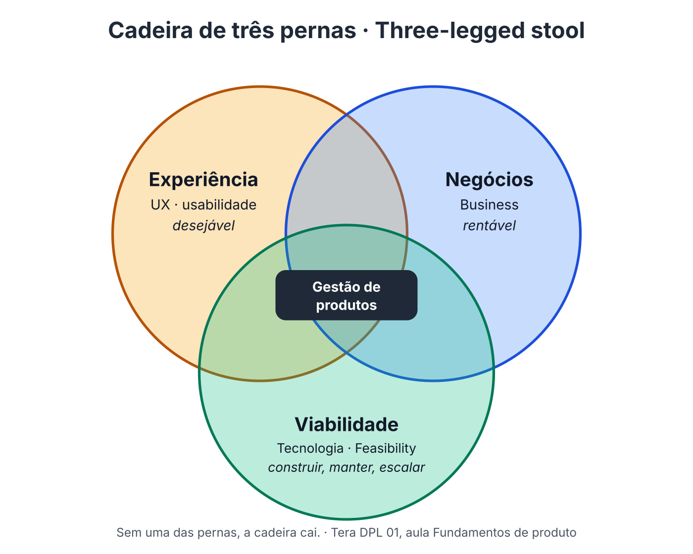
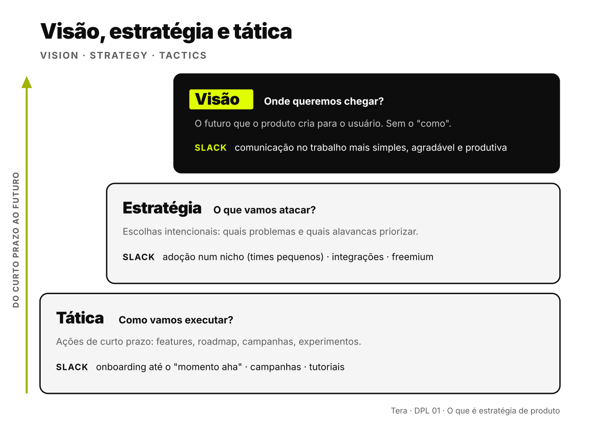

# Tera · Digital Product Leadership · 01: Fundamentos de Product Management

| Campo / Field | Valor / Value |
|---|---|
| Escola / School | Tera |
| Curso / Course | Digital Product Leadership (DPL), formação com 6 módulos / 6-module program |
| Módulo / Module | 01 · Fundamentos de Product Management |
| Situação / Status | 🟡 Em andamento · 9 de 15 aulas / In progress · 9 of 15 lessons |
| Fonte / Source | [Tera: Digital Product Leadership](https://plataforma.somostera.com/formations/digital-product-leadership) (login) |
| Projeto prático / Practice project | [01 · Raio-X de um produto](../../../projetos-projects/01-raio-x-de-um-produto/README.md) |

## Aulas / Lessons

| # | Aula / Lesson | Professor(a) / Instructor | Situação / Status |
|---|---|---|---|
| 1 | Sua jornada no DPL | Leandro Herrera (Tera) | ✅ |
| 2 | O ponto de partida de todo PM | Time Tera | ✅ |
| 3 | Fundamentos de produto | Murylo Schulttais | ✅ |
| 4 | Pessoas de Produto | Murylo Schulttais | ✅ |
| 5 | Q&A: Papéis e Fundamentos de Produto | Murylo Schulttais | ✅ |
| 6 | Ciclo de Vida de Produto | Murylo Schulttais | ✅ |
| 7 | Product Sense: Pensamento de Produtos | Murylo Schulttais | ✅ |
| 8 | O que é estratégia de produto | Bruno Gonzales | ✅ |
| 9 | Desenvolvendo estratégias claras e ambiciosas | Luciana Dahia | ✅ |
| 10 | Visão de produto | Cássio Scozzafave | ⬜ |
| 11 | Proposta de valor | Keiko Mori | ⬜ |
| 12 | Criação de valor | Keiko Mori | ⬜ |
| 13 | Conclusão do módulo | | ⬜ |
| 14 | Ferramentas para Product Managers | | ⬜ |
| 15 | Desafio do Mercado: Mitigação de Riscos em um Marketplace | Diego Poblete | ⬜ |

---

## 1–2. Por que começar pelos fundamentos / Why start with fundamentals

🇧🇷 A formação quer desenvolver, além da parte técnica, **visão de negócio**, **pensamento sistêmico** e **decisão em contexto complexo**. A ideia central da abertura: dá para ter o cargo, ir a todas as cerimônias e acompanhar os OKRs e mesmo assim só "ocupar um lugar na engrenagem". Sem fundamentos, a gente decide no piloto automático, foca em **entrega** em vez de **impacto** e confunde **atividade com resultado**.

🇺🇸 Fundamentals are what keep the product's purpose (solving a real problem) clear under delivery pressure. Without them: autopilot decisions, output over outcome, activity mistaken for results.

## 3. Fundamentos de produto / Product fundamentals

### O papel de produto está crescendo / The role is growing
- 🇧🇷 Com a digitalização, **estratégia da empresa e estratégia do produto** ficam cada vez mais próximas. Mas pessoa de produto **não define o negócio**: o negócio é maior (marketing, marca, jurídico, distribuição...). O produto é **um meio** para o negócio.
- 🇧🇷 A área está se dividindo em especialidades: PM técnico, PM de consumidor, PM de ferramentas internas, B2B.
- 🇧🇷 **Produto diz qual problema resolver, não como resolver.** Parte do trabalho é **aprender**: mercado, usuário, negócio, processos, times.
- 🇧🇷 **Consistência vale mais que intensidade.** O produto evolui aos poucos, em melhorias contínuas.
- 🇺🇸 Product says **which problem** to solve, not **how**. Consistency beats intensity.

### O papel no dia a dia (do vídeo) / The role day to day (from the video)
- 🇧🇷 **Por que falar de gestão de produto:** ainda há muita confusão sobre a profissão, a função mudou muito com o tempo e nunca foi tão essencial para as empresas.
- 🇧🇷 **Analogia do técnico:** a pessoa de produto entra em campo como **técnica do time**, não como jogadora. Ela não chuta a bola: não diz a quem desenvolve ou a quem faz design **como** resolver, e sim **quais problemas** resolver e **por quê**. Parece simples, mas é difícil e exige comunicação.
- 🇧🇷 **Pagos para aprender:** parte do escopo é aprender sempre (mercado, usuário, necessidade, problema, processo, time, capacidade).
- 🇧🇷 **Não tente ler toda a bibliografia de uma vez.** Comece pelos fundamentos e escolha o conteúdo pelo momento da sua empresa e da sua carreira.

**Consistência × intensidade: a maratona / Consistency vs intensity: the marathon**
🇧🇷 Produto é mais **maratona** do que corrida de 200 metros: quem dispara no começo cansa e para. O produto é incremental e as melhorias são contínuas. Consistência, em produto, quer dizer **evolução constante** em cinco frentes:

| Frente / Front | 🇧🇷 Pergunta de todo dia |
|---|---|
| Avaliação de oportunidades | Dos mil problemas, qual é o certo para resolver agora? |
| Descoberta de produto | O que construir para resolver esse problema? (há mil maneiras de "matar a fome do Olavo") |
| Desenvolvimento | O software quebra e precisa ser melhorado sempre: arquitetura, pontos falhos, processo |
| Escala | Como levar a solução de uma escala pequena para o grande público? |
| Compreensão de clientes | Só quem usa diz se o produto é o certo: **converse com os usuários** |

🇧🇷 A cada momento, a pessoa de produto **desenha as linhas de chegada**: para correr os 42 km é preciso cruzar o 1º, depois o 2º, e assim por diante.

### A cadeira de três pernas / The three-legged stool

🇧🇷 Sem uma das três pernas, a cadeira cai. No vídeo: **experiência** (UX, usabilidade) busca que o produto seja **desejável**; **negócios**, que seja **rentável**; **viabilidade/tecnologia**, que dê para construir, manter e escalar. A gestão de produtos fica no centro. Exemplo do dia a dia: a gente abandona apps porque a experiência piorou, porque ficaram caros demais para o que entregam, ou porque a empresa os desligou por serem difíceis de manter. 🇺🇸 Remove one leg and the stool falls: desirable, profitable, feasible.

### Comunicar começando pelo porquê / Start with why (Simon Sinek)
| Círculo dourado / Golden circle | Em produto / In product | Exemplo Apple / Apple example |
|---|---|---|
| **Por quê / Why** | Visão (o futuro que queremos criar) | Desafiar o status quo |
| **Como / How** | Estratégia | Com produtos de design excelente |
| **O quê / What** | Tática (o que será construído) | iPhone, iPad |

🇧🇷 Uma **visão clara** facilita colaboração e motivação, mesmo quando o mercado muda. A pessoa de produto é a **guardiã da visão**.

🇧🇷 **Exemplo do inverso (do vídeo):** começar pela tática ("vamos criar um app com cardápio e classificação...") perde a atenção de quem ouve. Começar pelo porquê ("quero acabar com a fome do mundo → pela digitalização → com um app de cardápios e recomendações") alinha as pessoas ao propósito.

🇧🇷 **Caso C6 Bank (do vídeo):** Murylo foi um dos primeiros PMs do banco. Na primeira reunião, perguntaram "o que a gente faz agora?" e ele respondeu "não sei", porque ainda não havia uma visão. A pergunta seguinte foi: qual futuro queremos construir, e o que faria as pessoas escolherem o C6 em vez dos concorrentes? Daí veio a visão "surpreender as pessoas com relações verdadeiras, transformando a experiência bancária". Ela era repetida em quase toda reunião. Com ela, **algumas discussões nem aconteciam**, porque não conversavam com a visão. Isso facilita convencer e influenciar. Guardar a visão chegou a significar levar ao Banco Central uma proposta de mudança de regulação. No PicPay, a visão era simplificar a vida (financeira) das pessoas.

### O processo depende do momento / Process depends on the moment
🇧🇷 Antes de criar processos, entenda o momento da organização, cruzando duas dimensões: **o modelo de negócio já está validado?** (sei como e quanto cobrar?) e **o problema já está compreendido?** Exemplo: usar Scrum quando ainda nem se sabe qual problema resolver trava o time ("não completamos as sprints"); para esse momento, dinâmicas de **Design Thinking** servem melhor. Os métodos (Design Thinking, Lean Startup, Design Sprint, Agile) se sobrepõem e nasceram uns dos outros. **Mais importante que a técnica é saber em que momento você está.**

### Dual track agile (trilha dupla ágil)
🇧🇷 Duas trilhas que andam juntas e sem parar: **descoberta** (sair da incerteza: entender o problema certo) e **entrega** (construir a solução). Todo dia de produto tem os dois extremos. A escolha do processo depende do momento da empresa e de quão claro está o problema: **contexto importa mais que técnica**.

~~~mermaid
flowchart LR
    I[Incerteza Uncertainty] -->|aprendizado learning| C[Certeza Certainty]
~~~

🇧🇷 **Do vídeo:** é um **conceito** (de Marty Cagan), não um processo. Ideias de qualquer origem entram na trilha de **discovery** (descobrir se a ideia é válida e a forma certa de resolver); o que foi validado desce para a trilha de **delivery** (construir, escalar e manter). As trilhas se relacionam, mas **nunca param**: nunca se para de descobrir o próximo problema nem de construir e manter o que já foi entregue. Nomes que aparecem nas referências para os dois lados:

| Esquerda: incerteza / Left | Direita: certeza / Right |
|---|---|
| Discovery | Delivery |
| *Fake it before you make it* | *Make it* |
| Construa coisas que não escalam | Construa coisas que escalam |
| *Move fast* | *Don't break things* (Facebook) |
| *Continuous Discovery* | *Continuous Delivery* (Teresa Torres) |

🇧🇷 A aula mostra vários processos possíveis em cima desse conceito (ex.: validar uma ideia e depois rodar sprints de Scrum ou Kanban; modelar uma aposta "fora do ciclo" enquanto a anterior é construída "dentro do ciclo"; no primeiro ano do C6, três trilhas: pesquisa, prototipação/contato com usuário e MDPs, *minimal desirable products*). Aviso do professor: copiar um desses processos do jeito que está provavelmente dá errado, porque cada um foi adaptado ao seu contexto.

**Da visão ao requisito (referência: Teresa Torres)**

~~~mermaid
flowchart TD
    V[Visão Vision] --> O[Objetivos Objectives] --> OP[Oportunidades Opportunities]
    OP --> ID[Ideias Ideas] --> VA[Validação Validation]
    VA --> F[Funcionalidades em produção Shipped features]
~~~

🇧🇷 Visão → objetivos → oportunidades é **estratégia**; ideias → validação é **discovery**; funcionalidades é **delivery**. O modelo de operação do time deve **conectar a visão ao requisito**. Quando falta tempo, dinheiro ou autonomia para validar tudo, **combine com a gestão** qual parte é um risco assumido, mas não deixe de montar esse raciocínio.
### Projeto × produto / Project vs product
| | 🇧🇷 Projeto / Project | 🇧🇷 Produto / Product |
|---|---|---|
| Foco / Focus | **Eficiência da entrega** (escopo, prazo, entrega) | **Resultado** |
| Formato / Shape | começo, meio e fim | começo, meio, meio, meio... |
| Bem gerido quando / Well managed when | escopo bem definido, desenvolvimento e entrega dentro do prazo | gera novos ciclos de desenvolvimento constante; não tem fim predeterminado |

🇧🇷 **Do vídeo, o "meio, meio, meio" do produto:** cada etapa é um ciclo próprio, e nenhuma é o fim.

~~~mermaid
flowchart LR
    I[Ideia Idea] --> P[Prototipação com poucos recursos] --> L[Lançamento Launch] --> T[Tração Traction] --> M[Monetização Monetization] --> C[Crescimento Growth]
    C -.próximo problema.-> I
~~~

🇧🇷 Lançar é **só o começo**: estar no ar não quer dizer que as pessoas usam, que gera resultado ou que tem valor.

### Resumo do bloco (takeaways do professor) / Block takeaways
1. 🇧🇷 Consistência promove evolução contínua: maratona, não corrida de 100 m, desenhando as linhas de chegada.
2. 🇧🇷 Gestão de produtos é uma função estratégica, focada em resolver problemas reais e assim alavancar o negócio. Por isso, pessoas de produto respondem pelos resultados.
3. 🇧🇷 PMs trabalham o tempo todo entre negócios, tecnologia e UX, buscando desejo de uso, rentabilidade e viabilidade. É comum esquecer de atuar nas três.
4. 🇧🇷 Visão de produto = o futuro que se quer construir. É a base de tudo, e as pessoas de produto são as guardiãs dela.
5. 🇧🇷 Práticas (Design Thinking, Lean Startup...) ajudam a obter resultados, mas **não são** o resultado: são o meio.
6. 🇧🇷 Suas habilidades anteriores podem e devem ser aproveitadas: nenhum conhecimento é desperdiçado.

## 4. Pessoas de Produto / Product people

> 🇧🇷 "Pessoas de produto existem para servir aos consumidores, de forma a atender negócios." (Marty Cagan, citado na aula)

🇧🇷 A **entrega é um meio**, não o fim. E o resultado nem sempre é receita: pode ser fatia de mercado (*market share*), por exemplo.

### PO × PM

🇧🇷 Modelo apresentado por Marty Cagan (Mind the Product, 2016), em três camadas que se somam:

| Camada / Layer | 🇧🇷 O que inclui | 🇺🇸 Includes |
|---|---|---|
| **Administração de backlog** → **Product Owner (PO)** | saber **o que** construir e garantir que aconteça: requisitos (o quê e como), cuidar do backlog, trabalhar junto com o time de desenvolvimento, acompanhar as versões (*releases*) | backlog, requirements, dev collaboration, releases |
| **Administração de roadmap** | planejar entregas, definir personas, problemas e necessidades, ouvir a "voz do usuário", lidar com falhas; o roadmap é uma ferramenta de **comunicação de objetivos** | delivery planning, personas, voice of the customer |
| **Product Manager (PM)** | visão de produto, **tese de mercado**, portfólio, segmentação de usuários, análise de concorrência | vision, market thesis, portfolio, competitive analysis |

| | 🇧🇷 PO | 🇧🇷 PM |
|---|---|---|
| Foco / Focus | **desenvolvimento**: maximizar o valor do que o time constrói | **resultado, negócio e estratégia** |
| Exemplo / Example | requisitos do software, mas também coisas como a política de privacidade | visão que orienta a estratégia; decisões com foco no negócio |

🇧🇷 **Detalhes do vídeo sobre cada camada:**
- **Administração de backlog (PO):** garantir que os requisitos estejam prontos (o time sabe o que construir e como); cuidar da **saúde do backlog** (melhorias, bugs, débitos técnicos: o que fazer agora?); colaborar com o time de desenvolvimento; acompanhar as entregas (*releases*).
- **Administração de roadmap:** construir e manter a visão e o roadmap, que é **a principal ferramenta de comunicação** dos objetivos e do que será produzido para atingi-los; planejar entregas; personas (perfis de pessoas que o produto quer atingir, cada uma com suas dores); ser a **voz do usuário** na organização; **gestão de falhas** ou riscos (o que acontece se um objetivo não for atingido? ex.: risco regulatório vindo de fora da empresa).
- **Product Manager:** **influenciar** (não construir sozinho) a tese de mercado, o modelo que sustenta o negócio; gestão de portfólio (quando há vários produtos); **segmentação de usuários** (ex.: no mercado financeiro, "alta renda" não é tudo igual: o produto para quem tem 1 milhão não é o mesmo para quem tem 999 milhões); **trade-offs**, ou seja, escolhas o tempo todo (ex.: comprar ou construir uma ferramenta? mais usuários ou mais receita?); análise competitiva; posicionamento; acompanhar o ciclo de vida.

🇧🇷 **Por que o produto não deveria ter fim:** no dia em que se declara um produto "pronto", abre-se espaço para a concorrência resolver melhor aquela dor e ocupar a fatia de mercado.

🇧🇷 **O exemplo da política de privacidade:** o PO cuida de **todo o desenvolvimento em volta do requisito**, não só do software. Se o backlog tem o login, mas ninguém lembrou da política de privacidade (normalmente escrita pelo jurídico), isso vira um risco enorme para a empresa.

🇧🇷 **Papel × função:** *Product Owner* é um **papel do Scrum**, que é um entre vários métodos ágeis. Usar métodos ágeis é muito indicado, mas é **meio** para o resultado. Gestão de produto é uma **função**. "As empresas não contratam papel, contratam função."

🇧🇷 **Quando a empresa tem PO e PM separados:** dá para dividir a função em duas pessoas, mas isso **segmenta a responsabilidade** e gera conflito. Exemplo: uma pessoa diz que é preciso corrigir um bug crítico, a outra diz que é preciso fazer uma melhoria importante para o resultado; a conversa já começa em lugares diferentes ("abacaxi e laranja"). Segundo o professor, empresas com mais maturidade em produto acabam **juntando os papéis** numa só pessoa, contratada pela função de gestão de produto. Construir o produto nem sempre é construir software: pode ser posicionamento, preço (*pricing*), marketing, marca.

🇧🇷 **Dica para explicar a função numa empresa tradicional:** explique menos o cargo e **mostre mais resultados**; depois conte como chegou neles e convide as pessoas para o processo.

🇧🇷 **Resultado muda com o momento da empresa** e se liga ao *product-market fit*: é como um restaurante com fila na porta, quando há mais gente querendo consumir do que capacidade de produzir. Antes disso, o trabalho é outro: menos exposição e topo de funil, **mais retenção**, entender o benefício para as poucas pessoas que já usam.

💡 🇧🇷 Ninguém faz todos os papéis todos os dias: o segredo é **saber a ordem das coisas**. Não construa um pedaço de software se ainda não sabe qual problema resolver; não tente descobrir necessidades de um público se ainda não tem certeza de qual é o mercado endereçável.

### Carreira / Career path
~~~mermaid
flowchart LR
    APM[APM entrada] --> PM[PM atua sozinho] --> SR[Sr. PM alta complexidade] --> GPM[GPM estratégia do produto] --> H[Head of Product um segmento do negócio] --> CPO[CPO executivo]
~~~
🇧🇷 Do APM até o Sr. PM (e as especializações, como *Product Operations*, *Technical PM* e *Product Marketing Manager*) os papéis são **de execução**, mão na massa. A partir do GPM são **de liderança**. O que diferencia o sênior é lidar com os produtos mais complexos, os que tocam o *core business*, aquilo que sustenta a empresa (ex.: pagamentos, no PicPay). O CPO **traduz números de negócio** (receita, volume de usuários, fatia de mercado) **em produto digital**. Essa trilha varia de empresa para empresa.

**T-Shaped Product Manager:** 🇧🇷 ferramenta para mapear **largura** (quantos temas conheço) e **profundidade** (onde sou especialista) do meu conhecimento, incluindo o que vem de fora de produto. Serve para escolher vagas que combinam comigo e decidir o que estudar primeiro. 🇧🇷 No vídeo: vale para qualquer formação (marketing, negócios, tecnologia, jurídico; o professor já trabalhou com PMs que eram nutricionista e professora universitária). O mapa também mostra **o que falta**: temas que deveriam estar na sua extensão mas onde você não tem profundidade viram o próximo foco de estudo. Foi assim que ele escolheu o que ler entre os "35 livros" que achou no Google. 🇺🇸 Maps breadth and depth of skills, and reveals gaps to study next. *(Vou fazer o meu no Projeto 01 / I'll do mine in Project 01.)*

## 5. Q&A: Papéis e fundamentos / Q&A highlights

| Pergunta / Question | 🇧🇷 Resposta, com minhas palavras |
|---|---|
| Que habilidades desenvolver no começo? | **Comunicação** (a mensagem certa para cada público de *stakeholders*, incluindo usuários) e **influência**, porque produto não define o negócio, mas precisa influenciar decisões de negócio. |
| Estratégia de produto × da empresa? | A do negócio é **maior**: inclui marca, marketing, regulação, distribuição. A de produto parte da visão, quebra em problemas e vira objetivos. Ela **compõe** a do negócio. |
| Como se relacionar com quem constrói? | Com **combinados claros sobre aonde queremos chegar**. O time precisa entender **o problema**, não só receber requisitos. Quando só uma área decide o destino, as outras se sentem subutilizadas. |
| PM × designer? | PM traz **o quê** (objetivos para usuário e negócio); design traz **o como** (a melhor experiência). Os dois se encontram no **porquê**: o problema. |
| *Fail fast* funciona em todas as etapas? | Sim, mas o foco é **aprender mais rápido** ("learn faster"), errando coisas novas, não as mesmas. Exige cultura que dê espaço para errar. |
| **PO e PM juntos na mesma estrutura?** | 🇧🇷 Acontece bastante. Funciona **se houver combinados claros** de comunicação e decisão. O risco é atrito: a estratégia "desce" e a solução não faz sentido para ela, e vice-versa. O foco tem que ser o **resultado**: testar com pessoas reais em vez de discutir de quem é a razão. |
| PM é chefe? | De **produto**, não de pessoas (*Product* Manager, não *People* Manager). Só lidera pessoas nos cargos de liderança de produto (GPM, Head, CPO). |
| Dual track só para times grandes? | Não, funciona com 5 ou 100 pessoas. Em times grandes, a PM não precisa estar em tudo: distribui responsabilidades, **pede ajuda** e decide a partir dos resultados de cada etapa. |
| Técnicas universais? | Três métodos: **Design Thinking**, **Lean Startup** (construir, medir, aprender) e **Agilidade**. |
| Quando criar uma visão? | **Sempre.** Ela muda quando o produto não tracionou ou parou de escalar (a tese de mercado falhou) ou em fusões e aquisições (procure o propósito em comum). |

💡 🇧🇷 Também do Q&A: as pessoas de tecnologia são as mais capacitadas para resolver problemas. Vale envolvê-las também no entendimento do problema, nas ideações e no **contato com o usuário**, para que entendam e sintam a dor.

## 6. Ciclo de vida de produto / Product life cycle

### Dois ciclos diferentes / Two different cycles
🇧🇷 O **ciclo de desenvolvimento** tem os *building blocks* do processo: definição do problema → definição do produto → planejamento do desenvolvimento → monitoramento → lançamento → compreensão dos resultados. O **ciclo de vida** (curva S, PLC, *Product Life Cycle*) mostra as vendas ou aquisição ao longo do tempo: introdução, crescimento, maturidade e declínio. **Acontece com todos os produtos.** O ciclo de desenvolvimento se repete **muitas vezes**, em cada fase do ciclo de vida.

~~~mermaid
flowchart LR
    subgraph CV[Ciclo de vida / Life cycle]
      direction LR
      I[Introdução busca de PMF] --> C[Crescimento growth] --> M[Maturidade vaca leiteira] --> D[Declínio inovação/disrupção]
    end
    CD((Ciclo de desenvolvimento problema → produto → plano → monitoramento → lançamento → resultados))
    CD -.repete em.-> I
    CD -.repete em.-> C
    CD -.repete em.-> M
    CD -.repete em.-> D
~~~

🇧🇷 **Simples → complicado:** à esquerda da curva, o produto é simples e resolve uma coisa só. Para crescer, ganha funcionalidades e, em algum ponto, fica complicado. Aí as pessoas migram para produtos mais simples, que é justamente o ponto de partida. Perguntas para localizar o seu produto: ainda é simples? Já está ganhando funcionalidades? Já ficou complicado? Está perdendo usuários para outro produto?

### Atravessar o abismo / Crossing the chasm (Geoffrey Moore)
🇧🇷 De um lado, as pessoas que querem coisas novas (**early adopters**); do outro, o **mercado mainstream**, onde está a maior parte da população e onde o produto precisa chegar para monetizar e crescer. Entre eles há um **abismo**, que só se cruza com uma **proposta de valor bem ajustada** ao grande público. Sem isso, o produto fica preso num nicho, com teto bem menor.

🇧🇷 **Exemplos do professor:** a Sherpay (antecipação salarial) ainda tentava descobrir, com poucas pessoas usando, os benefícios que levariam ao mercado grande; o C6 estava **no meio do abismo**, validando em alto crescimento se a proposta de valor fazia sentido; o PicPay, com quase 60 milhões de clientes, já estava no mainstream. Os erros possíveis numa startup pequena são mais "livres" do que numa empresa grande.

| Dica para cruzar / Tip | 🇧🇷 Detalhe do vídeo |
|---|---|
| 1. Entenda o ciclo de adoção | o que faz as pessoas adotarem a sua tecnologia |
| 2. Segmente | entenda o que cada segmento precisa e construa soluções específicas para ele |
| 3. Forneça um produto completo | MVPs são interessantes, mas precisam entregar valor; ao longo do ciclo, entregue um produto cada vez mais completo |
| 4. Conheça a concorrência | se as pessoas já têm soluções iguais, você só compete por **preço**; ajuste a proposta de valor ao que a concorrência oferece |

🇧🇷 Resumo das quatro dicas: **atingir o *product-market fit*** é uma das responsabilidades mais importantes.

### Onde está o meu produto? Métricas / Where is my product? Metrics
📏 🇧🇷 "O que não é metrificável é ingerenciável." As métricas seguem as três pernas da cadeira: **negócio**, **cliente** (experiência) e **produto** (tecnologia). Exemplo: aquisição baixa e custo alto = começo do ciclo; custo começa a baixar = meio; volta a subir de forma recorrente = talvez declínio.

| Fase / Stage | 🇧🇷 Como estão as métricas | 🇧🇷 Foco | 🇧🇷 Desafios da pessoa de produto | 🇧🇷 Pergunta-chave |
|---|---|---|---|---|
| **Introdução** | poucas; ainda não se sabe o motivo das variações | **retenção**: poucas pessoas usando muito (dá mais controle para entender o porquê) | entender como as pessoas interagem com o produto (**qualitativo**, porque há poucos usuários); entender os benefícios que elas tiram, para reforçá-los de forma escalável | Como resolver as dores dos usuários da melhor maneira possível? |
| **Crescimento** | aparecem correlações e causalidades; ainda é difícil ligar uso a resultado de negócio | com a retenção comprovada, entender **o que traz mais usuários** e replicar | separar **correlação de causalidade**; trabalho focado em **testes** e novas hipóteses; sustentar o crescimento do que está dando certo | Quais são as principais iniciativas para alavancar o uso do produto, pelo topo do funil (aquisição)? |
| **Maturidade** | estáveis; variáveis entendidas | **vazamentos em todo o funil** ("vedar o balde": quem entra, fica) | visão analítica profunda; gerar e testar hipóteses de melhoria; **começar a simplificar** | Como simplificar o produto para a proposta de valor continuar relevante? |
| **Declínio** | queda constante; impacto no negócio (custo de aquisição sobe, receita cai, NPS piora); grande furo no funil | entender **a causa** da queda de uso | descobrir o que tornou o produto irrelevante (onde a proposta de valor furou); identificar oportunidades-chave para reverter; **testar, testar, testar** | Como mitigar os riscos em novas apostas? |

🇧🇷 A fase de declínio é a mais importante para a **disrupção**, mas há inovação em todas as fases (o fim da curva se parece com o começo).

## 7. Product Sense: pensamento de produtos / Product thinking

🇧🇷 Também chamado de *product thinking* ou *product intuition*: uma forma de pensar que ajuda PMs a focar nos problemas certos. A aula tem três partes: **o que é** product sense, **os benefícios** (para o negócio e para as pessoas) e **como desenvolver** (com *product-led growth* e um pouco de "mão na graxa").

### O que é / What it is

🇧🇷 **A provocação do TikTok:** como usuária, o TikTok é "uma rede social de vídeos e dancinhas". Com olhar de produto, surgem outras perguntas: que tecnologia permite 1,5 bilhão de pessoas ativas por mês (dado de 2021)? Como as pessoas ganham dinheiro ali? Por que os vídeos têm de 15 segundos a 3 minutos? Que parceiros ele tem? Como **o TikTok** ganha dinheiro? Quem são os influenciadores e por que influenciam? A curiosidade vai além do viés de usuária e olha **a estrutura inteira**.

🇧🇷 **Product sense** é a habilidade de perceber o que faz um produto ter os resultados que tem, olhando pelas três dimensões da cadeira:

| Dimensão | 🇧🇷 Para que serve no pensamento de produto |
|---|---|
| **Negócios** | entender a vantagem competitiva, o que gera monetização e como ela é feita |
| **Design / experiência** | dores, necessidades e experiência de **todos** que estão na plataforma (no TikTok, quem consome e quem produz conteúdo; num e-commerce, quem vende e quem compra) |
| **Tecnologia** | resolver o problema (*problem solving*): tornar a solução palpável |

🇧🇷 Dos milhares de problemas que essas três dimensões revelam, o pensamento de produto escolhe **os mais valiosos para aquela organização naquele momento**.

~~~mermaid
flowchart LR
    subgraph EP["Espaço do problema Discovery"]
      U["O que os usuários precisam"]
    end
    subgraph ES["Espaço da solução Delivery"]
      N["O que o negócio fornece"]
    end
    U <-->|"Tecnologia reduz a lacuna entre os dois espaços"| N
~~~

🇧🇷 **Espaço do problema = discovery:** entender o que as pessoas precisam ter resolvido. **Espaço da solução = delivery:** construir e escalar o que foi descoberto. Há quem ache que product sense é só descobrir necessidades, e há quem ache que basta entregar; as duas visões estão incompletas. A **tecnologia** permeia os dois espaços e reduz a lacuna entre o que se descobriu e o que se deve entregar.

🇧🇷 **Definição:** product sense é a capacidade de entender o que torna um produto **excelente**: útil, simples, funcional, amado pelas pessoas, vendável. **Excelente não é perfeito.** Excelência é resolver a dor de alguém **do jeito que a pessoa quer ter resolvido** (não é só matar a fome: é matar a fome sem sair de casa, dividindo a conta, escolhendo o restaurante). Perfeito não existe, porque o mundo, o mercado e as pessoas mudam (antes, conseguir chamar um táxi era ótimo; hoje, esperar mais de 10 minutos já é ruim).

### Os 3 horizontes da McKinsey / The three horizons

| Horizonte | 🇧🇷 O que é |
|---|---|
| **1 · Mercado existente** | o mercado em que o produto já atua e que precisa ser sustentado |
| **2 · Mercados emergentes** | mercados em que se identificou potencial (ex.: uma nova geração de soluções) |
| **3 · Novos mercados** | antecipar problemas que as pessoas vão ter e criar novos produtos e até categorias |

🇧🇷 "Cheguei na empresa e já tenho 135 itens no backlog: como pensar em mercados emergentes?" A chave é **priorizar**. O ímpeto é ir direto à solução e ao horizonte 1 (e, dependendo do momento da empresa, é isso mesmo que precisa ser feito). Mas o product sense faz **perguntas poderosas** que não ficam presas ao agora. Exemplo: o TikTok nasceu em 2014 como **Musical.ly**, um app para dublar músicas, e só virou o que é a partir de 2017, quando se percebeu que o que estava sendo feito não levaria o negócio aonde ele queria chegar.

🇧🇷 É comum quem está entrando no mercado achar que conhecer muitos frameworks e técnicas é mais importante do que refletir sobre o problema e o resultado. Frameworks ajudam a estruturar o pensamento, mas **o fundamental é o senso de produto**.

### Produtos falham o tempo todo / Products fail all the time

🇧🇷 **O GIF do escorregador:** crianças escorregando na grama, fora do escorregador. Elas queriam **escorregar**, não um escorregador. Daria para ajudá-las de muitas formas (caixa de papelão, um morro...). O time que fez o escorregador esqueceu de falar com o usuário.

🇧🇷 Segundo uma lista da Forbes sobre por que startups falham, o primeiro motivo é **não ter mercado**: não havia gente querendo consumir o que estava sendo construído (ou a solução está mal ajustada, ou o problema não é o certo). O maior erro é **construir coisas que as pessoas não querem ou não precisam**.

🇧🇷 **Product-market fit**, na definição de Marc Andreessen: **estar em um bom mercado com um produto que satisfaça esse mercado**. O produto está no meio: é o **meio** para o resultado. Para empresas e times que estão começando, segundo Andreessen, PMF é a única coisa que importa.

🇧🇷 **Exemplo do café:** de um lado, o time do PicPay idealizando com post-its; do outro, uma pessoa no caixa de um café com vários apps de pagamento no celular. Por que ela usaria o PicPay? É preciso conversar com ela e **entender a concorrência**. O foco da empresa é atender as necessidades melhor do que as alternativas atuais; o foco do cliente é usar o que resolve melhor o problema dele. O que atrapalha: falta de compreensão dos usuários, desconhecer as **restrições do negócio** (legais, de operação, de atendimento) e falta de recursos (às vezes é preciso "vender" internamente uma mudança na topologia dos times).

🇧🇷 **Copiar a concorrência:** se para ter diferencial for preciso primeiro fazer tudo o que o concorrente faz, a competição já está perdida (quanto tempo levaria para construir um Nubank?). O problema pode ser resolvido por outro caminho. Ficar no conhecido é confortável, mas o product sense ajuda a diferenciar copiar o mercado de descobrir uma nova proposta de valor.

> 🇧🇷 "As pessoas acreditam que foco é dizer sim para a coisa que precisa ser feita. Mas não é isso. Significa dizer não para centenas de boas ideias." (Steve Jobs, citado na aula)

🇧🇷 **Dizer não** é difícil, principalmente com pressão de *stakeholders*. Para dizer não, é preciso **justificativa**, e ela vem de entender o que torna o produto excelente. Muitas vezes quem pede também quer terminar a maratona, mas acha que a direção é outra; se essa pessoa não tem as informações, é responsabilidade da PM levá-las. Ao espalhar informação, a PM gera foco e, nas entrelinhas, diz não.

### Componentes de um pensamento de produto estruturado / Components

~~~mermaid
flowchart LR
    A["1 · Ame o problema, não a solução"] --> B["2 · Pense em produtos, não em features"] --> C["3 · Seja específico e agnóstico"]
~~~

**1 · Ame o problema, não a solução** (expressão de Ash Maurya, criador do *Lean Canvas* e autor de *Running Lean*)
- 🇧🇷 Evita armadilhas e foca no principal: tudo o que não está ligado ao problema real é **desperdício**.
- 🇧🇷 Elimina o **viés do inovador**: achar que tudo precisa ser novo, abrir mercado ou resolver um problema que as pessoas nem sabem que têm. Às vezes o problema está escancarado e é só executar. Há um equilíbrio entre copiar e só inventar.
- 🇧🇷 Leva em conta sempre três perguntas: **necessidades** (que problema?), **usuários** (quem enfrenta?) e **mercado** (por que enfrentam?).
- 🇧🇷 **Exemplo da furadeira:** furadeira + quadro = quadro na parede. A pessoa quer **pendurar o quadro**, não comprar uma furadeira (dá para usar ganchinho adesivo, fita, prateleira, apoiar o quadro...). Quem só fabrica furadeiras melhores pode estar competindo no mercado errado. E fica mais ambíguo: e se a pessoa quer uma decoração bonita? E se quer expor memórias da família? Talvez nem precise de parede.

**2 · Pense em produtos, não em features**
- 🇧🇷 Sair do micro e pensar no macro: entender o problema completo (a casa, não as pecinhas).
- 🇧🇷 Não se perder numa das soluções possíveis: diante de 138 itens no backlog, a primeira pergunta é **por que** fazer o 138º.
- 🇧🇷 Deixa o trabalho **enxuto**: o que está fora do problema é desperdício.
- 🇧🇷 Usuários não se importam com funcionalidades: se importam com **alcançar seus objetivos**. Entendendo a dor real, a solução costuma ser **mais simples**.

**3 · Seja específico e agnóstico** (conceito de Shreyas Doshi; algumas referências chamam de *domain driven*)
- 🇧🇷 **Agnóstico** é não aceitar como verdade crenças só porque já foram ouvidas muitas vezes: o mundo e as pessoas mudam.
- 🇧🇷 Sendo específico e agnóstico, entendemos melhor **problemas, usuários, mercado e restrições**, e, pelo princípio de Pareto, poucas decisões boas geram 80% do resultado.
- 🇧🇷 Trabalhar com **fatos como eles são**, não como gostaríamos. Exemplo: "o brasileiro não sabe lidar com dinheiro". Que brasileiro? São mais de 200 milhões de pessoas, de quem não tem nada a bilionários. O fato seria algo como "uma parcela X da população, que representa um mercado de tal tamanho, tem tais dores".
- 🇧🇷 Product sense é montar esse raciocínio para chegar à decisão: **isso vem antes da técnica**.

### Benefícios do product sense / Benefits

**Para os negócios / For the business**

| Benefício | 🇧🇷 Do texto e do vídeo |
|---|---|
| **Recrutamento mais ajustado** | Modelo **10/30/50**: os 50% melhores candidatos têm **senso analítico**; os 30% melhores têm também **senso de execução** (transformam análise em trabalho); os **10%** melhores têm também **senso de produto**. Valida o raciocínio antes do conhecimento técnico. Nas entrevistas, isso aparece em três provas: **estratégia de produto** (entender mercados competitivos, declarar o que fazer e por quê), **melhorias de produto** (trabalhar com o que já existe) e **design de produto** (unir dores e necessidades com objetivos de negócio). Para treinar: perguntar qual é a estratégia do TikTok, o que o faz ser bom, quais são seus objetivos. |
| **Resolver problemas, não só entregar** | Exemplo: Steve Jobs apresentando o primeiro iPhone (2007). Os celulares da época competiam por teclados, mas as pessoas também queriam navegar, ouvir música, ligar, mandar mensagem. A tecnologia uniu o que as pessoas precisavam e o que o negócio podia oferecer. "Mais uma entrega" seria só mais um celular de que ninguém lembraria. |
| **Foco no usuário e no negócio o tempo todo** | Pirâmide do *product-market fit* (Dan Olsen): a base é o **mercado** (usuários, dores, necessidades); em cima vem o **produto** (proposta de valor, funcionalidades, experiência). Quanto mais a proposta de valor se encaixa nas necessidades, mais PMF. Se as duas dimensões não colam, não há resultado. |
| **Objetivos bem definidos e responsabilidade pelos resultados** | A empresa tem uma previsão de números (*forecasting*, fluxo de caixa). Produto quebra problemas e objetivos de curto, médio e longo prazo, como nos **3 horizontes da McKinsey**: o que sustenta o negócio hoje, o que atende mercados emergentes (*next*) e o que vem depois. No roadmap: no curto prazo, construir; no médio, descobrir e planejar; no longo, idealizar. Negócio e produto não podem virar "nós e eles". |
| **Liderar por contexto, não por controle** | Modelo do Spotify (alto alinhamento + alta autonomia): os times recebem **problemas para resolver**, não funcionalidades para construir. O contrário é o *top-down* ("constrói um app com cardápio assim e assado"). Microgestão faz as empresas perderem gente boa. |

**Para as pessoas de produto / For product people**

| Benefício | 🇧🇷 Do texto e do vídeo |
|---|---|
| **Trabalhar com estrutura** | conecta estratégia e entrega; facilita comunicar o plano; estrutura e espalha o aprendizado (o que deu certo e o que não deu); deixa o trabalho visível e colaborativo |
| **Empatizar com usuários** | mapear **jornadas de dor** (o passo a passo que as pessoas vivem para completar uma tarefa), não só a jornada de uso do produto; ex.: entrevistas e testes em que o usuário trava num fluxo que o time achava "fácil". Lidar com fatos, não com achismos. |
| **Clareza sobre trade-offs e decisão consciente** | comprar ou construir? corrigir ou melhorar? lançar ou evoluir antes? arriscar ou respeitar? pedir permissão ou desculpa? Nem toda decisão é da pessoa de produto (ex.: um risco jurídico decidido junto com o jurídico), mas **todas devem ser conscientes**, para depois saber o que deu certo. |
| **Transformar ambiguidade em soluções específicas** | sair do "bololô" de incertezas e insights para partes palpáveis do problema |
| **Boost na criatividade** | sair do óbvio. Caso PicPay: por que uma carteira de pagamentos criou um chat? Tese: **por trás de todo pagamento existe uma conversa**. Resultado buscado: mais frequência de uso, retenção e volume de transações. |
| **Pensar em escala** | não só tecnologia: também **escala do negócio** (sustentar-se no tempo) e **da sociedade** (o impacto e os comportamentos que o produto cria; ex.: o crescimento do Zoom na pandemia) |
| **Quebrar grandes problemas em partes menores** | WhatsApp, Waze e Spotify parecem resolver uma coisa só, mas resolvem milhares de problemas menores, otimizados o tempo todo para manter a proposta de valor |

### Como desenvolver o product sense / How to develop it

🇧🇷 **Product-led growth:** empresas crescem puxadas pelo marketing (*marketing-led*), pelas vendas (*sales-led*) ou pelo **produto** (*product-led*): o produto lidera o crescimento, criando algo novo e valioso que contribui ativamente para o valor de mercado. Primeiro passo: lembrar que **"meu produto é o que leva o negócio para frente"**. Por isso, **todas as pessoas da organização deveriam ter product sense**, não só a liderança e as pessoas de produto. Em empresas tradicionais, isso não acontece do dia para a noite.

🇧🇷 Cada área desenvolve o product sense pela **exposição constante** a um tipo de reação:

~~~mermaid
flowchart LR
    D["Design pesquisa, ideação, experimentos, crítica de design, feedback"] --> U(("Reações dos usuários"))
    T["Tecnologia planejamento, iterações, dados do produto, falhas e sucessos"] --> P(("Reações do produto"))
    N["Negócios comportamento do negócio, mercado, concorrência, market share, posicionamento"] --> M(("Reações do mercado"))
    U --> PS{{Product sense}}
    P --> PS
    M --> PS
~~~

🇧🇷 Dica do vídeo: trazer o time todo, inclusive tecnologia, para perto do discovery. As pessoas de tecnologia são "resolvedoras de problemas natas" e lidam bem com dados e métricas.

🇧🇷 **Não é gosto pessoal, é curiosidade:** entender o real motivo (o *porquê*, do círculo dourado) de umas coisas funcionarem e outras não.

🇧🇷 **Sistema e hábito:** citando Scott Adams (*Como fracassar em quase tudo e ainda ser bem-sucedido*), um **sistema** é algo que você faz regularmente e que aumenta suas chances de sucesso no longo prazo. Frameworks e técnicas são sistemas; praticá-los com regularidade vira hábito, e nas empresas os hábitos viram **processo de trabalho**. Não dá para dizer que se tem product sense sem conhecer ferramentas e estruturas para transformar o pensamento em trabalho.

| Espaço / Space | Técnicas que o professor usa |
|---|---|
| **Problema** (o que os usuários precisam) | *Jobs to be done*; *Continuous Discovery* e a **árvore de oportunidades** (Teresa Torres) |
| **Solução** (o que o negócio fornece) | **canvas**, como o *Lean Canvas* (Ash Maurya), para estruturar experimentos e iniciativas |

🇧🇷 Não existe receita de bolo nem framework pronto que garanta sucesso.

### "Mão na graxa": a estrutura de perguntas do professor / The question structure

🇧🇷 Ele usa essa estrutura no dia a dia e em entrevistas (cases e *role plays*). Cada degrau só começa quando o anterior está respondido:

~~~mermaid
flowchart TD
    A["1 · Usuário Qual problema preciso resolver? Para quem, e por quê?"] --> B["2 · Trabalho a ser feito Por que estou fazendo isso? Como farei isso? (declarar a intenção)"]
    B --> C["3 · Objetivos e recursos Que objetivos vou estabelecer? De que recursos vou precisar?"]
    C --> D["Testar e avaliar resultados"]
~~~

| Degrau | 🇧🇷 Detalhes e exemplos do vídeo |
|---|---|
| **1 · Usuário** | "Qual problema preciso resolver?" é a pergunta de um milhão: observe a relação das pessoas com o problema para justificar por que ele é o mais importante. "Para quem?": "o brasileiro não sabe lidar com dinheiro" — que parte dos brasileiros, e por quê? Ex.: num case "construa uma geladeira inteligente", pergunte por que e para quem; talvez o problema real nem tenha a ver com geladeira. |
| **2 · Trabalho a ser feito** | "Por que estou fazendo isso?" envolve entender o negócio. Ex.: no PicPay, alguém sugeriu colocar *stories*; as perguntas (por que, que valor gera, para quem, que futuro constrói) levaram à decisão de não fazer naquele momento. "Como farei isso?" é declarar a intenção. **Por que + como = estratégia de produto.** |
| **3 · Objetivos e recursos** | A distribuição dos objetivos no tempo (curto, médio e longo prazo; 3 horizontes) define se a estratégia é factível. Ex.: "triplicar o faturamento do iFood neste trimestre" é grande demais; o que se relaciona ao faturamento? Uso do produto, pessoas fazendo pedidos. Recursos não são só pessoas: ferramentas e tudo o que a construção envolve (ex.: mais restaurantes, mais entregadores). Daí saem as iniciativas. |

🇧🇷 Refletir sobre cada pergunta traz **priorização e foco** naturalmente. Muita gente entra no mercado achando que gestão de produto é só "testar e avaliar resultado", mas existe toda essa estrutura antes: não dá para testar sem saber aonde se quer chegar. E o objetivo é um produto **excelente, não perfeito**.

### Resumo da aula (takeaways) / Lesson takeaways
1. 🇧🇷 Pessoas de produto são naturalmente **curiosas**, como a criança que abre o brinquedo para ver o que tem dentro. Pessoas curiosas fazem boas perguntas.
2. 🇧🇷 Product sense é entender o que torna um produto **excelente** (não perfeito): útil, agradável, simples.
3. 🇧🇷 É sobre entender e resolver problemas, de usuários e do negócio; a tecnologia reduz a lacuna entre eles.
4. 🇧🇷 O que importa é atingir o **product-market fit**, compreendendo usuários e restrições do negócio.
5. 🇧🇷 Para o negócio: comprometimento com objetivos e resultados e um ambiente propício para **liderança por influência**.
6. 🇧🇷 Para PMs: estrutura para um trabalho em que nenhuma resposta é óbvia e capacidade de lidar com a incerteza.
7. 🇧🇷 Todas as pessoas da organização deveriam ter product sense: todas estão expostas a usuários, produto e mercado. Product sense não promove **silo funcional**.
8. 🇧🇷 Crie sistemas para estruturar o trabalho e exercite regularmente. Ninguém nasce com product sense: é um **hábito** e pode ser melhorado.

### Perguntas e respostas / Q&A

| Pergunta | 🇧🇷 Resposta, com minhas palavras |
|---|---|
| Serve em qualquer estágio da empresa? | Sim. Numa empresa em declínio, ajuda a renovar a proposta de valor; num produto em introdução, a entender o que gera retenção. Às vezes o problema nem é o funil, e sim a **precificação** (o produto ficou caro): isso só aparece pensando também no negócio. |
| Que habilidades desenvolvem o product sense? | **Disciplina** de se provocar diante dos produtos (não ver o TikTok só como app de vídeos, mas o ecossistema todo) e **curiosidade**. |
| Sou a primeira PM: como fazer a liderança confiar? | Confiança não se pede: **se conquista gerando resultado**. Ele prefere "pedir desculpa a pedir permissão": executar algo pequeno, sem colocar o negócio em risco, para ter dados. Sem dados, tudo é opinião, e "entre a sua e a minha, prefiro a minha". |
| É ficar fazendo perguntas sobre tudo? Quais são as certas? | Sim, como a criança do "por quê?". Ninguém sabe de início quais são as certas: com prática, algumas ficam mais refinadas. |
| Ajuda a decidir com pouca segurança? | Sim (há quem chame de *gut feeling*). Também ajuda a **corrigir o percurso** no meio do caminho. |
| É mais importante na estratégia ou na entrega? | É **transversal**: visão, execução, correção, escala, qualquer fase. Por isso é avaliado antes da habilidade técnica. |
| Faço gestão de projetos numa empresa tradicional: posso usar? | Sim: ir além do escopo dado e ajudar a empresa a ver que o problema pode ser outro. "Não é sobre ter mais, é sobre ser melhor." Gestão de projetos continua existindo (ex.: integrações exigidas por regulação, que já nascem com cara de projeto). |
| Como é avaliado em entrevistas? | Acima da técnica e do framework está **como você estrutura o trabalho**. Ele pergunta que produto a pessoa gosta, por quê, como ele se comporta no mercado, quem são os usuários; só depois vêm melhorias, problemas e soluções. Em cases, **pergunte antes de responder**: no case da "geladeira inteligente" numa empresa de transporte, o que importava eram as perguntas, não a geladeira. |
| Como ele desenvolveu o hábito? | Treino. Formado em ciência da computação, percebeu que resolvia problemas mas os produtos não eram desejados; numa consultoria de negócios, construía tecnologias úteis que ninguém queria usar. Descobriu que a união dessas três coisas se chamava gestão de produtos e passou a praticar com cases próprios, com a comunidade e no trabalho. |
| E quando o product sense e os OKRs dizem coisas diferentes? | OKR é uma ferramenta para descrever objetivos e como prová-los no tempo; faz parte do pensamento de produto, não compete com ele. Se o problema é desalinhamento entre negócio e produto, a solução é **aproximar as pessoas**: produto traz o foco no usuário, negócio traz o foco no negócio. |
| Como convencer sobre novas ideias? | Com **dados e fatos** sobre por que a ideia tem valor. "Qualquer outra maneira é achismo." Ele nunca produziria algo sem uma validação mínima antes. |
| Como provocar o pensamento de produto no time? | Fazendo **perguntas que incomodam**, no momento certo e sem tom pejorativo. Ex.: "essa certeza está validada? Cadê a informação que mostra que o usuário passa por isso?" |

### Conclusão / Wrap-up
🇧🇷 Product sense precisa virar **hábito**, e você precisa de gente em volta que te provoque. Traga negócio, tecnologia e design para construírem o pensamento de produto junto, quebrando os **silos funcionais**. Produto é um mundo ambíguo em que não se lidera pelo crachá, e sim pela **influência**: cabeça aberta, flexibilidade, comunicação, capacidade de simplificar o complexo, criatividade e prática frequente.

**Checklist da Tera — você deve sair desta aula entendendo:**
1. 🇧🇷 Por que é importante ter um pensamento estruturado para abordar problemas complexos de negócio.
2. 🇧🇷 As principais características de um pensamento estruturado para resolver problemas de pessoas e negócios.
3. 🇧🇷 Modelos e perguntas que ajudam a organizar e comunicar o pensamento de produto.

**Para aprofundar (indicações da aula):** os 3 horizontes de crescimento da McKinsey (*Enduring Ideas: The three horizons of growth*); vídeo *FAIL ACADEMY: Top Reasons Startups Fail*; artigo *The only thing that matters* (Marc Andreessen); *Running Lean* (Ash Maurya); perfil de Shreyas Doshi; *Jobs to be Done: Theory to Practice* (Anthony W. Ulwick); *Continuous Discovery Habits* (Teresa Torres); *Product Sense Demystified* (Marty Cagan); *Como fracassar em quase tudo e ainda ser bem-sucedido* (Scott Adams).

### Quiz comentado da aula 7 / Lesson 7 quiz
**Resultado: 6 de 7 ✅** (18/11/2026)

| # | Pergunta | Resposta certa | Por quê | Eu |
|---|---|---|---|---|
| 1 | O que é product sense? | Entender o que torna um produto excelente, olhando negócio, design e tecnologia | Frameworks ajudam, mas o fundamental é o senso de produto; excelente não é perfeito | ✅ |
| 2 | Qual o papel da tecnologia entre os espaços do problema e da solução? | Reduzir a lacuna entre o que se descobriu e o que o negócio deve entregar | Ela permeia o discovery e o delivery | ✅ |
| 3 | No exemplo da furadeira, o que a pessoa quer? | Pendurar o quadro (ou decorar, ou expor memórias) | Ame o problema, não a solução | ✅ |
| 4 | O que é o viés do inovador? | Achar que tudo precisa ser novo ou abrir mercado | Às vezes o problema está escancarado e é só executar | ✅ |
| 5 | Qual a ordem dos degraus da estrutura de perguntas? | **Usuário → trabalho a ser feito → objetivos e recursos → testar e avaliar** | Cada degrau depende do anterior: não dá para declarar o porquê e o como sem saber o problema e para quem; nem definir objetivos sem saber a intenção; nem testar sem saber aonde se quer chegar | ❌ revisar |
| 6 | O que é foco, pela frase de Steve Jobs? | Dizer não para centenas de boas ideias | Dizer não exige justificativa: entender o que torna o produto excelente | ✅ |
| 7 | O que diferencia os 10% melhores no modelo 10/30/50? | Senso analítico + execução + senso de produto | Por isso o raciocínio é avaliado antes da técnica | ✅ |

💡 🇧🇷 **Para lembrar a ordem (pergunta 5):** a aula descreve como "descer degraus", do mais amplo ao mais concreto: **quem e qual dor** → **por que e como** (= estratégia) → **o que alcançar e com o quê** → **testar**. Pela própria aula, cada pergunta de cima responde à de baixo: "vai testar o quê, se não sabe aonde quer chegar? Vai ter que intenção, se não sabe o que as pessoas precisam ter resolvido?"

## 8. O que é estratégia de produto / What is product strategy

🇧🇷 Com Bruno Gonzales (Product & Design Director), que trabalha com produtos há mais de 20 anos e liderou a transição de uma gestão de produto "como projeto" para agilidade e foco no cliente. A aula apresenta o conceito, seu papel no ciclo de vida do produto e como ele orienta decisões que equilibram visão, mercado e execução.

### Antes de tudo: o que é um produto (Marty Cagan) / First: what a product is

| Pilar | 🇧🇷 Do vídeo |
|---|---|
| **Resolve um problema do usuário** | talvez o mais importante: entender a **necessidade**, que muitas vezes é diferente do que o usuário **quer** |
| **Monetiza** | resolve o problema tão bem que o usuário te remunera: com dinheiro, com o tempo dele ou com algum dado |
| **É tecnicamente viável** | é possível de ser construído |

🇧🇷 Quando os três se conectam, existe um produto. (É a cadeira de três pernas da aula 3, com outros nomes.)

### Estratégia é mais do que um plano de entregas / More than a delivery plan
- 🇧🇷 Estratégia **não é** um plano de entregas, uma lista de tarefas ou um roadmap. O papel dela é **traduzir a visão em decisões sobre quais problemas o produto vai resolver**.
- 🇧🇷 É o instrumento de **alinhamento** de todas as pessoas ligadas ao produto, não só do time de produto. Anda junto com o **valor** que o produto gera e com **métricas** que mostram se ele vai na direção certa.
- 🇧🇷 **A estratégia é viva:** não se escreve na pedra. Ela se ajusta ao contexto do produto, às mudanças do mercado e, principalmente, aos **aprendizados** (conversas com usuários, discovery, pesquisas, métricas de comportamento).

### Visão, estratégia e tática / Vision, strategy and tactics

| | 🇧🇷 O que é | 🇧🇷 Pergunta | 🇧🇷 Exemplo do Slack |
|---|---|---|---|
| **Visão** | o destino: o futuro que o produto quer criar para o usuário e o impacto no mundo, **sem detalhar o como** | Onde queremos chegar? | Tornar a comunicação no trabalho mais simples, mais agradável e mais produtiva |
| **Estratégia** | escolhas intencionais, diante de um contexto, sobre **quais problemas atacar** e quais alavancas priorizar | O que vamos atacar? | Focar na **adoção** num nicho (times pequenos, startups) e depois levá-los para a versão paga. Insight: times que trocavam **mais de 2 mil mensagens** tinham grande chance de virar pagantes. Ações: **integrações** com ferramentas que o usuário já usa (Google Drive, Asana) e modelo **freemium** para reduzir a barreira de entrada |
| **Tática** | o **como**: ações específicas de curto prazo (features, roadmap, campanhas, experimentos de UX, lançamentos), sempre alinhadas à estratégia | Como vamos executar? | Campanhas de marketing para o nicho; melhorar o **onboarding** para o usuário chegar rápido ao "momento aha" (configurar 3 integrações e trocar 50 mensagens no primeiro dia); sprints de discovery para achar atritos; vídeos e tutoriais sobre a proposta de valor (trocar o e-mail pelo Slack) |

> 🇧🇷 "A visão descreve o futuro que você está tentando criar. A estratégia ajuda a decidir como chegar lá." (Marty Cagan, *Empowered*, citado na aula)

🇧🇷 **Para pensar a visão:** como vai ser a vida do usuário quando o produto estiver funcionando? Ex.: pedir pizza numa sexta-feira chuvosa sem o iFood, ou pedir um carro sem o Uber. Segundo Jeff Bezos (citado na aula), vale investir tempo na visão, que deve durar **de 5 a 7 anos**.

🇧🇷 **Analogia da maratona:** a visão é a linha de chegada; a estratégia é tudo o que você faz para chegar lá (preparação, tênis, roupa, água, comida) sem nunca perder a linha de chegada de vista; a tática são os passos.

🇧🇷 Separar os três evita confundir futuro desejado com execução imediata, alinha os times e evita a armadilha da *feature factory*.

### Os cinco elementos da estratégia (Marty Cagan) / The five elements

~~~mermaid
flowchart LR
    F["1 · Foco poucas alavancas"] --> I["2 · Insights dados, usuários, mercado"] --> A["3 · Ação times com propósito e ownership"] --> G["4 · Gerenciamento liderança que remove impedimentos"] --> M["5 · Métricas North Star, OKRs, KPIs"]
~~~

| Elemento | 🇧🇷 Do texto e do vídeo |
|---|---|
| **Foco** | definir **poucas alavancas** que movem os objetivos (aquisição, retenção, crescimento). Talvez o mais importante: foco também é **dizer não para boas ideias** |
| **Insights** | aprendizados de dados de usuário, comportamento, conversas, métricas, lacunas de mercado e avanços tecnológicos; fundamentam as decisões de foco |
| **Ação** | distribuir o trabalho para times com **propósito claro** e *ownership* de métricas. Analogia do quebra-cabeça: cada pessoa sabe quais peças vai colocar |
| **Gerenciamento** | liderança ativa, adaptativa e **servidora**: remove impedimentos, prepara o ambiente e corrige rotas sem engessar o processo |
| **Métricas** | indicadores que medem se o produto gera valor, resolve o problema e vai na direção da visão (ex.: North Star, OKRs, KPIs) |

🇧🇷 **Caso Facebook (os cinco elementos juntos):** no começo, o foco era **ativação inicial** de usuários (entrava-se por indicação). Insight: quem indicava **7 amigos nos primeiros 10 dias** tinha grande chance de virar usuário ativo no longo prazo. Ações: estimular indicações nos primeiros dias e melhorar o onboarding (sugestões de amizade, notificações). Resultado: grande aumento da base e uma base sólida para crescer.

### Times empoderados × times de features / Empowered teams vs feature teams

🇧🇷 Conceito de Marty Cagan que vai além de "times com autonomia": um ambiente em que as pessoas são **donas dos resultados que geram, não das coisas que fazem** (*accountability* pelo resultado). Isso não é gerenciar menos; é gerenciar melhor.

| | 🇧🇷 Time de features (*feature team*) | 🇧🇷 Time empoderado |
|---|---|---|
| Foco | o que precisa ser feito: desenhar, codar | **problemas para resolver**, junto com o cliente |
| Papel da PM | quase gerente de projeto: datas, entregas, agendas | responsável pelo produto da descoberta à geração de valor; cuida da viabilidade técnica **e** financeira |
| Responde pelo resultado? | não | **sim** |
| Medida por | quantidade de entregas do roadmap ("ticks" na lista) — **output** | valor entregue ao mercado — **outcome** |

### Armadilhas / Traps

🇧🇷 **Build trap (feature factory):** o time fica ocupado só em entregar features e perde a conexão com o problema. **Features têm prazo de validade; problemas são atemporais.** Exemplo: a frase atribuída a Henry Ford ("se eu perguntasse o que as pessoas queriam, diriam cavalos mais rápidos"). O carro resolveu o mesmo problema que os cavalos, o **deslocamento de pessoas**; depois vieram o táxi, o Uber, as motos, as bicicletas e patinetes de aluguel. As entregas mudam, o problema continua.

| Caso | 🇧🇷 O que fizeram | 🇧🇷 O que aconteceu |
|---|---|---|
| **Fintech** (app de crédito) | lançou várias features (categorizar gastos, exportar PDF, dashboards) sem validar se resolviam o problema | time ocupadíssimo, mas **churn** (cancelamento) continuou alto e o engajamento não melhorou: ninguém investigou o que impedia o cliente de usar o app |
| **E-commerce de cosméticos** | passou meses redesenhando a home com banners animados porque achava a do concorrente mais bonita (**mudança cosmética**) | a conversão não mudou: o problema real era **falta de confiança no prazo de entrega e frete alto** |

🇧🇷 Lição: estar sempre perto do cliente e do que ele **precisa** (que muitas vezes é diferente do que ele **quer**); só depois construir a tática.

### Contexto, foco e sequenciamento / Context, focus and sequencing

~~~mermaid
flowchart LR
    C["Contexto Qual é a realidade atual do produto?"] --> F["Foco Onde colocar a energia agora?"] --> S["Sequenciamento Em que ordem fazer as iniciativas?"]
~~~

| Etapa | 🇧🇷 O que responde |
|---|---|
| **Contexto** | em que situação e mercado o produto está, as personas, o problema que ele resolve; se ele dita uma tendência ou chega depois do concorrente (e vai fazer diferente ou melhor); concorrência e capacidades da empresa |
| **Foco** | o problema prioritário que vai gerar valor para o usuário. A boa pessoa de produto sabe **o momento de dizer não**, e faz isso muitas vezes por dia |
| **Sequenciamento** | a **ordem** das iniciativas, para avançar de forma rápida, consciente e consistente. É **priorização**: fazer primeiro porque gera mais valor, porque exige menos esforço, ou porque posiciona o produto como pioneiro |

| | 🇧🇷 Slack | 🇧🇷 App de meditação |
|---|---|---|
| Contexto | boom de startups precisando de comunicação mais eficiente e assíncrona que o e-mail | mercado saturado; usuários abandonam esse tipo de app depois de 3 dias; muita coisa gratuita |
| Foco | nicho: times pequenos com propensão a pagar | **retenção nos primeiros 7 dias** (hipótese: quem fica 7 dias fica muito mais tempo) |
| Sequenciamento | 1) onboarding simples → 2) integrações → 3) monitorar o uso para gerar insights | 1) onboarding → 2) lembretes ao longo do dia → 3) recomendações personalizadas → 4) medir a retenção |

🇧🇷 Resumindo o framework: parar de construir coisas desconectadas do problema; escolher **conscientemente** onde atuar (com dados, fatos, conversas com clientes, não opiniões pessoais); definir uma ordem lógica de execução.

### Estratégia × plano de entregas / Strategy vs delivery plan

- 🇧🇷 A estratégia é um **guia que orienta principalmente o que não fazer** (talvez mais importante do que o que fazer), as **métricas** que dizem se está funcionando e **como cada time contribui** para o valor final.
- 🇧🇷 Entregas sozinhas não geram valor. Mantra: **comece sempre pelo problema**; na dúvida, vá conversar com o cliente. Marty Cagan (*Inspired*) convida a **se apaixonar pelo problema**, não pela feature.
- 🇧🇷 Segundo Cagan (citado na aula), a estratégia de produto conecta os objetivos de negócio e a visão ao trabalho de cada time: define **quais objetivos serão perseguidos, por qual time e em que tempo**.
- 🇧🇷 **Definição de fechamento:** estratégia é a escolha consciente de **em que campo o time vai jogar**, com base em contexto, foco e prioridades, definindo os problemas prioritários e o que vai destravar valor para o usuário.
- 🇧🇷 **O plano de entregas** também importa: uma lista em ordem de prioridade, conectada à estratégia, dizendo o que se faz no curto, médio e longo prazo. Mas estratégia boa **não é roadmap recheado de features**: o saudável é **fazer menos coisas, bem feitas**. Ex.: meta de aumentar em 30% a retenção de novos usuários nos 7 primeiros dias → revisar o onboarding, lembretes por push, testar recomendações personalizadas.

### Product Vision Board (Roman Pichler)

🇧🇷 Framework em blocos de perguntas para construir a estratégia:

| Bloco | 🇧🇷 Perguntas |
|---|---|
| **Visão** | Qual é o propósito de criar o produto? Que mudança ele vai gerar na vida do usuário? |
| **Público-alvo** | Quem são as personas? Em que mercado vou atuar? |
| **Necessidades** | Que problema o produto resolve? Que benefício oferece (menos tempo, menos etapas, uma nova tendência — como ninguém imaginava, há 15 anos, resolver tudo pelo celular)? |
| **Produto** | O que ele é? O que o diferencia da concorrência? O que faz o usuário parar o que está fazendo para usá-lo? (a tríade: resolve o problema, é pago por isso, é viável) |
| **Alvos do negócio** | O que a empresa quer com o produto: faturamento, base de usuários, dados para gerar outro valor? |

### Resumo da aula / Lesson takeaways

**Lembre-se (Tera):**
1. 🇧🇷 Clareza entre visão, estratégia e tática evita times correndo sem direção.
2. 🇧🇷 A visão inspira, mas é a estratégia que transforma o futuro em escolhas práticas.
3. 🇧🇷 Estratégia não é lista de features: é decidir o que priorizar e o que deixar de lado.
4. 🇧🇷 Bons insights vêm de dados, usuários e mercado, não de achismos.
5. 🇧🇷 Métricas certas guiam o time; métricas erradas distraem.
6. 🇧🇷 Evite a feature factory: **entregar muito não significa entregar valor**.

**Checklist da Tera — você deve sair desta aula entendendo:**
1. 🇧🇷 A diferença entre visão, estratégia e tática.
2. 🇧🇷 Os cinco elementos do núcleo da estratégia: foco, insights, ação, gerenciamento e métricas.
3. 🇧🇷 Por que a estratégia precisa ser viva, ajustada pelo aprendizado e pelo contexto.
4. 🇧🇷 O impacto de estratégias bem estruturadas, como mais retenção e alinhamento entre times.
5. 🇧🇷 As armadilhas: feature factory e mudanças cosméticas que não atacam os problemas reais.

**Para aprofundar (indicações da aula):** *Empowered* e *Inspired* (Marty Cagan).

### Quiz comentado da aula 8 / Lesson 8 quiz
**Resultado: 6 de 7 ✅** (18/11/2026)

| # | Pergunta | Resposta certa | Por quê | Eu |
|---|---|---|---|---|
| 1 | Papel principal da estratégia de produto? | Traduzir a visão em decisões sobre quais problemas resolver | Lista de features e datas de roadmap são tática; descrever o futuro é a visão | ✅ |
| 2 | "Focar na adoção num nicho e depois levar para a versão paga" (Slack) é...? | Estratégia | A visão é o destino; tática são as ações de curto prazo; métrica é um indicador | ✅ |
| 3 | Os cinco elementos da estratégia (Cagan)? | Foco, insights, ação, gerenciamento e métricas | "Contexto, foco e sequenciamento" é o **outro** framework da aula | ✅ |
| 4 | Time empoderado × time de features? | Dono dos resultados (outcome), não das coisas que faz (output) | Medir por entregas e PM focada em datas descrevem o time de features | ✅ |
| 5 | Por que o redesenho da home não converteu? | O problema real era confiança no prazo de entrega e frete alto | Mudança cosmética: olhar a aparência repete o erro do time | ✅ |
| 6 | "Features têm validade, problemas são atemporais"? | As soluções mudam, o problema (deslocar pessoas) continua | A aula não manda remover nem deixar de lançar features | ✅ |
| 7 | O que é o sequenciamento? | **Definir a ordem das iniciativas (priorizar o que vem primeiro)** | Entender mercado e personas é o **contexto**; escolher o problema prioritário é o **foco**; medir a retenção é só um passo dentro da sequência | ❌ revisar |

💡 🇧🇷 **Para lembrar (pergunta 7):** as três etapas respondem a três perguntas diferentes, nesta ordem:
- **Contexto →** *onde estamos?* (mercado, concorrência, personas, o que o produto resolve)
- **Foco →** *o que atacar agora?* (o problema prioritário; dizer não ao resto)
- **Sequenciamento →** *em que ordem?* (ex.: Slack: onboarding simples → integrações → monitorar o uso; app de meditação: onboarding → lembretes → recomendações → medir retenção)

Um truque: **sequência = ordem**. Se a resposta não fala de "primeiro isso, depois aquilo", não é sequenciamento.

## 9. Desenvolvendo estratégias claras e ambiciosas / Building clear and ambitious strategies

🇧🇷 Com Luciana Dahia (Diretora de Produto). A aula conecta **leitura de contexto** com **escolhas estratégicas**: entender cliente, produto, empresa e mercado e transformar isso em direção clara. Ferramentas: *JTBD*, ciclo de vida do produto, **Canvas C>P>E>M**, **Product Strategy Stack** e **1-pager**, com cases para praticar priorização e foco.

### Entendendo o contexto antes de decidir / Understand context before deciding

🇧🇷 **Cenário:** você acabou de assumir como head de produto e precisa definir a estratégia. Surgem dezenas de perguntas (que produto, que estágio, que métricas, que feedbacks, que concorrentes, que time...). É desafiador, mas estratégico e de muita visibilidade. Se não é uma startup que acabou de nascer, você pega **o bonde andando**: o trabalho inicial é de **investigação**, e um bom diagnóstico precisa de **estrutura**, senão você fica "pulando de galho em galho" e apagando incêndio.

**As quatro dicas da professora:**
1. 🇧🇷 **Comece pelo que mais importa, que é sempre o cliente** (não o concorrente, não o marketing).
2. 🇧🇷 **Não pule para conclusões:** é comum chegar cheia de "eu acho"; seja curiosa e siga investigando.
3. 🇧🇷 **Conecte os pontos para ver o panorama geral** (*big picture*): pode entrar no detalhe, mas sempre dê um *zoom out*.
4. 🇧🇷 **Clareza de pensamento = clareza de estratégia:** pensamento bagunçado vira estratégia confusa e o time diz que "não sabe qual é a estratégia".

~~~mermaid
flowchart LR
    C["1 · Cliente"] --> P["2 · Produto"] --> E["3 · Empresa"] --> M["4 · Mercado"] --> D{{"Diagnóstico (big picture)"}}
~~~

**Checklist investigativo / Investigation checklist**

| Camada | 🇧🇷 Perguntas e dicas do vídeo |
|---|---|
| **Cliente** | Quem é o público-alvo (PF, PJ, segmentos, renda, perfil)? Público real × desejado. Qual a satisfação atual (ex.: **NPS**; para quem busca PMF, o **Sean Ellis Score**)? Quais os principais feedbacks **positivos e negativos** (ligações, comentários, redes sociais)? Como o cliente **usa** o produto (observe, use você mesma)? Qual é o **job to be done**? Dica: **IA** ajuda a processar milhares de feedbacks e sintetizar o que dói mais, mas não substitui ler alguns na íntegra. E não comece do zero: **use as pesquisas que já existem**. |
| **Produto** | Qual é a **proposta de valor** (*value prop*)? Em que **estágio do ciclo de vida** ele está? Como ele contribui para os objetivos da empresa (gera receita? engajamento? principalidade? ecossistema?)? Quais são os **OKRs** e como estão? Quem é o time e como está performando (habilidades, equilíbrio)? |
| **Empresa** | Qual é o **BHAG**? Como a empresa ganha dinheiro (produtos, fontes de receita, incentivos)? Quais os diferenciais (cultura, produto, marca)? Como funciona o ecossistema, o **flywheel**? Quais os principais gaps? Dica: comece pelos **materiais institucionais** e pelo site de **relações com investidores (RI)**; depois pergunte o que faltar, sem vergonha. |
| **Mercado** | Tendências, oportunidades e ameaças; ambiente **regulatório** e **econômico**; concorrentes diretos e indiretos, no Brasil e fora: experiência, modelo de negócio e posicionamento de cada um. |

💡 🇧🇷 **Tudo bem não ter todas as respostas:** a falta de resposta também é parte do diagnóstico.

💡 🇧🇷 **Não conhecer a indústria não é um limitador:** empresas costumam buscar quem já é do setor, mas essa barreira se vence com curiosidade, leitura e investigação.

### Jobs to be done (JTBD)
🇧🇷 Teoria de inovação para explicar **o que motiva alguém a comprar ou usar um produto** (livro *Muito Além da Sorte*, de Clayton Christensen). O *job* é **o progresso que o cliente quer fazer numa circunstância específica**.

🇧🇷 **O caso do milkshake:** uma lanchonete queria vender mais milkshake. Observando os clientes, viram que um grupo chegava cedo, comprava só o milkshake e tomava no carro, a caminho do trabalho. O *job*: **matar a fome e se distrair no trânsito**. Uma embalagem com purpurina não mudaria nada para essas pessoas; uma embalagem **que não derrama** ou um canudo que deixe o líquido passar, sim. No fim do dia, os clientes eram outros (famílias), com outros jobs. Por isso é preciso entender a **circunstância**, as dimensões **funcionais, sociais e emocionais** e as concessões que a pessoa aceita fazer.

### O ciclo de vida, agora pelo olhar da estratégia / Life cycle, through strategy

| Fase | 🇧🇷 Objetivo principal |
|---|---|
| **Introdução** | encontrar o **PMF** (ex.: medir com o Sean Ellis Score); o foco não é crescer, é achar um segmento que **ame** o produto |
| **Crescimento** | **escalar mantendo a satisfação**: satisfação com produto pequeno é fácil; difícil é manter a qualidade com muitas transações |
| **Maturidade** | **manter o market share** (já é muito desafiador, com concorrentes entrando o tempo todo) e buscar novas oportunidades. Qualquer mudança mexe com milhões de transações; na introdução há muito mais margem de manobra |
| **Declínio** | **reverter a tendência** ou decidir **desligar** o produto, que "cumpriu sua missão". Numa carreira longa, você vai lidar com isso |

### Flywheel (Amazon)
🇧🇷 Criado por Jeff Bezos para explicar aos funcionários, de forma simples, como o negócio se alimenta: um **ciclo virtuoso que se retroalimenta**.

~~~mermaid
flowchart LR
    G["Crescimento"] --> CU["Custo menor"] --> PR["Preços menores"] --> EX["Experiência do cliente melhor"] --> TR["Mais clientes (tráfego)"] --> VE["Mais vendedores"] --> SE["Mais seleção de produtos"] --> EX
    EX --> G
~~~

🇧🇷 Desafio da professora: **você saberia desenhar o flywheel da sua empresa?** (como os produtos se conectam para entregar uma experiência melhor).

### Canvas C>P>E>M

🇧🇷 Um quadro que reúne as perguntas do diagnóstico para ir preenchendo durante a investigação. A parte de diferenciais, gaps, oportunidades e ameaças funciona como uma **matriz SWOT** (forças, fraquezas, oportunidades e ameaças): o canvas junta várias ferramentas.

| Cliente | Produto | Empresa | Mercado |
|---|---|---|---|
| público-alvo | proposta de valor **em uma frase** | objetivos de longo prazo (**BHAG**) | tendências |
| métricas de satisfação | estágio do ciclo de vida | fontes de receita | oportunidades |
| feedbacks | métricas de contribuição | diferenciais | ameaças |
| *jobs to be done* | | principais gaps | concorrência |

🇧🇷 **Perguntas para refletir enquanto preenche:** Foi fácil obter as informações? Por que algum item ficou em branco? Os itens **se conectam** e fazem sentido? Há **contradições** (ex.: o público-alvo é um, mas o time faz outra coisa)? Dá para entender a estratégia atual do produto?

🇧🇷 O resultado pode ser: **continuidade** (a estratégia já está clara), **ajuste** (há gaps e contradições) ou até um **giro de 180 graus** (o contexto da empresa mudou). E as lacunas também dizem onde investigar.

🇧🇷 Frameworks servem para **ajudar e inspirar**, não para engessar o processo.

**Case real: a mudança de North Star Metric**

| | 🇧🇷 Antes | 🇧🇷 Depois |
|---|---|---|
| Público-alvo | varejo | **alta renda** |
| Proposta de valor | **guardar** dinheiro (ultra simplificada) | **investir** (um job maior para o público de alta renda) |
| Ciclo de vida | introdução (buscando PMF) | crescimento, expansão |
| Contribuição para a empresa | *funding* (o dinheiro guardado viabiliza empréstimos na outra ponta) | *funding* + **principalidade e receita** |
| **North Star Metric** | **quantidade de clientes** | **total investido** |

🇧🇷 Parece uma mudança pequena, mas **muda tudo**: a NSM define o que é sucesso, e dela descem os objetivos e os *key results* (**cascata de métricas**). Querer o número de clientes crescendo é muito diferente de querer o dinheiro investido crescendo: as iniciativas priorizadas mudam. O contexto muda com o tempo, e cabe à pessoa de produto perceber isso e revisar a estratégia.

~~~mermaid
flowchart TD
    N["North Star Metric o que é sucesso"] --> O["Objetivos"] --> K["Key Results"] --> I["Iniciativas priorizadas"]
~~~

### Escolhas estratégicas e foco / Strategic choices and focus

🇧🇷 Depois do diagnóstico, é hora de **sair da investigação e decidir**: priorizar problemas, públicos e frentes de forma coerente, e **comunicar** essas escolhas.

> 🇧🇷 "Estratégia é sobre fazer escolhas, assumir trade-offs e decidir conscientemente ser diferente." (Michael Porter, citado na aula)

🇧🇷 A professora indica o livro ***Jogar para Vencer***, que define estratégia como um **conjunto integrado de escolhas** que posiciona a empresa de forma única no setor, criando **vantagem competitiva sustentável** e valor superior ao da concorrência. A ideia é "vencer" num **jogo infinito**: o produto deve prosperar por tempo indeterminado.

**Product Strategy Stack (Reforge)**

~~~mermaid
flowchart TD
    A["Missão e estratégia da empresa (company)"] --> B["Estratégia de produto (o foco desta aula)"] --> C["Product delivery roadmap e objetivos táticos"]
~~~

🇧🇷 A ferramenta descreve a estratégia de produto como um "plano de como o produto vai impulsionar a estratégia da empresa". A professora prefere trocar **plano** por **conjunto de escolhas**.

### O 1-pager da estratégia / The strategy 1-pager

🇧🇷 Se alguém perguntar "qual é a estratégia do seu produto?", a resposta cabe **numa página**, com cinco pontos. Com escolhas claras, os times priorizam e decidem sem precisar consultar alguém a toda hora.

| Ponto | 🇧🇷 Pergunta | 🇧🇷 Exemplos e dicas do vídeo |
|---|---|---|
| **1 · Business intent** | Qual é o papel do produto para o negócio? Por que ele existe? | **Máquinas de café em cápsula:** a receita está muito mais nas **cápsulas** (recorrentes) do que na máquina; uma promoção "leve 25 cápsulas e ganhe a máquina" mostra isso. **Bebidas de café:** uma marca presente na rotina da manhã lançou um produto para a **rotina da noite**, aumentando os pontos de contato com o cliente. **Amazon Prime:** frete grátis por assinatura parecia dar prejuízo, mas **concentra as compras** na plataforma e alimenta o flywheel. Lição: um produto pode contribuir de várias formas, não só com receita direta |
| **2 · North Star Metric** | O que é **sucesso** para o produto? | Pode ser a da empresa ou mais específica; deve contribuir para a receita, mas **refletir valor para o cliente e medir progresso**. Palpites da professora (ela não trabalha nessas empresas): **Duolingo** → usuários ativos por dia (a contagem de dias seguidos incentiva voltar); **Spotify / Netflix** → **tempo consumindo conteúdo** (não tempo procurando o que ver, que pode até ser ruim) |
| **3 · Público-alvo** | Quem vamos priorizar? | "Pessoa física" ou "PJ" é **amplo demais**. Detalhar sem exagero, olhando aspectos **geográficos** (região, cultura, situação econômica), **psicográficos** (estilo de vida, personalidade, hobbies, valores), **demográficos** (idade, gênero, ocupação) e **comportamentais** (horário de uso, número de compras, hábitos de consumo) |
| **4 · Jobs to be done / necessidades** | Para que trabalhos o produto é "contratado"? | **Funcional:** estou com frio → compro um casaco. **Emocional:** quero me sentir bem → medito num app todo dia. **Social:** quero pertencer a um grupo (ex.: o **FOMO** de uma rede só para convidados) |
| **5 · Proposta de valor** | Como descrever o produto **"em um tweet"**? | Fórmula: **para** [público-alvo] **que** [problema / job], **o** [produto] **é** [categoria] **que** [principal benefício]. **Diferente de** [alternativas], **nós** [diferencial]. Exemplo inventado pela professora: *para mulheres de 30 a 60 anos que sofrem com cabelos brancos e retocam a raiz todo mês, a "Silver Dark" é uma cápsula oral que reverte o cabelo branco; diferente das tintas, tem fórmula natural que grávidas e lactantes podem usar, e economiza dinheiro e horas de salão.* Serve para **testar** se a frase atrai as pessoas |

🇧🇷 Os cinco pontos são **o mínimo**; dá para complementar. E a dica que a professora diz ser a maior da carreira dela: **comunicar, comunicar, comunicar**. Não adianta ter uma estratégia que ninguém conhece: tem gente que faltou na reunião, que chegou depois, que não leu o documento, que estava fazendo duas coisas ao mesmo tempo. "Nada é óbvio." A estratégia deve ser razoavelmente **perene** (não mudar todo mês), mas deve ser **revisada** quando o contexto mudar.

### Case: como definir um MVP? / Case: defining an MVP

🇧🇷 **A situação:** você lidera produto numa **grande instituição financeira** e precisa definir o **MVP de um app de investimentos**, para lançar em **6 a 12 meses**. Os clientes já têm **expectativas altas** (todo mundo conhece a marca, então o cuidado com o MVP, ou com o **MLP, *Minimum Lovable Product***, é maior) e o mercado já tem **vários apps completos** de investimento.

🇧🇷 **As perguntas difíceis:** qual o mínimo que a plataforma deve ter? Por qual investimento começar (ações, CDB, títulos públicos...)? Como se diferenciar? App, site ou os dois? Sem contexto, não dá para responder. "Na teoria tudo é fácil." Recursos são escassos e a vontade é fazer tudo; quando as decisões estão alinhadas à estratégia, **tudo faz sentido**, e **priorizar fica mais fácil**.

🇧🇷 **A proposta de valor que destrava as decisões:** *para investidores **tech-savvy** e **do it yourself** (gostam de decidir por conta própria), de 25 a 45 anos, com conhecimento básico e pelo menos R$ 50 mil investidos, que querem fazer o dinheiro render mas **não gostam de volatilidade**, a XYZ é uma plataforma de investimentos **100% digital e sem "financês"**. Diferente das outras, **personalizamos o plano** de acordo com seus objetivos e enviamos **reports semanais** sobre a sua carteira.*

| Trecho da proposta de valor | 🇧🇷 Decisão que ele sugere para o MVP |
|---|---|
| público **tech-savvy** | começar pelo **app**, não pelo site (pode evoluir depois) |
| quer rendimento, mas **sem volatilidade** | começar por **renda fixa**, produtos mais conservadores |
| **100% digital e sem financês** | linguagem fácil; não priorizar indicadores técnicos (ex.: índice de Sharpe) para quem tem conhecimento básico |
| **plano personalizado e reports semanais** | o MVP precisa entregar algo de **assessoria digital e acompanhamento**, que é o diferencial |

🇧🇷 É um exercício simplificado (na vida real, o MVP não sairia só disso), mas mostra como **uma estratégia clara afunila as escolhas**.

### Resumo da aula / Lesson takeaways

**Do vídeo (três takeaways da professora):**
1. 🇧🇷 **Não pule para conclusões, entenda o big picture.** Investigue, diagnostique e sempre dê um zoom out.
2. 🇧🇷 **Clareza de pensamento = clareza de estratégia.** Os frameworks ajudam a organizar a cabeça e, por consequência, a estratégia.
3. 🇧🇷 **Estratégia = conjunto de escolhas.** Quais são as escolhas do seu produto? Defina e **comunique muito bem**.

**Lembre-se (Tera):**
1. 🇧🇷 Não decida no vazio: um diagnóstico estruturado reduz vieses e revela alavancas.
2. 🇧🇷 Conectar sinais de cliente, produto, empresa e mercado é pré-requisito para boas escolhas.
3. 🇧🇷 Estratégia = escolhas comunicadas em formatos simples (Stack e 1-pager).
4. 🇧🇷 Uma NSM coerente com o contexto evita otimizar o que não importa.
5. 🇧🇷 Na prática, a proposta de valor guia o escopo do MVP.

**Checklist da Tera — você deve sair desta aula sabendo:**
1. 🇧🇷 Conduzir um diagnóstico 360° de cliente, produto, empresa e mercado.
2. 🇧🇷 Explicar o JTBD do cliente e usá-lo para priorizar problemas.
3. 🇧🇷 Identificar o estágio do ciclo de vida e ajustar estratégia e metas ao momento.
4. 🇧🇷 Formular um 1-pager com business intent, NSM, público-alvo, JTBD/necessidades e proposta de valor.
5. 🇧🇷 Alinhar e comunicar escolhas com clareza para reduzir escopo sem perder ambição.
6. 🇧🇷 Aplicar a estratégia em cases de MVP, deixando a proposta de valor orientar o que entra primeiro.

**Para aprofundar (indicações da aula):** *Muito Além da Sorte* (Clayton Christensen); *Jogar para Vencer*; Product Strategy Stack (Reforge).

---

## Para aprofundar (indicações das aulas 1 a 6) / Go deeper (from lessons 1–6)
- *Comece pelo porquê* (Simon Sinek) e o TED Talk dele sobre o círculo dourado; vídeo dele sobre consistência × intensidade.
- Palestra de Marty Cagan no Brasil sobre dual track agile; livros *Inspirado* e *Empoderado*; palestra no Mind the Product (Londres, 2016).
- *Continuous Discovery Habits* (Teresa Torres).
- Melissa Perri: previsões para os próximos 10 anos de Produto e o artigo *A Decade of Product Management*.
- Ferramenta *T-Shaped Product Manager*, de Valentine Stefferz.
- *Atravessando o Abismo* (Geoffrey A. Moore).

## Lembre-se (resumo da própria Tera) / Key takeaways (Tera's own summary)
**Pessoas de Produto**
1. 🇧🇷 Pessoas de produto existem para servir aos consumidores, de forma a atender negócios, e são responsáveis pelos resultados.
2. 🇧🇷 Papéis e responsabilidades são importantes, mas você não executa todos eles todos os dias.
3. 🇧🇷 Conheça suas habilidades: elas podem e devem ser aproveitadas na carreira de produtos.

**Ciclo de Vida**
1. 🇧🇷 Ciclo de desenvolvimento e ciclo de vida de produto são coisas diferentes.
2. 🇧🇷 Uma proposta de valor adequada traz usuários.
3. 🇧🇷 Simplifique constantemente o produto para manter o *product-market fit*.
4. 🇧🇷 Meça o negócio, o produto e o consumidor o tempo todo.
5. 🇧🇷 A atuação de PMs varia de acordo com o momento no ciclo.
