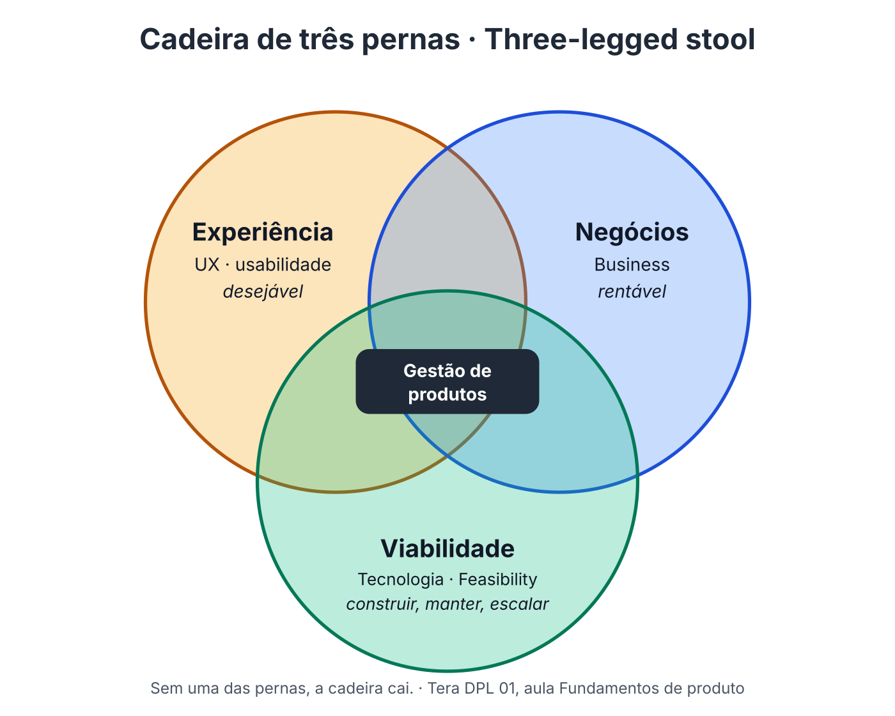

[← Tera · Digital Product Leadership · 01: Fundamentos de Product Management](README.md)

# Aula 3: Fundamentos de produto / Product fundamentals

## O papel de produto está crescendo / The role is growing
- 🇧🇷 Com a digitalização, **estratégia da empresa e estratégia do produto** ficam cada vez mais próximas. Mas pessoa de produto **não define o negócio**: o negócio é maior (marketing, marca, jurídico, distribuição...). O produto é **um meio** para o negócio.
- 🇧🇷 A área está se dividindo em especialidades: PM técnico, PM de consumidor, PM de ferramentas internas, B2B.
- 🇧🇷 **Produto diz qual problema resolver, não como resolver.** Parte do trabalho é **aprender**: mercado, usuário, negócio, processos, times.
- 🇧🇷 **Consistência vale mais que intensidade.** O produto evolui aos poucos, em melhorias contínuas.
- 🇺🇸 Product says **which problem** to solve, not **how**. Consistency beats intensity.

## O papel no dia a dia (do vídeo) / The role day to day (from the video)
- 🇧🇷 **Por que falar de gestão de produto:** ainda há muita confusão sobre a profissão, a função mudou muito com o tempo e nunca foi tão essencial para as empresas.
- 🇧🇷 **Analogia do técnico:** a pessoa de produto entra em campo como **técnica do time**, não como jogadora. Ela não chuta a bola: não diz a quem desenvolve ou a quem faz design **como** resolver, e sim **quais problemas** resolver e **por quê**. Parece simples, mas é difícil e exige comunicação.
- 🇧🇷 **Pagos para aprender:** parte do escopo é aprender sempre (mercado, usuário, necessidade, problema, processo, time, capacidade).
- 🇧🇷 **Não tente ler toda a bibliografia de uma vez.** Comece pelos fundamentos e escolha o conteúdo pelo momento da sua empresa e da sua carreira.

**Consistência × intensidade: a maratona / Consistency vs intensity: the marathon**
🇧🇷 Produto é mais **maratona** do que corrida de 200 metros: quem dispara no começo cansa e para. O produto é incremental e as melhorias são contínuas. Consistência, em produto, quer dizer **evolução constante** em cinco frentes:

| Frente / Front | 🇧🇷 Pergunta de todo dia |
|---|---|
| Avaliação de oportunidades | Dos mil problemas, qual é o certo para resolver agora? |
| Descoberta de produto | O que construir para resolver esse problema? (há mil maneiras de "matar a fome do Olavo") |
| Desenvolvimento | O software quebra e precisa ser melhorado sempre: arquitetura, pontos falhos, processo |
| Escala | Como levar a solução de uma escala pequena para o grande público? |
| Compreensão de clientes | Só quem usa diz se o produto é o certo: **converse com os usuários** |

🇧🇷 A cada momento, a pessoa de produto **desenha as linhas de chegada**: para correr os 42 km é preciso cruzar o 1º, depois o 2º, e assim por diante.

## A cadeira de três pernas / The three-legged stool

🇧🇷 Sem uma das três pernas, a cadeira cai. No vídeo: **experiência** (UX, usabilidade) busca que o produto seja **desejável**; **negócios**, que seja **rentável**; **viabilidade/tecnologia**, que dê para construir, manter e escalar. A gestão de produtos fica no centro. Exemplo do dia a dia: a gente abandona apps porque a experiência piorou, porque ficaram caros demais para o que entregam, ou porque a empresa os desligou por serem difíceis de manter. 🇺🇸 Remove one leg and the stool falls: desirable, profitable, feasible.

## Comunicar começando pelo porquê / Start with why (Simon Sinek)
| Círculo dourado / Golden circle | Em produto / In product | Exemplo Apple / Apple example |
|---|---|---|
| **Por quê / Why** | Visão (o futuro que queremos criar) | Desafiar o status quo |
| **Como / How** | Estratégia | Com produtos de design excelente |
| **O quê / What** | Tática (o que será construído) | iPhone, iPad |

🇧🇷 Uma **visão clara** facilita colaboração e motivação, mesmo quando o mercado muda. A pessoa de produto é a **guardiã da visão**.

🇧🇷 **Exemplo do inverso (do vídeo):** começar pela tática ("vamos criar um app com cardápio e classificação...") perde a atenção de quem ouve. Começar pelo porquê ("quero acabar com a fome do mundo → pela digitalização → com um app de cardápios e recomendações") alinha as pessoas ao propósito.

🇧🇷 **Caso C6 Bank (do vídeo):** Murylo foi um dos primeiros PMs do banco. Na primeira reunião, perguntaram "o que a gente faz agora?" e ele respondeu "não sei", porque ainda não havia uma visão. A pergunta seguinte foi: qual futuro queremos construir, e o que faria as pessoas escolherem o C6 em vez dos concorrentes? Daí veio a visão "surpreender as pessoas com relações verdadeiras, transformando a experiência bancária". Ela era repetida em quase toda reunião. Com ela, **algumas discussões nem aconteciam**, porque não conversavam com a visão. Isso facilita convencer e influenciar. Guardar a visão chegou a significar levar ao Banco Central uma proposta de mudança de regulação. No PicPay, a visão era simplificar a vida (financeira) das pessoas.

## O processo depende do momento / Process depends on the moment
🇧🇷 Antes de criar processos, entenda o momento da organização, cruzando duas dimensões: **o modelo de negócio já está validado?** (sei como e quanto cobrar?) e **o problema já está compreendido?** Exemplo: usar Scrum quando ainda nem se sabe qual problema resolver trava o time ("não completamos as sprints"); para esse momento, dinâmicas de **Design Thinking** servem melhor. Os métodos (Design Thinking, Lean Startup, Design Sprint, Agile) se sobrepõem e nasceram uns dos outros. **Mais importante que a técnica é saber em que momento você está.**

## Dual track agile (trilha dupla ágil)
🇧🇷 Duas trilhas que andam juntas e sem parar: **descoberta** (sair da incerteza: entender o problema certo) e **entrega** (construir a solução). Todo dia de produto tem os dois extremos. A escolha do processo depende do momento da empresa e de quão claro está o problema: **contexto importa mais que técnica**.

~~~mermaid
flowchart LR
    I[Incerteza Uncertainty] -->|aprendizado learning| C[Certeza Certainty]
~~~

🇧🇷 **Do vídeo:** é um **conceito** (de Marty Cagan), não um processo. Ideias de qualquer origem entram na trilha de **discovery** (descobrir se a ideia é válida e a forma certa de resolver); o que foi validado desce para a trilha de **delivery** (construir, escalar e manter). As trilhas se relacionam, mas **nunca param**: nunca se para de descobrir o próximo problema nem de construir e manter o que já foi entregue. Nomes que aparecem nas referências para os dois lados:

| Esquerda: incerteza / Left | Direita: certeza / Right |
|---|---|
| Discovery | Delivery |
| *Fake it before you make it* | *Make it* |
| Construa coisas que não escalam | Construa coisas que escalam |
| *Move fast* | *Don't break things* (Facebook) |
| *Continuous Discovery* | *Continuous Delivery* (Teresa Torres) |

🇧🇷 A aula mostra vários processos possíveis em cima desse conceito (ex.: validar uma ideia e depois rodar sprints de Scrum ou Kanban; modelar uma aposta "fora do ciclo" enquanto a anterior é construída "dentro do ciclo"; no primeiro ano do C6, três trilhas: pesquisa, prototipação/contato com usuário e MDPs, *minimal desirable products*). Aviso do professor: copiar um desses processos do jeito que está provavelmente dá errado, porque cada um foi adaptado ao seu contexto.

**Da visão ao requisito (referência: Teresa Torres)**

~~~mermaid
flowchart TD
    V[Visão Vision] --> O[Objetivos Objectives] --> OP[Oportunidades Opportunities]
    OP --> ID[Ideias Ideas] --> VA[Validação Validation]
    VA --> F[Funcionalidades em produção Shipped features]
~~~

🇧🇷 Visão → objetivos → oportunidades é **estratégia**; ideias → validação é **discovery**; funcionalidades é **delivery**. O modelo de operação do time deve **conectar a visão ao requisito**. Quando falta tempo, dinheiro ou autonomia para validar tudo, **combine com a gestão** qual parte é um risco assumido, mas não deixe de montar esse raciocínio.
## Projeto × produto / Project vs product
| | 🇧🇷 Projeto / Project | 🇧🇷 Produto / Product |
|---|---|---|
| Foco / Focus | **Eficiência da entrega** (escopo, prazo, entrega) | **Resultado** |
| Formato / Shape | começo, meio e fim | começo, meio, meio, meio... |
| Bem gerido quando / Well managed when | escopo bem definido, desenvolvimento e entrega dentro do prazo | gera novos ciclos de desenvolvimento constante; não tem fim predeterminado |

🇧🇷 **Do vídeo, o "meio, meio, meio" do produto:** cada etapa é um ciclo próprio, e nenhuma é o fim.

~~~mermaid
flowchart LR
    I[Ideia Idea] --> P[Prototipação com poucos recursos] --> L[Lançamento Launch] --> T[Tração Traction] --> M[Monetização Monetization] --> C[Crescimento Growth]
    C -.próximo problema.-> I
~~~

🇧🇷 Lançar é **só o começo**: estar no ar não quer dizer que as pessoas usam, que gera resultado ou que tem valor.

## Resumo do bloco (takeaways do professor) / Block takeaways
1. 🇧🇷 Consistência promove evolução contínua: maratona, não corrida de 100 m, desenhando as linhas de chegada.
2. 🇧🇷 Gestão de produtos é uma função estratégica, focada em resolver problemas reais e assim alavancar o negócio. Por isso, pessoas de produto respondem pelos resultados.
3. 🇧🇷 PMs trabalham o tempo todo entre negócios, tecnologia e UX, buscando desejo de uso, rentabilidade e viabilidade. É comum esquecer de atuar nas três.
4. 🇧🇷 Visão de produto = o futuro que se quer construir. É a base de tudo, e as pessoas de produto são as guardiãs dela.
5. 🇧🇷 Práticas (Design Thinking, Lean Startup...) ajudam a obter resultados, mas **não são** o resultado: são o meio.
6. 🇧🇷 Suas habilidades anteriores podem e devem ser aproveitadas: nenhum conhecimento é desperdiçado.

---

[← Tera · Digital Product Leadership · 01: Fundamentos de Product Management](README.md)
