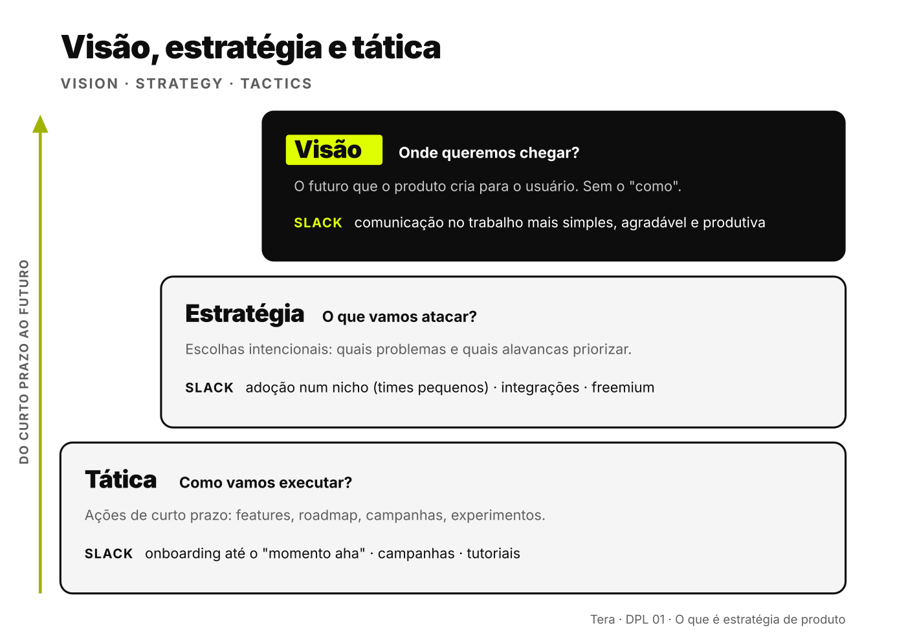

[← Tera · Digital Product Leadership · 01: Fundamentos de Product Management](README.md)

# Aula 8: O que é estratégia de produto / What is product strategy

🇧🇷 Com Bruno Gonzales (Product & Design Director), que trabalha com produtos há mais de 20 anos e liderou a transição de uma gestão de produto "como projeto" para agilidade e foco no cliente. A aula apresenta o conceito, seu papel no ciclo de vida do produto e como ele orienta decisões que equilibram visão, mercado e execução.

## Antes de tudo: o que é um produto (Marty Cagan) / First: what a product is

| Pilar | 🇧🇷 Do vídeo |
|---|---|
| **Resolve um problema do usuário** | talvez o mais importante: entender a **necessidade**, que muitas vezes é diferente do que o usuário **quer** |
| **Monetiza** | resolve o problema tão bem que o usuário te remunera: com dinheiro, com o tempo dele ou com algum dado |
| **É tecnicamente viável** | é possível de ser construído |

🇧🇷 Quando os três se conectam, existe um produto. (É a cadeira de três pernas da aula 3, com outros nomes.)

## Estratégia é mais do que um plano de entregas / More than a delivery plan
- 🇧🇷 Estratégia **não é** um plano de entregas, uma lista de tarefas ou um roadmap. O papel dela é **traduzir a visão em decisões sobre quais problemas o produto vai resolver**.
- 🇧🇷 É o instrumento de **alinhamento** de todas as pessoas ligadas ao produto, não só do time de produto. Anda junto com o **valor** que o produto gera e com **métricas** que mostram se ele vai na direção certa.
- 🇧🇷 **A estratégia é viva:** não se escreve na pedra. Ela se ajusta ao contexto do produto, às mudanças do mercado e, principalmente, aos **aprendizados** (conversas com usuários, discovery, pesquisas, métricas de comportamento).

## Visão, estratégia e tática / Vision, strategy and tactics

| | 🇧🇷 O que é | 🇧🇷 Pergunta | 🇧🇷 Exemplo do Slack |
|---|---|---|---|
| **Visão** | o destino: o futuro que o produto quer criar para o usuário e o impacto no mundo, **sem detalhar o como** | Onde queremos chegar? | Tornar a comunicação no trabalho mais simples, mais agradável e mais produtiva |
| **Estratégia** | escolhas intencionais, diante de um contexto, sobre **quais problemas atacar** e quais alavancas priorizar | O que vamos atacar? | Focar na **adoção** num nicho (times pequenos, startups) e depois levá-los para a versão paga. Insight: times que trocavam **mais de 2 mil mensagens** tinham grande chance de virar pagantes. Ações: **integrações** com ferramentas que o usuário já usa (Google Drive, Asana) e modelo **freemium** para reduzir a barreira de entrada |
| **Tática** | o **como**: ações específicas de curto prazo (features, roadmap, campanhas, experimentos de UX, lançamentos), sempre alinhadas à estratégia | Como vamos executar? | Campanhas de marketing para o nicho; melhorar o **onboarding** para o usuário chegar rápido ao "momento aha" (configurar 3 integrações e trocar 50 mensagens no primeiro dia); sprints de discovery para achar atritos; vídeos e tutoriais sobre a proposta de valor (trocar o e-mail pelo Slack) |

> 🇧🇷 "A visão descreve o futuro que você está tentando criar. A estratégia ajuda a decidir como chegar lá." (Marty Cagan, *Empowered*, citado na aula)

🇧🇷 **Para pensar a visão:** como vai ser a vida do usuário quando o produto estiver funcionando? Ex.: pedir pizza numa sexta-feira chuvosa sem o iFood, ou pedir um carro sem o Uber. Segundo Jeff Bezos (citado na aula), vale investir tempo na visão, que deve durar **de 5 a 7 anos**.

🇧🇷 **Analogia da maratona:** a visão é a linha de chegada; a estratégia é tudo o que você faz para chegar lá (preparação, tênis, roupa, água, comida) sem nunca perder a linha de chegada de vista; a tática são os passos.

🇧🇷 Separar os três evita confundir futuro desejado com execução imediata, alinha os times e evita a armadilha da *feature factory*.

## Os cinco elementos da estratégia (Marty Cagan) / The five elements

~~~mermaid
flowchart LR
    F["1 · Foco poucas alavancas"] --> I["2 · Insights dados, usuários, mercado"] --> A["3 · Ação times com propósito e ownership"] --> G["4 · Gerenciamento liderança que remove impedimentos"] --> M["5 · Métricas North Star, OKRs, KPIs"]
~~~

| Elemento | 🇧🇷 Do texto e do vídeo |
|---|---|
| **Foco** | definir **poucas alavancas** que movem os objetivos (aquisição, retenção, crescimento). Talvez o mais importante: foco também é **dizer não para boas ideias** |
| **Insights** | aprendizados de dados de usuário, comportamento, conversas, métricas, lacunas de mercado e avanços tecnológicos; fundamentam as decisões de foco |
| **Ação** | distribuir o trabalho para times com **propósito claro** e *ownership* de métricas. Analogia do quebra-cabeça: cada pessoa sabe quais peças vai colocar |
| **Gerenciamento** | liderança ativa, adaptativa e **servidora**: remove impedimentos, prepara o ambiente e corrige rotas sem engessar o processo |
| **Métricas** | indicadores que medem se o produto gera valor, resolve o problema e vai na direção da visão (ex.: North Star, OKRs, KPIs) |

🇧🇷 **Caso Facebook (os cinco elementos juntos):** no começo, o foco era **ativação inicial** de usuários (entrava-se por indicação). Insight: quem indicava **7 amigos nos primeiros 10 dias** tinha grande chance de virar usuário ativo no longo prazo. Ações: estimular indicações nos primeiros dias e melhorar o onboarding (sugestões de amizade, notificações). Resultado: grande aumento da base e uma base sólida para crescer.

## Times empoderados × times de features / Empowered teams vs feature teams

🇧🇷 Conceito de Marty Cagan que vai além de "times com autonomia": um ambiente em que as pessoas são **donas dos resultados que geram, não das coisas que fazem** (*accountability* pelo resultado). Isso não é gerenciar menos; é gerenciar melhor.

| | 🇧🇷 Time de features (*feature team*) | 🇧🇷 Time empoderado |
|---|---|---|
| Foco | o que precisa ser feito: desenhar, codar | **problemas para resolver**, junto com o cliente |
| Papel da PM | quase gerente de projeto: datas, entregas, agendas | responsável pelo produto da descoberta à geração de valor; cuida da viabilidade técnica **e** financeira |
| Responde pelo resultado? | não | **sim** |
| Medida por | quantidade de entregas do roadmap ("ticks" na lista) — **output** | valor entregue ao mercado — **outcome** |

## Armadilhas / Traps

🇧🇷 **Build trap (feature factory):** o time fica ocupado só em entregar features e perde a conexão com o problema. **Features têm prazo de validade; problemas são atemporais.** Exemplo: a frase atribuída a Henry Ford ("se eu perguntasse o que as pessoas queriam, diriam cavalos mais rápidos"). O carro resolveu o mesmo problema que os cavalos, o **deslocamento de pessoas**; depois vieram o táxi, o Uber, as motos, as bicicletas e patinetes de aluguel. As entregas mudam, o problema continua.

| Caso | 🇧🇷 O que fizeram | 🇧🇷 O que aconteceu |
|---|---|---|
| **Fintech** (app de crédito) | lançou várias features (categorizar gastos, exportar PDF, dashboards) sem validar se resolviam o problema | time ocupadíssimo, mas **churn** (cancelamento) continuou alto e o engajamento não melhorou: ninguém investigou o que impedia o cliente de usar o app |
| **E-commerce de cosméticos** | passou meses redesenhando a home com banners animados porque achava a do concorrente mais bonita (**mudança cosmética**) | a conversão não mudou: o problema real era **falta de confiança no prazo de entrega e frete alto** |

🇧🇷 Lição: estar sempre perto do cliente e do que ele **precisa** (que muitas vezes é diferente do que ele **quer**); só depois construir a tática.

## Contexto, foco e sequenciamento / Context, focus and sequencing

~~~mermaid
flowchart LR
    C["Contexto Qual é a realidade atual do produto?"] --> F["Foco Onde colocar a energia agora?"] --> S["Sequenciamento Em que ordem fazer as iniciativas?"]
~~~

| Etapa | 🇧🇷 O que responde |
|---|---|
| **Contexto** | em que situação e mercado o produto está, as personas, o problema que ele resolve; se ele dita uma tendência ou chega depois do concorrente (e vai fazer diferente ou melhor); concorrência e capacidades da empresa |
| **Foco** | o problema prioritário que vai gerar valor para o usuário. A boa pessoa de produto sabe **o momento de dizer não**, e faz isso muitas vezes por dia |
| **Sequenciamento** | a **ordem** das iniciativas, para avançar de forma rápida, consciente e consistente. É **priorização**: fazer primeiro porque gera mais valor, porque exige menos esforço, ou porque posiciona o produto como pioneiro |

| | 🇧🇷 Slack | 🇧🇷 App de meditação |
|---|---|---|
| Contexto | boom de startups precisando de comunicação mais eficiente e assíncrona que o e-mail | mercado saturado; usuários abandonam esse tipo de app depois de 3 dias; muita coisa gratuita |
| Foco | nicho: times pequenos com propensão a pagar | **retenção nos primeiros 7 dias** (hipótese: quem fica 7 dias fica muito mais tempo) |
| Sequenciamento | 1) onboarding simples → 2) integrações → 3) monitorar o uso para gerar insights | 1) onboarding → 2) lembretes ao longo do dia → 3) recomendações personalizadas → 4) medir a retenção |

🇧🇷 Resumindo o framework: parar de construir coisas desconectadas do problema; escolher **conscientemente** onde atuar (com dados, fatos, conversas com clientes, não opiniões pessoais); definir uma ordem lógica de execução.

## Estratégia × plano de entregas / Strategy vs delivery plan

- 🇧🇷 A estratégia é um **guia que orienta principalmente o que não fazer** (talvez mais importante do que o que fazer), as **métricas** que dizem se está funcionando e **como cada time contribui** para o valor final.
- 🇧🇷 Entregas sozinhas não geram valor. Mantra: **comece sempre pelo problema**; na dúvida, vá conversar com o cliente. Marty Cagan (*Inspired*) convida a **se apaixonar pelo problema**, não pela feature.
- 🇧🇷 Segundo Cagan (citado na aula), a estratégia de produto conecta os objetivos de negócio e a visão ao trabalho de cada time: define **quais objetivos serão perseguidos, por qual time e em que tempo**.
- 🇧🇷 **Definição de fechamento:** estratégia é a escolha consciente de **em que campo o time vai jogar**, com base em contexto, foco e prioridades, definindo os problemas prioritários e o que vai destravar valor para o usuário.
- 🇧🇷 **O plano de entregas** também importa: uma lista em ordem de prioridade, conectada à estratégia, dizendo o que se faz no curto, médio e longo prazo. Mas estratégia boa **não é roadmap recheado de features**: o saudável é **fazer menos coisas, bem feitas**. Ex.: meta de aumentar em 30% a retenção de novos usuários nos 7 primeiros dias → revisar o onboarding, lembretes por push, testar recomendações personalizadas.

## Product Vision Board (Roman Pichler)

🇧🇷 Framework em blocos de perguntas para construir a estratégia:

| Bloco | 🇧🇷 Perguntas |
|---|---|
| **Visão** | Qual é o propósito de criar o produto? Que mudança ele vai gerar na vida do usuário? |
| **Público-alvo** | Quem são as personas? Em que mercado vou atuar? |
| **Necessidades** | Que problema o produto resolve? Que benefício oferece (menos tempo, menos etapas, uma nova tendência — como ninguém imaginava, há 15 anos, resolver tudo pelo celular)? |
| **Produto** | O que ele é? O que o diferencia da concorrência? O que faz o usuário parar o que está fazendo para usá-lo? (a tríade: resolve o problema, é pago por isso, é viável) |
| **Alvos do negócio** | O que a empresa quer com o produto: faturamento, base de usuários, dados para gerar outro valor? |

## Resumo da aula / Lesson takeaways

**Lembre-se (Tera):**
1. 🇧🇷 Clareza entre visão, estratégia e tática evita times correndo sem direção.
2. 🇧🇷 A visão inspira, mas é a estratégia que transforma o futuro em escolhas práticas.
3. 🇧🇷 Estratégia não é lista de features: é decidir o que priorizar e o que deixar de lado.
4. 🇧🇷 Bons insights vêm de dados, usuários e mercado, não de achismos.
5. 🇧🇷 Métricas certas guiam o time; métricas erradas distraem.
6. 🇧🇷 Evite a feature factory: **entregar muito não significa entregar valor**.

**Checklist da Tera — você deve sair desta aula entendendo:**
1. 🇧🇷 A diferença entre visão, estratégia e tática.
2. 🇧🇷 Os cinco elementos do núcleo da estratégia: foco, insights, ação, gerenciamento e métricas.
3. 🇧🇷 Por que a estratégia precisa ser viva, ajustada pelo aprendizado e pelo contexto.
4. 🇧🇷 O impacto de estratégias bem estruturadas, como mais retenção e alinhamento entre times.
5. 🇧🇷 As armadilhas: feature factory e mudanças cosméticas que não atacam os problemas reais.

**Para aprofundar (indicações da aula):** *Empowered* e *Inspired* (Marty Cagan).

## Quiz comentado da aula 8 / Lesson 8 quiz
**Resultado: 6 de 7 ✅** (18/11/2026)

| # | Pergunta | Resposta certa | Por quê | Eu |
|---|---|---|---|---|
| 1 | Papel principal da estratégia de produto? | Traduzir a visão em decisões sobre quais problemas resolver | Lista de features e datas de roadmap são tática; descrever o futuro é a visão | ✅ |
| 2 | "Focar na adoção num nicho e depois levar para a versão paga" (Slack) é...? | Estratégia | A visão é o destino; tática são as ações de curto prazo; métrica é um indicador | ✅ |
| 3 | Os cinco elementos da estratégia (Cagan)? | Foco, insights, ação, gerenciamento e métricas | "Contexto, foco e sequenciamento" é o **outro** framework da aula | ✅ |
| 4 | Time empoderado × time de features? | Dono dos resultados (outcome), não das coisas que faz (output) | Medir por entregas e PM focada em datas descrevem o time de features | ✅ |
| 5 | Por que o redesenho da home não converteu? | O problema real era confiança no prazo de entrega e frete alto | Mudança cosmética: olhar a aparência repete o erro do time | ✅ |
| 6 | "Features têm validade, problemas são atemporais"? | As soluções mudam, o problema (deslocar pessoas) continua | A aula não manda remover nem deixar de lançar features | ✅ |
| 7 | O que é o sequenciamento? | **Definir a ordem das iniciativas (priorizar o que vem primeiro)** | Entender mercado e personas é o **contexto**; escolher o problema prioritário é o **foco**; medir a retenção é só um passo dentro da sequência | ❌ revisar |

💡 🇧🇷 **Para lembrar (pergunta 7):** as três etapas respondem a três perguntas diferentes, nesta ordem:
- **Contexto →** *onde estamos?* (mercado, concorrência, personas, o que o produto resolve)
- **Foco →** *o que atacar agora?* (o problema prioritário; dizer não ao resto)
- **Sequenciamento →** *em que ordem?* (ex.: Slack: onboarding simples → integrações → monitorar o uso; app de meditação: onboarding → lembretes → recomendações → medir retenção)

Um truque: **sequência = ordem**. Se a resposta não fala de "primeiro isso, depois aquilo", não é sequenciamento.

---

[← Tera · Digital Product Leadership · 01: Fundamentos de Product Management](README.md)
