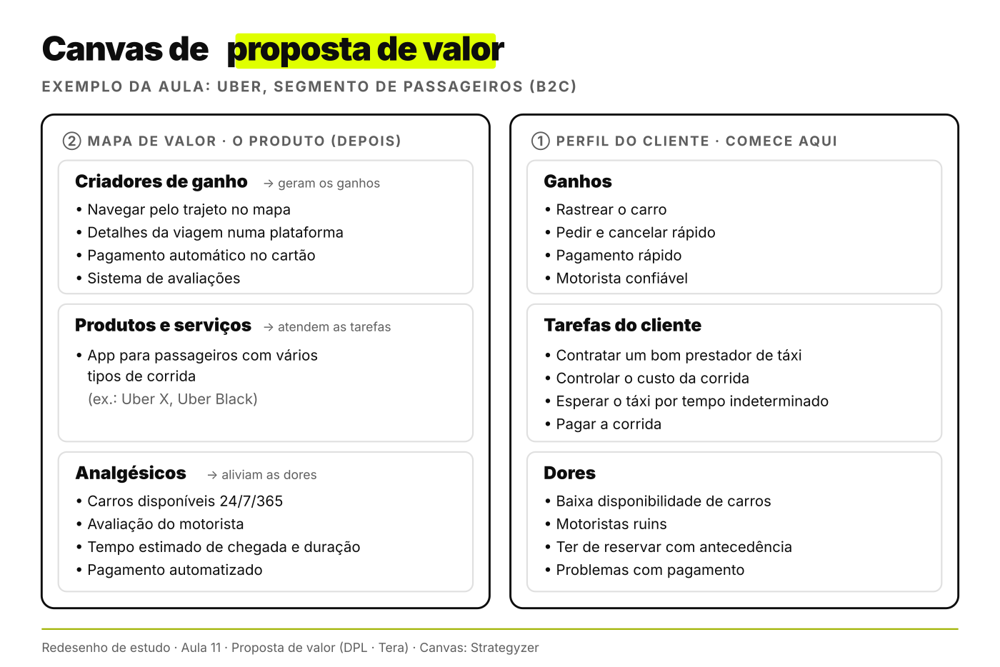

[← Tera · Digital Product Leadership · 01: Fundamentos de Product Management](README.md)

# Aula 11: Proposta de valor / Value proposition

🇧🇷 Com Keiko Mori (Head of Product Marketing, TikTok). A aula liga **problema, proposta de valor e Product Market Fit** ao marketing, e mostra ferramentas para validar cada etapa.

🇺🇸 Problem–solution fit, value proposition and product–market fit, and why they come before any marketing strategy. Tools: Golden Circle, value proposition canvas (Uber), Lean Canvas, TAM/SAM/SOM, MVP types and ways to measure fit (NPS, 40% rule, other metrics).

~~~mermaid
flowchart LR
  A["Problem Solution Fit prototipar, validar, pivotar"] --> B["Proposta de valor"] --> C["Product Market Fit prototipar, validar, pivotar"] --> D["Escala crescer, otimizar"]
~~~

> 🇧🇷 **"O melhor marketing do mundo não é capaz de salvar um produto sem proposta de valor."** Antes de decidir canal, mídia ou comunicação, esses passos precisam estar claros.

## 1. Problema e Problem Solution Fit / Problem and problem–solution fit

🇧🇷 **Qual problema a sua marca resolve?** Uma pergunta simples, mas que impacta muito o resultado da empresa. O slide traz a frase de Eric Ries (*Lean Startup*): sucesso é aprender como resolver o problema do seu cliente.

🇧🇷 **Problem Solution Fit** é quando uma solução resolve um problema relevante ou atende a uma necessidade identificada do público-alvo. Significa que você:
1. tem um **problema validado** (que realmente existe);
2. já validou as principais **hipóteses de solução** (chegou a uma, no máximo duas).

## 2. Proposta de valor / Value proposition

🇧🇷 A proposta de valor responde: **por que um consumidor compraria o seu produto ou serviço, e não o do concorrente?** Ela deve descrever, de forma **curta, clara e direta**, o valor que a pessoa ganha. Segundo o texto da aula, é o elemento mais importante da mensagem de marketing.

**Golden Circle (Simon Sinek), no exemplo da Apple:**

| Camada | Pergunta | Apple |
|---|---|---|
| **What / O quê** | O que você faz? | Ótimos computadores (e outros eletrônicos) |
| **How / Como** | Ações específicas para realizar o porquê | Produtos lindamente desenhados e fáceis de usar |
| **Why / Por quê** | Qual é a sua causa? No que acredita? | **Desafiar o status quo** e fazer diferente |

> 🇧🇷 "As pessoas não compram **o que** você faz. Elas compram **o porquê** você faz." (Simon Sinek)

🇧🇷 Para a professora, o porquê é **o grande segredo da proposta de valor**: a Apple pode vender computador, celular, fone e, quem sabe, até uma geladeira, desde que desafie o status quo.

🇧🇷 **As empresas que mais crescem e inovam não entregam produto, entregam valor:** a maior rede de hospedagem não tem hotéis (**Airbnb** vende a experiência de viver a cultura do lugar); uma das maiores empresas de transporte particular não tem carros (**Uber**); uma das maiores de fotografia não tira fotos (**Instagram**). Elas pensam na atividade final, não no meio.

## 3. Product Market Fit / Product–market fit

🇧🇷 É o **encontro entre produto e mercado**: o seu produto atende uma demanda relevante? Qual é o seu mercado? Ter problema e solução não basta; sem mercado, o produto não "aterrissa". Segundo a professora, falta de Product Market Fit é o principal motivo de a maioria das startups e produtos novos falharem.

**Definições citadas no slide:**
- 🇧🇷 **Marc Andreessen:** estar em um bom mercado com um produto que pode satisfazer esse mercado.
- 🇧🇷 **Josh Porter** (*Principles of Product Design*): é quando as pessoas vendem para você.
- 🇧🇷 **Dan Olsen** (*The Lean Product Playbook*): o produto atende às necessidades reais do cliente de uma forma melhor que as alternativas.

> 🇧🇷 Atenção (texto da aula): só vá para o Product Market Fit quando tiver indícios suficientes de ter passado pelas validações do Problem Solution Fit.

## Como encontrar o Product Market Fit / How to find it

**Passo 1: validar o problema**

~~~mermaid
flowchart LR
  H["Hipóteses de problema pesquisa de mercado, observação, entrevistas"] --> P["Dor / problema (idealmente 1, no máximo 2 ou 3)"]
  P --> R["Causa / raiz do problema"]
  P --> I["Intensidade da dor"]
  I --> PR["Priorizar as soluções"]
~~~

🇧🇷 Exemplo de hipóteses: "a demora na fila do banco" e "atendimento para o público da terceira idade" podem ser dois problemas em paralelo, ou você pode priorizar um. A **intensidade da dor** importa porque um produto quase nunca tem uma função só: ela é o que permite priorizar as soluções (e o MVP).

**Passo 2: validar a solução**

🇧🇷 Como: estudar soluções disponíveis, entrevistar potenciais clientes, observar o comportamento do cliente e o mercado. A solução precisa atender **três pilares**:

| Pilar | Pergunta |
|---|---|
| **Desejável** | Seu produto é algo que as pessoas querem? |
| **Viável** | As pessoas vão pagar por ele? Ele se paga? (lembre que você disputa **o mesmo bolso** do cliente com concorrentes diretos e indiretos) |
| **Realizável** | Seu produto pode ser feito? (às vezes é desejável e viável, mas não existe tecnologia para fazer) |

**Passo 3: o Canvas de proposta de valor**

🇧🇷 Do **Business Model Canvas**, dê um zoom em dois blocos, **segmento de clientes** e **proposta de valor**: juntos, eles formam o **Canvas de proposta de valor** (Strategyzer).
- **Lado direito, perfil do cliente:** **tarefas** (o que o cliente faz para atingir um objetivo), **dores** (problemas no caminho) e **ganhos** (o que o deixaria feliz ou facilitaria a vida). Aqui, pense **só no cliente**, não no produto.
- **Lado esquerdo, mapa de valor:** **produtos e serviços** (atendem as tarefas), **analgésicos** (aliviam as dores) e **criadores de ganho** (geram os benefícios).

🇧🇷 A professora gosta de **começar pelo lado direito**. Se começar pelo produto, você tende, sem perceber, a encaixar as necessidades do cliente na solução que já tem pronta, e não o contrário.

🇧🇷 **Case Uber:** é uma **plataforma multilateral**, com dois segmentos (motoristas e passageiros), então precisa de **dois canvas**. A aula faz o dos passageiros, imaginando o Uber sendo criado do zero (quando esperar táxi levava horas e às vezes era preciso agendar no dia anterior):

**O que o texto da aula destaca sobre o canvas:**
- 🇧🇷 Mais da metade das propostas de valor falham em atender às expectativas dos clientes e desaparecem do mercado. O canvas ajuda a evitar isso, porque mostra os problemas do público e o que ele deseja.
- 🇧🇷 É uma ferramenta central que torna a proposta de valor **visível e tangível**, focada na interação entre consumidor e produto.
- 🇧🇷 Também vale para **novas features** em produtos que já existem.
- 🇧🇷 Produtos com **várias personas** (especialmente B2B) precisam de **um canvas por persona**.

## Como alcançar o Product Market Fit: três etapas / Three steps

| Etapa | Ferramenta |
|---|---|
| 1. Definir o **segmento de clientes e o mercado** | **Lean Canvas** |
| 2. Calcular o **tamanho do mercado** | **TAM / SAM / SOM** |
| 3. **Validar** o produto e a proposta de valor | **MVP** |

**1. Lean Canvas**

🇧🇷 Uma versão mais resumida e simples do Business Model Canvas, muito usada por startups. Dividido ao meio: o **lado esquerdo é produto** (problema, solução, métricas, custos) e o **lado direito é mercado** (segmento de clientes, canais, vantagem injusta (*unfair advantage*), fontes de receita). No **meio** fica a **proposta de valor**, que une produto e mercado. "Não é coincidência": ele foi feito para facilitar o encontro entre produto e mercado.

**2. TAM / SAM / SOM** (exemplo da aula: sabão em pó)

| Sigla | O que é | Sabão em pó |
|---|---|---|
| **TAM** (*Total Addressable Market*) | O mercado total para o produto: todos que poderiam usá-lo | Todas as casas do Brasil |
| **SAM** (*Serviceable Available Market*) | A parte do mercado possível de capturar com o seu modelo de negócio | As casas onde se lava roupa |
| **SOM** (*Serviceable Obtainable Market*) | A % do mercado disponível realisticamente capturável | Se a marca for premium, as classes A e B |

🇧🇷 Isso ajuda até no plano de mídia (quantas pessoas atingir). Comece a estratégia de marketing pelo **SOM**; ele pode parecer um nicho, mas a professora diz que ele já é bastante.

**3. MVP (Produto Mínimo Viável)**

🇧🇷 A versão de um produto que permite **coletar o máximo de aprendizado validado sobre os clientes com o mínimo esforço**. O MVP **não é uma versão ruim**, é uma versão **simples**: comece pelas **dores de maior intensidade**.

🇧🇷 **Exemplo do carro:** o MVP de um carro não é só o chassi ou só as rodas, porque isso não entrega valor. É algo que já cumpre o objetivo de se **locomover**: skate, patinete, bicicleta, moto.

**Cinco tipos de MVP citados:**

| Tipo | O que é |
|---|---|
| **Landing page test** | Página teste para captar interesse; a proposta de valor precisa estar muito clara |
| **Fake door** | Funcionalidade que aparece disponível, mas ainda não funciona, e capta o interesse |
| **Concierge** | Funcionalidade não está pronta: um humano faz tudo por trás, **e o cliente sabe** |
| **Mágico de Oz** | Parecido com o concierge, mas o humano **não aparece**: o cliente não sabe |
| **Vídeo** | Vídeo de apresentação contando a proposta de valor; mede interesse pelas visualizações |

## Como mensurar se encontramos o Product Market Fit / Measuring fit

🇧🇷 Três formas principais:
- **Pesquisa quantitativa:** quantas pessoas se interessaram. O texto da aula observa que estudos quantitativos são mais indicados para avaliar algo já pronto, pois usados com frequência no início podem sair caros.
- **Pesquisa qualitativa:** tão ou mais importante, porque o cliente conta o que achou e se a dor foi resolvida. Boa para identificar os principais problemas (ex.: o que impede alguém de enviar um formulário).
- **NPS (Net Promoter Score):** "você recomendaria para um amigo?", de 0 a 10.

| Nota | Grupo | Comportamento |
|---|---|---|
| **9–10** | Promotores | Compram mais, ficam mais tempo, indicam (quase vendem por você) |
| **7–8** | Neutros | No meio: não falam mal, mas não defendem |
| **0–6** | Detratores | Menos propensos a gerar valor; provavelmente tiveram experiência ruim |

🇧🇷 **A regra dos 40%** (texto da aula): se 40% dos clientes pesquisados disserem que ficariam **"muito desapontados"** se não pudessem mais usar o produto, você (pode) ter um bom produto em mãos.

**Outras métricas (dependem do modelo de negócio e da proposta de valor):**

| Métrica | O que mede |
|---|---|
| **Taxa de rejeição** | % de quem entra e sai antes de qualquer ação. Cerca de 60% pode ser alta; mas rejeição alta não quer dizer negócio inútil (pode ser design ou mensagem) |
| **Tempo de uso** | Quanto tempo a pessoa passa no site/app; difícil definir o "bom", então compare semanas ou meses |
| **Engajamento (frequência)** | Quantas vezes usa; crucial para um app de banco, por exemplo |
| **Ativação (usuários ativos)** | De nada adianta 100 mil clientes na base se só 5% são ativos |
| **Coeficiente viral / referrals** | Crescimento orgânico, o boca a boca |
| **CLTV** (*Customer Lifetime Value*) | Valor do cliente durante todo o tempo em que fica com você (1, 5, 10 anos?) |

## Proposta de valor na prática / In practice

| Marca | Proposta de valor | Por que funciona (texto da aula) |
|---|---|---|
| **Shopify** | Qualquer pessoa, de qualquer lugar, pode começar um negócio | Linguagem simples para vários tipos de vendedor, da empresa estabelecida a quem vende suéter de crochê para cachorro numa loja temporária |
| **Nubank** | Acabar com a complexidade e devolver o controle da vida financeira para cada um | Bancos costumam ser associados a burocracia, papelada e atendimento pouco eficiente |
| **Sebrae** | Promover o desenvolvimento sustentável e a competitividade de micro e pequenas empresas | Micro e pequenos negócios têm alta mortalidade nos primeiros anos e sofrem com burocracia |

🇧🇷 **Nenhuma das três fala de produto, e sim de valor.** Por isso, segundo a professora, uma boa proposta de valor **não data o produto**: o Shopify poderia vender logística ou embalagens; o Nubank, crédito, conta, app de gestão ou cursos; o Sebrae, cursos, consultoria ou plataforma. Tudo cabe, desde que alinhado à proposta de valor.

## Resumo da aula / Lesson takeaways

**Do vídeo de conclusão:**
1. 🇧🇷 **Problem Solution Fit:** validar se o problema realmente existe no mercado.
2. 🇧🇷 **Proposta de valor:** é crítica na decisão de compra do cliente.
3. 🇧🇷 **Product Market Fit:** validar se existe mercado para o produto.
4. 🇧🇷 Esses passos vêm **antes da escala** e antes da estratégia de marketing, comunicação ou escolha de canal. "O melhor marketing do mundo não é capaz de salvar um produto sem proposta de valor."

**Checklist da Tera — ao final desta aula, você deve sentir segurança para:**
1. 🇧🇷 Entender o que é proposta de valor e os elementos que definem o valor de um produto ou serviço.
2. 🇧🇷 Avaliar os princípios de Problem Solution Fit e Product Market Fit.
3. 🇧🇷 Identificar os estágios de crescimento e o potencial do mercado.

**Referências citadas na aula:** *Lean Startup* (Eric Ries); Golden Circle (Simon Sinek); Marc Andreessen; *Principles of Product Design* (Josh Porter); *The Lean Product Playbook* (Dan Olsen); Value Proposition Canvas (Strategyzer).

---

[← Tera · Digital Product Leadership · 01: Fundamentos de Product Management](README.md)
