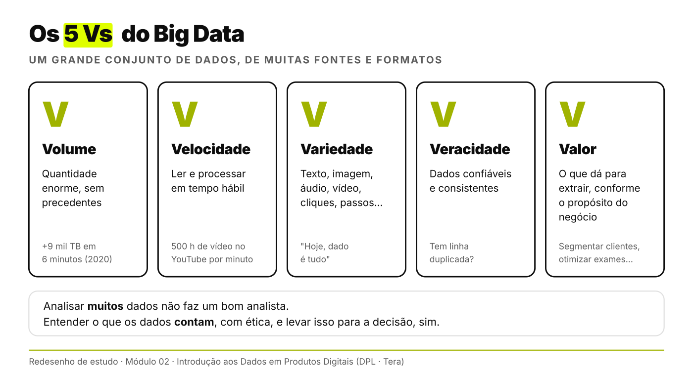
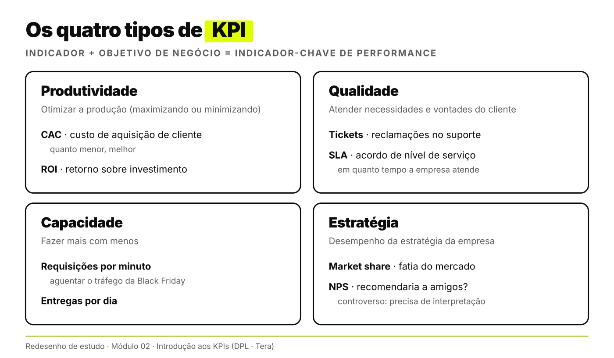

# Tera · Digital Product Leadership · 02: Métricas para Produtos Digitais

| Campo / Field | Valor / Value |
|---|---|
| Escola / School | Tera |
| Curso / Course | Digital Product Leadership (DPL), formação com 6 módulos / 6-module program |
| Módulo / Module | 02 · Métricas para Produtos Digitais |
| Situação / Status | 🟡 Em andamento · 3 de 11 aulas / In progress · 3 of 11 lessons |
| Fonte / Source | [Tera: Digital Product Leadership](https://plataforma.somostera.com/formations/digital-product-leadership) (login) |

🇧🇷 Sobre o módulo (texto da plataforma): entender a função das métricas no ciclo de desenvolvimento, aprender a definir indicadores e aprofundar os conhecimentos em análise de dados.

🇺🇸 About: the role of metrics in the development cycle, how to define indicators, and data analysis.

## Aulas / Lessons

| # | Aula / Lesson | Professor(a) / Instructor | Situação / Status |
|---|---|---|---|
| 1 | Depois da base, é hora de medir (opcional) | Time Tera | ✅ |
| 2 | Introdução aos Dados em Produtos Digitais | Juliana Reksua (iFood) | ✅ |
| 3 | Introdução aos KPIs | Henrique Santana | ✅ |
| 4 | Definição e Comunicação de KPIs | Henrique Santana (Dell) | ⬜ |
| 5 | Métricas para Produtos e Negócios | Igor Torres (Neon) | ⬜ |
| 6 | Teste de Hipóteses | Gustavo Rodrigues Pilatti | ⬜ |
| 7 | Planejamento e Implementação de Tracking (Tracking Plan) | Huxley Dias | ⬜ |
| 8 | Cultura de Analytics e Planejamento de Testes | Huxley Dias | ⬜ |
| 9 | SQL para PMs: comandos básicos para consultas rápidas | | ⬜ |
| 10 | Conclusão: Métricas para Produtos Digitais (recap + teste) | Tera | ⬜ |
| 11 | Desafio: tomada de decisão com KPI | | ⬜ |

---

## 1. Depois da base, é hora de medir / After the basics, it's time to measure

🇧🇷 Vídeo curto (cerca de 1 min e meio) que faz a ponte entre o Módulo 01 e o 02. Com a base estabelecida, surge a pergunta: **como provar que o produto cumpre o seu papel?** Não basta ter propósito: é preciso **evidência**.

🇺🇸 Bridge video: purpose is not enough, you need evidence. Without metrics, even your best argument is just an opinion.

~~~mermaid
flowchart LR
  A["Propósito (Módulo 01)"] -->|"métricas"| B["Evidência"] --> C["Decisões mais seguras e consistentes"]
~~~

**Ideias principais do vídeo:**
- 🇧🇷 **"Sem métrica, até o seu melhor argumento vira opinião."**
- 🇧🇷 Boas intenções não bastam, e **percepção não é validação**: um produto pode parecer promissor, mas só os dados mostram se ele realmente gera valor.
- 🇧🇷 A pergunta muda: **o que exatamente estamos medindo? E por quê?**
- 🇧🇷 O módulo promete ajudar a sair da abstração para a objetividade: **medir o que importa, traduzir resultado em argumento e usar métricas para guiar decisões** com mais segurança.
- 🇧🇷 **Não** se trata de decorar KPIs "de prateleira" ou repetir fórmulas prontas, e sim de usar dados **com intenção**, em produtos vivos, com times reais e sob pressão.
- 🇧🇷 Fortalecer o raciocínio de PM: alinhar **visão e execução com base em evidência, não em achismos**, e usar **a métrica certa no momento certo**, mesmo quando não há consenso.

> 🇧🇷 "Bora tirar os números da gaveta e colocar as decisões na mesa?"

---

## 2. Introdução aos Dados em Produtos Digitais / Intro to data in digital products

🇧🇷 Com Juliana Reksua (Advanced Data Analyst, iFood), economista, com passagem por estatística, ciência de dados e estratégia de negócio; a conversa é mediada pela Gil, da Tera. A aula mostra **de onde vêm os dados**, o que é **Big Data** e por que os dados se tornaram centrais na tomada de decisão.

🇺🇸 Where data comes from (a short history), Big Data and its 5 Vs, and the three types of data (structured, unstructured, semi-structured).

### De onde vêm os dados? / Where does data come from?

🇧🇷 Usar dados para decidir **não é novidade**: o resumo da aula cita o primeiro experimento estatístico registrado no século XVII e o termo *Business Intelligence* em 1865. A partir dos anos 1920, com o primeiro método de armazenamento (fitas magnéticas), o mundo dos dados passa a crescer de forma **exponencial**.

**Alguns marcos da linha do tempo da aula:**

| Ano | Marco |
|---|---|
| 1865 | Surge a ideia de *Business Intelligence* (inteligência para decisões de negócio) |
| ~1928 | Primeiro método de guardar informações: fitas magnéticas |
| 1946 | ENIAC, o primeiro computador eletrônico |
| 1970 | Surge o **SQL**, linguagem de coleta e tratamento de dados |
| 1974 | Pesquisa de texto (como digitar algo no Google) |
| ~1990 | Primeiras menções ao termo *Big Data*; surge o **Python** |
| 1991 | Internet |
| 1997 | Google |
| 2004 | Facebook |
| 2006 | Hadoop: processamento distribuído para grandes volumes de acesso |
| 2007 | scikit-learn, biblioteca de Python para modelagem ("três linhas de código, você tem um modelo") |
| 2013 | Amazon Redshift: armazenamento em nuvem |
| 2017 | Tecidos e redes de dados (cruzar bases de forma mais fluida) |
| 2019 | Python vira a linguagem mais usada do mundo |
| 2020 | AutoML e plataformas de Data Science (máquinas criando modelos) |

🇧🇷 Dois aspectos marcam a virada a partir da metade do século XX: a **velocidade** das mudanças e as inovações em **comunicação** (carta, rádio, TV, internet, celular). Somados a ferramentas que permitem **visualizar** os dados, eles explicam a curva exponencial.

> 🇧🇷 **Python é só para quem trabalha com dados?** Não. Com bases muito grandes (mais de ~500 mil linhas) o Excel deixa de funcionar, e SQL e Python facilitam. Mas, segundo a professora, **dominar essas ferramentas não é o que define um bom profissional de dados**.

### Big Data e os 5 Vs / Big Data and the 5 Vs

🇧🇷 *Big Data* é um grande conjunto de dados vindo de muitas fontes, com características e estruturas diferentes. A professora comenta que já viu os "Vs" como 3 e como 7; ela usa **5**:

| V | O que significa (resumo da aula) | Exemplo do vídeo |
|---|---|---|
| **Volume** | A quantidade de dados produzida e armazenada é enorme, sem precedentes | Estudo citado (2020): em 6 minutos, mais de 9 mil terabytes, como 2 milhões de stories no Instagram e 250 milhões de mensagens no WhatsApp |
| **Velocidade** | Os dados precisam ser lidos e processados em tempo hábil; sem essa velocidade, o volume nem existiria | A cada minuto: 500 horas de vídeo no YouTube, 404 mil horas assistidas na Netflix |
| **Variedade** | Textos, imagens, áudios, vídeos, cliques, passos, compras… "hoje, dado é tudo" | Até a posição do mouse na tela é dado para alguém |
| **Veracidade** | Extrair informação de forma **confiável**: robustez e consistência | Antes da análise, confira a veracidade dos dados que a geraram; dados errados (ou mal interpretados de propósito) podem até direcionar público eleitoral |
| **Valor** | Que valor dá para extrair, de acordo com o propósito do negócio | Para uma empresa, segmentar usuários; para um médico, otimizar exames e ter histórico dos pacientes |

> 🇧🇷 **Analisar muito dado faz de alguém um bom analista?** Não. Segundo a professora, você pode analisar pouquíssimos dados e ser excelente. O que conta é entender **o que os dados estão contando**, trabalhar com eles com **ética** e levar um **direcionamento estratégico** ao time (negócio, produto…).

🇧🇷 No fim, o objetivo é **tomar decisões estratégicas orientadas a dados**. Alinhar com stakeholders e fazer as decisões da análise serem **compartilhadas e validadas** pelos times melhora muito o resultado.

### Tipos de dados / Types of data

| Tipo | O que é | Exemplo |
|---|---|---|
| **Estruturado** | Armazenado, acessado e processado num **formato fixo**; exige menos processos | Uma planilha tratada: linhas e colunas. No Big Data, **não passam de ~20%** dos dados |
| **Não estruturado** | Forma e estrutura **desconhecidas**; o **maior volume** de dados; precisa de tratamento para análise | Fotos, posts, buscas no Google, músicas ouvidas |
| **Semiestruturado** | Mistura dos dois: o conteúdo é não estruturado, mas ganha "etiquetas" | A mesma foto enviada por e-mail ou salva numa pasta: agora se sabe quem enviou, para quem e onde está |

### Para que e para quem são os dados / What data is for, and for whom

🇧🇷 **Big Data não é só negócio.** Dados servem em qualquer situação onde (1) há necessidade de melhoria e (2) nós, humanos, não conseguimos captar sozinhos. Exemplo do vídeo: um time de vôlei que media batimentos, risco de contusão, tempo de resposta à bola e posição na quadra para estudar cada adversário. A gente já vive imerso em dados (e gera muitos sem perceber), então dá para ter **menos medo** de trabalhar com eles.

🇧🇷 A tecnologia fez surgir um novo tipo de empresa, que decide com base em dados para medir **efeito, impacto e risco** das decisões. A professora mostra que as marcas mais valiosas de 2020 são empresas que consomem e também geram muitos dados ("dados como o novo petróleo").

🇧🇷 **Quem trabalha com dados?** Não só cientistas e engenheiros de dados: uma **pessoa de produto** que roda um teste para escolher a melhor melhoria também gera dados e decide com base neles. A demanda por esses profissionais cresce ano a ano (gráfico citado, da Austrália).

**Uma pessoa letrada em dados (*data literacy*) precisa de três blocos:**

| Bloco | O que é (segundo a aula) |
|---|---|
| **Ler dados** | Não é só ler gráfico: dado o contexto do negócio (ou produto), **qual análise faz sentido?** Pode ser mínimo, máximo e média, ou um modelo robusto |
| **Coletar e gerenciar dados** | Não é sobre ferramenta (SQL, Python): é receber uma planilha e tratá-la com **olhar crítico**. Ex.: numa pesquisa com 200 usuários, saber o que fazer com 3 respostas "teste" ou vazias e o quanto isso afeta a amostra |
| **Comunicar-se com dados** | Relatórios, dashboards e apresentações claros. Se o stakeholder não entende o gráfico, "nada vale": o produto de dados é feito para outras pessoas consumirem |

🇧🇷 **Competências, do básico ao avançado** (o mapa da aula):
1. **Conhecimento de dados:** o que é um dado, estruturado ou não, de onde vem.
2. **Decisões com dados:** análises básicas (mínimo, média, mediana), visualizações simples, usar dados para fortalecer o argumento de produto ou negócio.
3. **Coleta de dados:** depende do contexto. Uma pesquisa de produto com 500 ou 5 mil usuários cabe no Excel; a base de pedidos do iFood (mais de 2 milhões por dia, analisando 3 meses) não cabe.
4. **Gerenciamento de dados:** organização, preservação e curadoria. Ex.: o pedido no app gera um dado **bruto** (zona *raw*), que é tratado e limpo para analistas e cientistas usarem; em grandes empresas, há **governança** de acessos.
5. **Aplicação:** quem dá direcionamento estratégico precisa garantir antes que o dado **faz sentido** (é consistente? não tem linha duplicada?).

> 🇧🇷 Os itens 1 a 3 são o que, segundo a professora, toda pessoa que quer decidir com dados (ou promover uma cultura *data-driven* no time) deve ter em mente. Ninguém precisa saber tudo: o mapa de skills da Cappra para profissionais de dados chegou a **mais de 200 skills**.

**"Habilidades técnicas são importantes, mas não são suficientes."** (Juliana Reksua)
- 🇧🇷 "De nada adianta programar em 30 linguagens se você não sabe o que fazer com aquilo", e às vezes o problema se resolve **com uma média**. A ferramenta precisa responder ao **problema de negócio**.
- 🇧🇷 **Ética:** em algum momento há um humano por trás do modelo; vieses pessoais se replicam nos modelos (a aula cita casos de modelos racistas, misóginos, machistas).
- 🇧🇷 Uma pesquisa da IBM com cerca de 5.800 executivos (comentada por Josh Bersin) apontou a necessidade de recapacitar cerca de **120 milhões de profissionais** em skills **não técnicas**; entre 2016 e 2018, as soft skills passaram à frente das hard skills no ranking.
- 🇧🇷 **Validade das habilidades técnicas:** até a segunda metade do século XX, uma habilidade técnica "durava" uns 15 anos (ex.: datilografia); hoje, cerca de 5 anos; em dados, **2 a 3 anos**. Por isso, "skill zero" é **saber aprender e se adaptar**, com flexibilidade, resiliência e abertura.

### Cultura *data-driven* / Data-driven culture

🇧🇷 É a cultura em que **toda decisão** é orientada por dados, da mais micro ("água em garrafa ou em lata na geladeira da startup?") à mais macro (comprar outra empresa). **Tecnologia de ponta não basta**: é preciso romper barreiras culturais e organizacionais e ter um novo modelo de liderança. Empresas tradicionais têm processos mais engessados; empresas mais jovens tendem a se adaptar mais rápido.

**Maturidade de dados de uma organização** (exemplo da aula: um salão de beleza):

~~~mermaid
flowchart LR
  A["1. Resistente não usa dados"] --> B["2. Curiosa vê valor, mas não coleta de forma inteligente"] --> C["3. Tática analisa o passado"] --> D["4. Estratégica entende o porquê e antecipa o próximo período"] --> E["5. Data-driven dados em todas as etapas e todos os níveis"]
~~~

| Estágio | Como é |
|---|---|
| **Resistente** | Não tem dados e não se importa; pode até ver valor, mas não faz nada para coletar |
| **Curiosa** | Atribui valor aos dados, mas não sabe quais KPIs importam nem como aplicar (ex. do vídeo: papelada no setor público) |
| **Tática** | Analisa comportamentos **passados** (o salão viu um pico às sextas no mês passado), mas não usa para prever nem reorganizar |
| **Estratégica** | Entende a **razão** dos comportamentos e antecipa o que esperar da clientela no próximo período |
| **Data-driven** | Dados coletados e enriquecidos de forma sistemática, usados do planejamento à conclusão; a cultura é absorvida **em todos os níveis**, e todos "falam a mesma língua" |

> 🇧🇷 Nenhum estágio é "errado", mas quem não usa dados perde eficiência e decide com mais risco. Lembrete da professora: **correlação não é causalidade** (o tema volta mais à frente).

**Dois exercícios propostos no vídeo:**
1. 🇧🇷 Preencher o mapa de skills de dados da Cappra agora e de novo no fim do curso, para ver a evolução.
2. 🇧🇷 Pensar em usos de dados no seu dia a dia (saúde, bem-estar, trabalho).

**Aprofunde (indicações da aula):** artigo *The Skills Of The Future Are Now Clear: And Despite What You Think, They're Not Technical* (Josh Bersin); relatório *The enterprise guide to closing the skills gap* (IBM Institute for Business Value); estudo *Trilhas de Conhecimento Organizado por Área* (Cappra Institute for Data Science).

### Usabilidade dos dados: três cases / Data in practice

| Case | O que fazem com dados | Resultado |
|---|---|---|
| **Grupo Pão de Açúcar (Clube Extra)** | Programa de recompensas: produtos mais comprados, ticket médio, marcas preferidas → **clusterizar** os clientes e estudar o comportamento | Promoções com mais conversão (ex.: quem compra muito item de bebê recebe desconto nisso). "Você paga o desconto com seus dados" |
| **Monsanto (hoje Bayer)** | Estatística e testes para recomendar plantio de sementes aos agricultores | Menos risco, mais rendimento, menos uso de terra; testar várias hipóteses ao mesmo tempo aumenta a chance de aprender |
| **iFood** | IA para (1) montar a **lista de restaurantes** de cada pessoa (mesmo morando na mesma casa, as listas diferem) e (2) **prever pedidos e entregadores** por dia e turno (e se chover? feriado?) | Direciona o consumo e organiza a logística |

### Processos de decisão com base em dados / Data-driven decision making

🇧🇷 Ao levar uma análise para o stakeholder, é preciso **comunicar com clareza** e evitar **vieses**. A aula destaca três:

| Viés | O que é | Exemplo da aula |
|---|---|---|
| **De padrão** | O cérebro procura padrões e quer replicá-los | Achar um "padrão" nos números sorteados da loteria. **Correlação não é causalidade**: o consumo de queijo muçarela e o número de doutores em engenharia civil sobem juntos, mas um não causa o outro (site citado: *Spurious Correlations*) |
| **De curto prazo** | Ganhos rápidos dão de 3 a 4 vezes mais dopamina do que ganhos de longo prazo, então tendemos a priorizar o curto prazo | Case do NPS dos restaurantes (abaixo) |
| **De ganhar** | Preferimos a opção apresentada como **ganho** à apresentada como **perda**, mesmo quando são iguais | Jogo de aposta (abaixo) |

**🍕 Case: NPS baixo dos restaurantes no iFood**

🇧🇷 Pesquisas mostram que a maior dor dos restaurantes é ter **poucos pedidos**. Três ações possíveis para aumentar o volume:
1. Enviar **cupons** sem custo para o restaurante se autopromover.
2. Dar **destaque na listagem** para restaurantes com poucos pedidos.
3. **Ajudar o restaurante a melhorar a operação** (estudar ineficiências, acompanhar KPIs, levantar hipóteses).

🇧🇷 A Gil escolheu o cupom ("todo mundo chuta cupom"). Mas 1 e 2 são decisões **curto-prazistas**: quando o cupom ou o destaque acabam, o restaurante não aprendeu a vender mais. A opção 3 é trabalhosa (talvez um ciclo de seis meses, clusterizando perfis e levantando hipóteses), mas resolve a dor **sem criar dependência**. Pergunta-chave: **estou resolvendo a dor ou só mascarando?**

**🎲 Jogo da aposta (enquadramento)**
- 🇧🇷 **Opção 1:** você recebe R$ 1.000 e pode **ganhar mais R$ 500** (ou apostar para ganhar mais R$ 1.000).
- 🇧🇷 **Opção 2:** você recebe R$ 2.000 e pode **perder R$ 500** (ou apostar entre não perder nada e perder R$ 1.000).
- 🇧🇷 As opções seguras levam ao **mesmo saldo (R$ 1.500)**, mas a gente prefere a que fala em "ganhar". **A forma como a informação é transmitida influencia a decisão.**

> 🇧🇷 **A forma de comunicar o trabalho é tão importante quanto o trabalho.** Se você testou 30 hipóteses e conta como se fossem 2, a mensagem fica simplista e diz pouco do seu trabalho. A professora brinca: quem trabalha com dados é "influencer", porque o trabalho é **influenciar decisões**, com base em dados, de forma ética.

### Resumo da aula / Lesson takeaways

**Lembre-se (Juliana Reksua):**
1. 🇧🇷 **Habilidades técnicas são importantes, mas não sozinhas.** É preciso saber usá-las além do técnico: entender o problema, a dor e como gerar valor.
2. 🇧🇷 **As pessoas nem sempre pensam igual a você, e as hipóteses que você escolher as influenciarão.** Decisões grandes (de empresas, de governos) podem depender de como você apresenta os dados.
3. 🇧🇷 **Ferramentas são instrumentos de análise, mas quem toma e direciona decisões é você.** Conhecer contexto social, econômico e financeiro, e ter ética, também faz um bom profissional.

**Checklist da Tera — você deve sair desta aula entendendo:**
1. 🇧🇷 De onde os dados vieram e como vêm sendo usados no mercado nos últimos anos, com o crescimento das áreas de dados.
2. 🇧🇷 Como o uso de dados se tornou estratégico e decisivo na tomada de decisão de negócios.
3. 🇧🇷 Como é trabalhar com dados, discutindo ferramentas comuns nas áreas de dados.

---

## 3. Introdução aos KPIs / Intro to KPIs

🇧🇷 Com Henrique Santana (Head of Data and Machine Learning na CloudHumans; na plataforma, Principal ML Engineer na Dell), em conversa com o Bruno, da Tera. A aula apresenta o conceito de KPI, os quatro tipos, os KPIs mais comuns por modelo de negócio e a diferença entre **pipeline** e **plataforma**.

🇺🇸 What a KPI is, four KPI types, common KPIs by business model, and pipeline vs platform businesses.

### Conceito e tipos de KPIs / Concept and types

🇧🇷 Um **KPI** (*Key Performance Indicator*) é um indicador-chave para a empresa, normalmente associado a um conjunto de **objetivos**. Um **indicador** pode ser uma única métrica ou um cálculo entre métricas; quando ele é ligado a um **objetivo de negócio** e a empresa toda passa a focar nele, ele é "promovido" a KPI.

~~~mermaid
flowchart LR
  M["Métrica algo que se mede"] --> I["Indicador métrica ou cálculo entre métricas"] --> K["KPI indicador ligado a um objetivo de negócio"]
~~~

**Como é um bom KPI (segundo a aula):**
- 🇧🇷 **Mensurável:** toda métrica tem uma medida por trás.
- 🇧🇷 **Relevante para o negócio:** não adianta um KPI que nada tem a ver com o negócio.
- 🇧🇷 **Dá uma direção clara:** de onde vem, para onde vai, mínimo, máximo, o que se espera, qual é a meta.
- 🇧🇷 **Traz o propósito** da empresa embutido nos números.

> 🇧🇷 Sem isso, a empresa fica com vários indicadores perdidos, que ninguém sabe o que significam nem consegue comunicar. "Se a gente não torna ele relevante, as pessoas vão esquecer e ninguém vai bater essa meta."

| Tipo | Objetivo | Exemplos da aula |
|---|---|---|
| **Produtividade** | Otimizar a produção (maximizando ou minimizando) e acompanhar se cresce | **CAC**, custo de aquisição de cliente (quanto menor, melhor); **ROI**, retorno sobre investimento |
| **Qualidade** | Ver se o produto atende às necessidades e vontades dos clientes | Número de **tickets** ou reclamações; **SLA** (*Service Level Agreement*), o tempo para atender |
| **Capacidade** | Fazer "mais com menos" com a estrutura atual | **Requisições por minuto** (aguentar a Black Friday no e-commerce); **entregas por dia** |
| **Estratégia** | Analisar o desempenho das estratégias | **Market share** (fatia do mercado); **NPS** |

**Exemplos do vídeo:**
- 🇧🇷 **CAC:** depende do time de vendas, mas também da retenção, porque trazer um cliente custa muito mais do que mantê-lo. Logo no primeiro exemplo já aparece a importância de **vários times acompanharem os KPIs**.
- 🇧🇷 **Entregas por dia no iFood:** com a mesma quantidade de entregadores, otimizar a rota para fazer três ou quatro entregas na mesma rua sem voltar ao estabelecimento. Os KPIs influenciam como você melhora o produto e a logística.
- 🇧🇷 **NPS é controverso:** tenta medir algo subjetivo com um número (% de promotores − % de detratores). **40 promotores e 60 neutros** dão NPS 40; **60 promotores, 20 neutros e 20 detratores** também dão 40. Situações bem diferentes, mesmo valor. Todo KPI depende de **interpretação**.

### KPIs por tipo de negócio / KPIs by business model

| Negócio | KPIs citados | O que medem |
|---|---|---|
| **Conteúdo com publicidade** (ex.: ge.globo) | **Tempo no site**; **profundidade de rolagem** (*scroll depth*) | Quanto mais tempo e mais rolagem, mais chance de mostrar anúncios e sinal de que o conteúdo agrada |
| **E-commerce** | **Produtos adicionados ao carrinho**; **abandono de carrinho**; **valor médio do pedido** | Intenção de compra; potenciais clientes perdidos (ex.: o livro importado ficou caro com o dólar); quanto cada compra traz |
| **Assinatura** (ex.: Medium, Netflix, Spotify) | **Taxa de conversão** (visitante → assinante); **valor do cliente no longo prazo** / *upsell*; **churn** (taxa de evasão) | Virar assinante; gerar mais valor (plano família, 4K); quem deixa de assinar quando o conteúdo deixa de ser relevante |
| **Geração de leads e vendas** (ex.: HubSpot, SAP, Salesforce, Zendesk) | **Conversão** em etapas (lead → **lead qualificado**); **taxa de fechamento** | Se o comercial não fecha com quem já viu a demo, desperdiça recurso e perde cliente |
| **Aplicativos móveis** (texto da aula) | **Taxa de instalação**; **taxa de ativação** (usou depois de baixar?); **taxa de retenção** (continuou usando?) | O caminho do download ao uso contínuo |

**Pontos de atenção do vídeo:**
- 🇧🇷 **A mesma métrica muda de sentido com o negócio:** no site de conteúdo, mais tempo é bom; num site de vendas, muito tempo pode indicar dúvida.
- 🇧🇷 **Um KPI pode prejudicar outro:** jogar o cliente direto para o carrinho com um único item reduz o **abandono**, mas piora o **valor médio do pedido**. É uma decisão de negócio; por isso é preciso saber qual é o **objetivo principal** para definir qual KPI pesa mais.
- 🇧🇷 **Netflix e churn:** para não depender das produtoras, que podem tirar conteúdo da plataforma (e fazer o assinante sair), a Netflix passou a produzir conteúdo próprio, uma decisão de negócio baseada no KPI de churn.
- 🇧🇷 Vender licenças para empresas (SAP, Salesforce) pede contato mais personalizado, porque o retorno de cada conversão é alto. E quem acompanha os dados precisa estar perto do negócio e dos times que fazem o processo.

### Pipeline × plataforma / Pipeline vs platform

| Pipeline | Plataforma |
|---|---|
| Um **fluxo** que vai da matéria-prima ao produto final; a compra final faz o fluxo continuar | Um modelo que cria valor ao **facilitar trocas** entre dois ou mais grupos interdependentes (produtores e consumidores) |
| Ex.: o tênis da Adidas: matéria-prima → fábrica → armazém → logística → loja → você | Ex.: Uber (sem carros), Airbnb (sem quartos), iFood, a loja de apps do Google |
| KPI típico: vender mais tênis | Ex. do shopping: o que importa não é a venda de um tênis específico, e sim se as lojas são relevantes e se o cliente passa por várias delas |

🇧🇷 **Case Loft (exemplo de plataforma):** a pessoa **compradora** (*buyer*) procura imóveis na vitrine; a **vendedora** (*seller*) anuncia o imóvel; na transação, o pagamento vai para a plataforma, que repassa à vendedora **menos a taxa** (é assim que ela ganha dinheiro). Como tem os dois lados, a plataforma pode oferecer **mais serviços** para ficar ainda mais relevante para as duas pontas.

~~~mermaid
flowchart LR
  B["Buyer quer comprar"] -->|"busca e paga"| P["Plataforma (owner)"]
  S["Seller quer vender"] -->|"anuncia"| P
  P -->|"repassa o valor menos a taxa"| S
~~~

### Resumo da aula / Lesson takeaways

**Lembre-se (Henrique Santana):**
1. 🇧🇷 **As empresas não são iguais**, então não faz sentido usar as mesmas métricas. Tudo o que se fala de dados precisa estar ligado ao **negócio** e ao seu objetivo.
2. 🇧🇷 **Nem todo indicador vai ser um KPI.** Só os que são chave para o objetivo da empresa são "promovidos", e isso depende de contexto e interpretação.

**Checklist da Tera — você deve sair desta aula entendendo:**
1. 🇧🇷 O conceito de KPIs e suas principais categorias.
2. 🇧🇷 KPIs comumente usados em diferentes tipos de negócios.
3. 🇧🇷 A diferença entre pipeline e plataforma.
