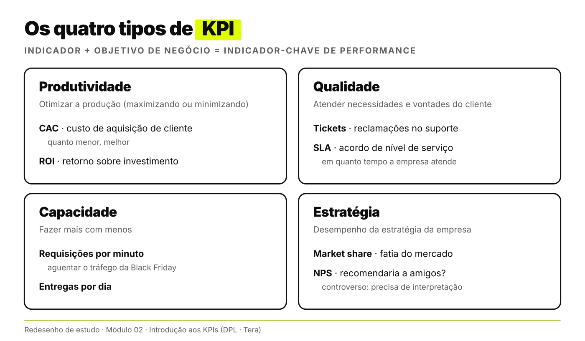

[← Tera · Digital Product Leadership · 02: Métricas para Produtos Digitais](README.md)

# Aula 3: Introdução aos KPIs / Intro to KPIs

🇧🇷 Com Henrique Santana (Head of Data and Machine Learning na CloudHumans; na plataforma, Principal ML Engineer na Dell), em conversa com o Bruno, da Tera. A aula apresenta o conceito de KPI, os quatro tipos, os KPIs mais comuns por modelo de negócio e a diferença entre **pipeline** e **plataforma**.

🇺🇸 What a KPI is, four KPI types, common KPIs by business model, and pipeline vs platform businesses.

## Conceito e tipos de KPIs / Concept and types

🇧🇷 Um **KPI** (*Key Performance Indicator*) é um indicador-chave para a empresa, normalmente associado a um conjunto de **objetivos**. Um **indicador** pode ser uma única métrica ou um cálculo entre métricas; quando ele é ligado a um **objetivo de negócio** e a empresa toda passa a focar nele, ele é "promovido" a KPI.

~~~mermaid
flowchart LR
  M["Métrica algo que se mede"] --> I["Indicador métrica ou cálculo entre métricas"] --> K["KPI indicador ligado a um objetivo de negócio"]
~~~

**Como é um bom KPI (segundo a aula):**
- 🇧🇷 **Mensurável:** toda métrica tem uma medida por trás.
- 🇧🇷 **Relevante para o negócio:** não adianta um KPI que nada tem a ver com o negócio.
- 🇧🇷 **Dá uma direção clara:** de onde vem, para onde vai, mínimo, máximo, o que se espera, qual é a meta.
- 🇧🇷 **Traz o propósito** da empresa embutido nos números.

> 🇧🇷 Sem isso, a empresa fica com vários indicadores perdidos, que ninguém sabe o que significam nem consegue comunicar. "Se a gente não torna ele relevante, as pessoas vão esquecer e ninguém vai bater essa meta."

| Tipo | Objetivo | Exemplos da aula |
|---|---|---|
| **Produtividade** | Otimizar a produção (maximizando ou minimizando) e acompanhar se cresce | **CAC**, custo de aquisição de cliente (quanto menor, melhor); **ROI**, retorno sobre investimento |
| **Qualidade** | Ver se o produto atende às necessidades e vontades dos clientes | Número de **tickets** ou reclamações; **SLA** (*Service Level Agreement*), o tempo para atender |
| **Capacidade** | Fazer "mais com menos" com a estrutura atual | **Requisições por minuto** (aguentar a Black Friday no e-commerce); **entregas por dia** |
| **Estratégia** | Analisar o desempenho das estratégias | **Market share** (fatia do mercado); **NPS** |

**Exemplos do vídeo:**
- 🇧🇷 **CAC:** depende do time de vendas, mas também da retenção, porque trazer um cliente custa muito mais do que mantê-lo. Logo no primeiro exemplo já aparece a importância de **vários times acompanharem os KPIs**.
- 🇧🇷 **Entregas por dia no iFood:** com a mesma quantidade de entregadores, otimizar a rota para fazer três ou quatro entregas na mesma rua sem voltar ao estabelecimento. Os KPIs influenciam como você melhora o produto e a logística.
- 🇧🇷 **NPS é controverso:** tenta medir algo subjetivo com um número (% de promotores − % de detratores). **40 promotores e 60 neutros** dão NPS 40; **60 promotores, 20 neutros e 20 detratores** também dão 40. Situações bem diferentes, mesmo valor. Todo KPI depende de **interpretação**.

## KPIs por tipo de negócio / KPIs by business model

| Negócio | KPIs citados | O que medem |
|---|---|---|
| **Conteúdo com publicidade** (ex.: ge.globo) | **Tempo no site**; **profundidade de rolagem** (*scroll depth*) | Quanto mais tempo e mais rolagem, mais chance de mostrar anúncios e sinal de que o conteúdo agrada |
| **E-commerce** | **Produtos adicionados ao carrinho**; **abandono de carrinho**; **valor médio do pedido** | Intenção de compra; potenciais clientes perdidos (ex.: o livro importado ficou caro com o dólar); quanto cada compra traz |
| **Assinatura** (ex.: Medium, Netflix, Spotify) | **Taxa de conversão** (visitante → assinante); **valor do cliente no longo prazo** / *upsell*; **churn** (taxa de evasão) | Virar assinante; gerar mais valor (plano família, 4K); quem deixa de assinar quando o conteúdo deixa de ser relevante |
| **Geração de leads e vendas** (ex.: HubSpot, SAP, Salesforce, Zendesk) | **Conversão** em etapas (lead → **lead qualificado**); **taxa de fechamento** | Se o comercial não fecha com quem já viu a demo, desperdiça recurso e perde cliente |
| **Aplicativos móveis** (texto da aula) | **Taxa de instalação**; **taxa de ativação** (usou depois de baixar?); **taxa de retenção** (continuou usando?) | O caminho do download ao uso contínuo |

**Pontos de atenção do vídeo:**
- 🇧🇷 **A mesma métrica muda de sentido com o negócio:** no site de conteúdo, mais tempo é bom; num site de vendas, muito tempo pode indicar dúvida.
- 🇧🇷 **Um KPI pode prejudicar outro:** jogar o cliente direto para o carrinho com um único item reduz o **abandono**, mas piora o **valor médio do pedido**. É uma decisão de negócio; por isso é preciso saber qual é o **objetivo principal** para definir qual KPI pesa mais.
- 🇧🇷 **Netflix e churn:** para não depender das produtoras, que podem tirar conteúdo da plataforma (e fazer o assinante sair), a Netflix passou a produzir conteúdo próprio, uma decisão de negócio baseada no KPI de churn.
- 🇧🇷 Vender licenças para empresas (SAP, Salesforce) pede contato mais personalizado, porque o retorno de cada conversão é alto. E quem acompanha os dados precisa estar perto do negócio e dos times que fazem o processo.

## Pipeline × plataforma / Pipeline vs platform

| Pipeline | Plataforma |
|---|---|
| Um **fluxo** que vai da matéria-prima ao produto final; a compra final faz o fluxo continuar | Um modelo que cria valor ao **facilitar trocas** entre dois ou mais grupos interdependentes (produtores e consumidores) |
| Ex.: o tênis da Adidas: matéria-prima → fábrica → armazém → logística → loja → você | Ex.: Uber (sem carros), Airbnb (sem quartos), iFood, a loja de apps do Google |
| KPI típico: vender mais tênis | Ex. do shopping: o que importa não é a venda de um tênis específico, e sim se as lojas são relevantes e se o cliente passa por várias delas |

🇧🇷 **Case Loft (exemplo de plataforma):** a pessoa **compradora** (*buyer*) procura imóveis na vitrine; a **vendedora** (*seller*) anuncia o imóvel; na transação, o pagamento vai para a plataforma, que repassa à vendedora **menos a taxa** (é assim que ela ganha dinheiro). Como tem os dois lados, a plataforma pode oferecer **mais serviços** para ficar ainda mais relevante para as duas pontas.

~~~mermaid
flowchart LR
  B["Buyer quer comprar"] -->|"busca e paga"| P["Plataforma (owner)"]
  S["Seller quer vender"] -->|"anuncia"| P
  P -->|"repassa o valor menos a taxa"| S
~~~

## Resumo da aula / Lesson takeaways

**Lembre-se (Henrique Santana):**
1. 🇧🇷 **As empresas não são iguais**, então não faz sentido usar as mesmas métricas. Tudo o que se fala de dados precisa estar ligado ao **negócio** e ao seu objetivo.
2. 🇧🇷 **Nem todo indicador vai ser um KPI.** Só os que são chave para o objetivo da empresa são "promovidos", e isso depende de contexto e interpretação.

**Checklist da Tera — você deve sair desta aula entendendo:**
1. 🇧🇷 O conceito de KPIs e suas principais categorias.
2. 🇧🇷 KPIs comumente usados em diferentes tipos de negócios.
3. 🇧🇷 A diferença entre pipeline e plataforma.

---

[← Tera · Digital Product Leadership · 02: Métricas para Produtos Digitais](README.md)
