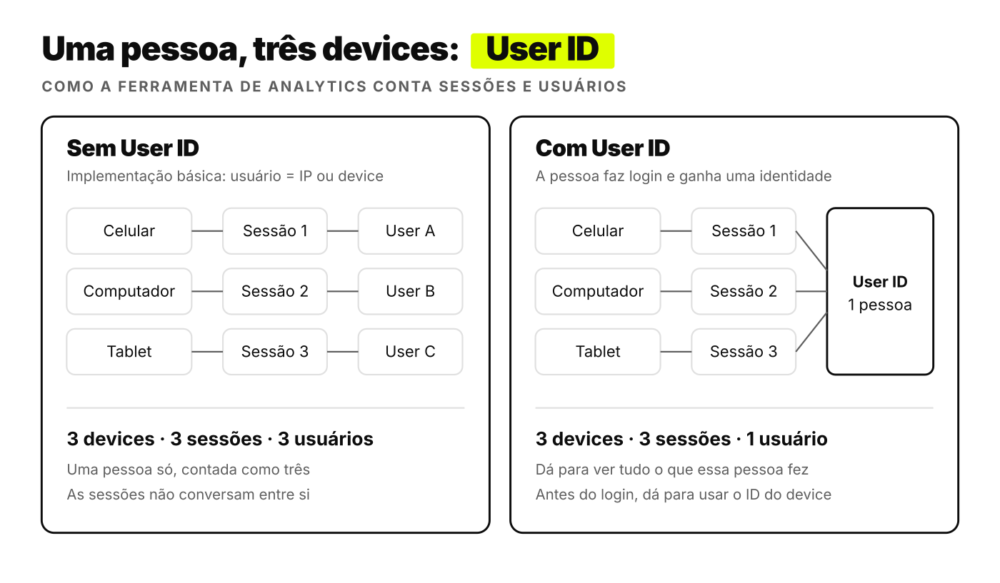
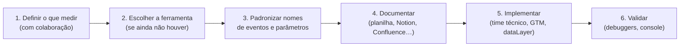

[← Tera · Digital Product Leadership · 02: Métricas para Produtos Digitais](README.md)

# Aula 7: Planejamento e Implementação de Tracking (Tracking Plan) / Tracking planning and implementation

**Expert:** Huxley Dias (founder da PunkMetrics; ex-líder de produto em growth), em conversa com uma facilitadora da Tera · 7 seções

🇧🇷 **Objetivos (checklist da aula):** entender a importância do planejamento estratégico em Product Analytics; as etapas-chave para um plano de análise de dados eficaz; como executar testes com sucesso e interpretar os resultados.

🇺🇸 **Summary:** before collecting data, plan it. Learn the basic analytics vocabulary (session, user, user ID, event, metric, dimension, cookie, hit, attribution), connect business goals to what you measure through collaboration, standardize names, document functionally, implement with tools like Google Tag Manager and the dataLayer, and validate that the data arrives as planned. Tracking is part of the product process: without it, the "measure" in build-measure-learn never happens.

**Agenda da aula:** conceitos básicos de analytics → como planejar o rastreamento (ligar objetivos de negócio às interações que viram métrica) → boas práticas de documentação → validação dos dados → resumo.

## 7.1 Conceitos básicos de analytics / Analytics basics

🇧🇷 Parecem básicos, mas, se forem pulados, dão problema na implementação **e** depois, nas análises. As ferramentas usam os nomes em inglês.

| Conceito | O que é (com as palavras da aula) |
|---|---|
| **Session** (sessão) | Começa toda vez que alguém entra no app ou site, como a campainha que toca quando alguém entra numa loja. Por padrão, na maioria das ferramentas, dura **30 minutos**: saiu e voltou depois disso, é outra sessão. Serve para agrupar tudo o que o usuário fez naquela visita |
| **User** | Medido pelo **IP ou device** da pessoa, não pela pessoa em si (implementação básica) |
| **User ID** | Uma identidade atribuída ao usuário (por exemplo, o ID do cadastro no banco de dados), que liga as ações de vários devices à mesma pessoa. A aula cita que algumas plataformas desaconselham usar dado pessoal, como e-mail, por LGPD e privacidade |
| **Events** | Qualquer ação do usuário: play no vídeo, enviar formulário, adicionar ao carrinho. Hoje até o *page view* é um evento (GA4, Amplitude, Mixpanel, Heap são *event-based*). São "os rastros" que os usuários deixam ao usar o produto |
| **Metrics** | Geradas a partir de um evento escolhido (ex.: contar as adições ao carrinho) ou coletadas por padrão pela ferramenta |
| **Dimension** | Atributo qualitativo de uma métrica, também chamado de **parâmetro** ou **atributo**. É a "perspectiva": sessões **por cidade**, eventos **por device** |
| **Self-service analytics** | Métrica + dimensão: quem tem acesso à ferramenta escolhe métrica, dimensão e período e analisa sozinho |
| **Cookie** | Registra interações e propriedades no navegador; é com ele que muitas ferramentas web separam usuários **novos** de **retornantes**. A aula diz que os cookies tendem a acabar, porque as plataformas estão limitando |
| **Hit / server call** | Cada envio de dado para o servidor da ferramenta. A maioria das ferramentas **cobra por hit**: com um bom plano de mensuração, você **não precisa coletar tudo** |
| **Tag** | Trecho de código que a ferramenta fornece (um para web, outro para app). Instalado no produto, envia os dados ao servidor, que depois aparecem na interface |
| **Modelo de atribuição** | Como atribuir a conversão à origem do tráfego (e-mail, anúncios, WhatsApp…). Comuns: **first click** e **last click**; empresas mais maduras criam o próprio modelo |

🇧🇷 **E se a pessoa ainda não fez login?** A aula explica que dá para usar o **ID do device** (ou *fingerprint*) como identificador provisório e, quando ela faz login ou cria conta, transferir todo o rastro anterior para o User ID novo. Exemplo do expert: num app imobiliário, as pessoas podiam favoritar imóveis sem login; o histórico ficava no device ID e era ligado à conta depois.

> 🇧🇷 **A ferramenta não é o principal.** GA4, Amplitude, Mixpanel, Clarity, Hotjar… todas têm praticamente a mesma mecânica. O que vem primeiro é o seu planejamento: saber o que quer monitorar e que perguntas quer responder.

## 7.2 Plano de rastreamento e coleta de dados / Tracking plan

🇧🇷 As queixas mais comuns dos times: "temos a ferramenta, mas nenhum dado útil" ou "não temos acesso". Para o expert, isso é **falta de colaboração** no planejamento. Coletar tudo traz dois problemas: custo alto e **paralisia de análise** (se metade dos dados não serve, quem chega não sabe o que analisar).

**Como fazer a etapa de colaboração:**
- 🇧🇷 Junte quem tem interesse: produto, design, engenharia, dados (analistas, cientistas, engenheiros), marketing e operações.
- 🇧🇷 Coloque o **objetivo** da empresa, da iniciativa ou do momento à frente de tudo. Exemplo da aula: uma empresa buscando *market fit* foca em aquisição; um SaaS já estabelecido foca em retenção ("retenção é a nova aquisição").
- 🇧🇷 Liste os **objetivos de produto**, os **desafios de dados** (ex.: a ferramenta atual é contratada por mais um ano e não faz tal coisa) e desenhos **aspiracionais** ("eu queria ver um funil assim").
- 🇧🇷 Priorize sempre voltando à pergunta: "isso conversa com o objetivo?". Se não, fica para depois.
- 🇧🇷 Funciona presencial ou remoto (boards online, como o Miro).

**Frameworks, do estratégico ao tático:**

| Nível | Framework | Para que serve na aula |
|---|---|---|
| Estratégico | **OKRs** | Diálogo da empresa inteira, do C-level aos squads |
| ↓ | **AARRR** (métricas piratas) | Métricas por etapa da jornada |
| ↓ | **HEART** | Escolher o objetivo e os **sinais** que os usuários dão ao interagir, que depois viram métricas |
| Tático | **Mapeamento de eventos** (event map) | Prints das telas da jornada lado a lado; marcar onde cada evento dispara e que variável vai junto (ex.: o cupom usado na compra). O time desenha o funil que quer ver |

🇧🇷 O tático é o detalhe da interação: "o usuário clicou em favoritar?", "recebeu erro no formulário?", "mexeu no toggle?". Squads estáveis pensam nisso a cada release, teste A/B ou *feature flag*.

**Padrão de nomenclatura:** antes de implementar, decida português ou inglês, maiúsculas ou minúsculas, traço ou *underline*. A aula compara uma tabela de eventos ilegível com uma legível (categoria "clique no CTA", ação "inscreva-se", label "nome do curso") e mostra o GA4, em que todos os eventos seguem um padrão (minúsculas, *underline*, inglês) e cada um leva parâmetros (session ID, page location, page title). Benefícios: menos esforço para quem lê o dado e menos erros nas transformações e na ingestão.

🇧🇷 **A planilha também vale**, desde que organize e que todos saibam que ali é onde se define a implementação. Dica do expert: ter um campo de **observação ou contexto** para lembrar **por que** aquele evento foi escolhido.

## 7.3 Boas práticas e documentação / Documentation

- 🇧🇷 A documentação nasce dos **artefatos das etapas anteriores**: o board da dinâmica, a planilha.
- 🇧🇷 **Documentação funcional:** nem tão exaustiva que ninguém ache o útil, nem tão curta que deixe de fora detalhe relevante ou técnico. Serve para perfis técnicos e não técnicos. Teste: se outro time pegasse, conseguiria repetir?
- 🇧🇷 **Use a ferramenta que a empresa já usa** (Confluence, Notion, Google Docs…), porque é onde as pessoas já estão. Times de dados podem ter ferramentas dedicadas. "O seu objetivo é ter o dado", não uma documentação linda.
- 🇧🇷 Para quem é técnico: deixar **trechos de código padrão** por tipo de interação e por plataforma (Android, iOS, web, Tag Manager) reduz a barreira de esforço.
- 🇧🇷 **E quem não programa?** Tudo bem: se o planejamento foi bem feito, o time técnico entra em cena. Ferramentas *no-code* ajudam, mas tendem a coletar eventos demais (e encarecer). As documentações das plataformas podem ser enviadas ao time de desenvolvimento.

## 7.4 Validação de dados e implementação prática / Validation and implementation

| Ferramenta ou recurso | O que faz |
|---|---|
| **Google Tag Manager (GTM)** | Muito usado na web (inclusive por marketing, para *tags de conversão*), mesmo com ferramentas que não são do Google. Tem **container** (um por produto: web, iOS, Android, AMP), **variáveis** (atributos como cidade, user ID, plano), **tags** e **triggers** (gatilhos que disparam as tags). Controla quem cria, edita e publica: dá para testar antes de pôr no ar |
| **Tag Assistant** | Mostra o mapa de tags (disparadas e não disparadas) e, ao clicar numa tag, seus eventos, parâmetros e trigger. Serve para validar |
| **Custom dimensions** | Dimensões que só existem no seu produto (ex.: empresa, cargo, tipo de plano num SaaS). Depois viram filtros e segmentações |
| **dataLayer** (camada de dados) | Na web, leva informações que não aparecem na tela (sobre o usuário, o produto visto). O GTM lê o dataLayer por padrão |
| **Console do navegador** | Inspecionar → Console → digitar `dataLayer` mostra a camada de dados de um site |

🇧🇷 **Demonstração do vídeo:** o expert preenche a planilha (evento em minúsculas com *underline* e três parâmetros de exemplo), a planilha gera o código do dataLayer, ele cola no console de um site com GTM e o evento chega no **Mixpanel** e no **Amplitude** com os mesmos parâmetros (há um pequeno atraso, não é tempo real). Validar é isto: conferir, com os *debuggers* de cada ferramenta, se o dado chegou como foi planejado. A aula sugere praticar com contas de teste ou de demonstração das ferramentas.

## 7.5 Resumo do bloco (Lembre-se) / Takeaways

> 🇧🇷 **1. Colaboração faz parte do plano de mensuração.** Não é só técnica: quando as pessoas participam, a cultura de dados se fortalece. Senão, você monta uma coleta que ninguém usa.
>
> **2. Documentação é importante, e ponto.** Feita de forma acionável, traz padronização, confiabilidade e escalabilidade: responde por você quando alguém tem dúvida ou chega no onboarding.
>
> **3. Tracking faz parte do processo de produto.** Juntar pessoas, definir, mapear, documentar, implementar e testar leva tempo. Se não entrar no processo, o *measure* do build-measure-learn "será sempre uma falácia".

**Materiais da aula** (guardados no repositório privado): slides em PDF e a planilha modelo de documentação de eventos indicada pelo expert.

---

[← Tera · Digital Product Leadership · 02: Métricas para Produtos Digitais](README.md)
