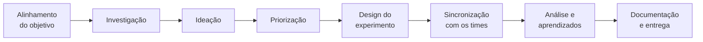

[← Tera · Digital Product Leadership · 02: Métricas para Produtos Digitais](README.md)

# Aula 8: Cultura de Analytics e Planejamento de Testes / Analytics culture and test planning

**Expert:** Huxley Dias, em conversa com uma facilitadora da Tera · 5 seções

🇧🇷 **Objetivos (checklist da aula):** entender a importância da coleta de dados precisa e automatizada em Product Analytics; a importância de uma cultura de experimentação e os princípios-chave da coleta de dados e sua relação com análises de qualidade; ferramentas e técnicas de automação para otimizar processos de experimentação.

🇺🇸 **Summary:** experimentation reduces uncertainty and risk (including financial and brand risk) and turns ideas into structured hypotheses ("based on X, we believe Y will change, measured by Z"). Tools like the Test Card and Learning Card help. To become a culture, experimentation needs a process: goal alignment, investigation, ideation, prioritization, experiment design, team sync, analysis, documentation and delivery. Most experiments fail, and that is learning. Tools (Growth software, feature flags, A/B testing tools) are a means, not the end; consistency beats volume.

## 8.1 Por que experimentar / Why experiment

- 🇧🇷 **Reduzir incertezas, e com isso riscos.** Ao fazer produto, a gente não sabe tudo. Experimentar também permite aprender, errar e corrigir rápido.
- 🇧🇷 Experimentação é "a ponte" entre a cegueira das pessoas (as "verdades" e vieses que todos acumulam) e a realidade das preferências dos usuários. É manter a crença de que sempre há algo a aprender.
- 🇧🇷 Pequenos experimentos soltos dão ganhos periféricos (às vezes por sorte). **Com processo e método**, os ganhos incrementais podem "mudar o jogo" da empresa.
- 🇧🇷 Em tempos de **eficiência de custo**, não há margem para manobras arriscadas (orçamento de mídia, um squad inteiro numa aposta). Experimentar reduz também o **risco financeiro** e o **risco de marca**: se algo der errado, afeta uma parcela pequena da base. Exemplo do expert: num app de logística já conhecido, testes de aquisição de entregadores eram feitos por experimento para evitar exposição da marca.
- 🇧🇷 Modelos de processo com ciclos incrementais e experimentação o tempo todo: **Circular Design** (definir, construir, lançar, entender), **Lean Analytics** (*build, measure, learn*) e o tradicional **PDCA** (planejar, fazer, verificar, agir).
- 🇧🇷 **"E se eu não tenho volume?"** Empresas com muitos usuários testam o tempo todo e aprendem mais rápido; com menos volume, o ciclo leva mais tempo, mas não é motivo para não experimentar. Experimentar vai de validar um modelo de negócio a testar a desejabilidade de uma feature.

## 8.2 De ideia a hipótese / From idea to hypothesis

🇧🇷 **Ideia** qualquer um tem (operação, marketing, financeiro…), e tudo bem. **Hipótese** é diferente: conecta o objetivo do produto, o que se quer fazer, as **evidências prévias** e o que se pretende alcançar. "Tem uma ideia? Transforme em hipótese."

**Anatomia de uma hipótese:**

> **Com base em** *[informação observada: pesquisa, dados da ferramenta de analytics; cite a fonte]*,
> **acreditamos que** *[vai impactar ou mudar algo ligado ao objetivo do negócio]*
> **e será medido através de** *[referência quantitativa ou qualitativa]*.

🇧🇷 **Test Card e Learning Card** (do livro *Testing Business Ideas*, da Strategyzer): o Test Card estrutura a hipótese antes do teste; o Learning Card registra o aprendizado depois.

| Campo do Test Card | O que escrever |
|---|---|
| **Acreditamos que** (*we believe*) | A hipótese e as evidências que levaram a ela |
| **Para verificar** | A ação do teste: campanha, contato com a base, *feature* falsa… |
| **E vamos medir** | A métrica principal, métricas secundárias e a fonte do dado |
| **Estaremos certos se** | O critério de sucesso, com o tamanho do efeito |

💡 **Duas dicas do expert:**
- 🇧🇷 **Métrica de saúde (*health metric*)**, como nos OKRs: escolha uma métrica "defensiva" para não ganhar numa e perder noutra. Exemplo clássico: aumentar cadastros, mas o **CAC** disparar.
- 🇧🇷 **Defina o aumento mínimo válido** no critério de sucesso (peça ajuda ao time de BI ou analytics). Aumentos pequenos podem ser só sazonalidade, um "incremento periférico".

**Exemplo completo da aula:**
- 🇧🇷 **Com base** nos dados da ferramenta de analytics, **acreditamos** que usuários que assistem vídeo convertem 4% a mais.
- 🇧🇷 **Para verificar:** destacar o vídeo ou produzir mais vídeos (uma hipótese pode ter **vários experimentos**).
- 🇧🇷 **Vamos medir:** a conversão de quem viu o vídeo até a página de agendamento.
- 🇧🇷 **Estaremos certos se** a taxa de conversão aumentar 0,7 p.p., **mantendo o mesmo CAC**.

🇧🇷 A facilitadora contou um caso de marketing de performance: comparar o CAC de uma campanha aberta com o de uma campanha para públicos parecidos com os melhores clientes. Mesmo com CAC um pouco mais alto, vale se o retorno compensar. Quando o assunto é dinheiro, ninguém aprova "uma ideia": pedem evidências.

## 8.3 O processo de experimentação / The experimentation process

🇧🇷 Para sair dos experimentos isolados (um time ou uma pessoa com mais apetite) e virar cultura, é preciso um **processo**. Nenhuma etapa é obrigatória: adapte ao seu contexto e comece aos poucos.

| Etapa | O que fazer (segundo a aula) |
|---|---|
| **Alinhamento do objetivo** | Fácil se a empresa usa **OKRs**. Se não, busque o objetivo do squad, da tribo ou pergunte à liderança. O foco pode mudar por ciclo (um trimestre aquisição, outro retenção) |
| **Investigação** | Olhar dados quanti e quali, conversar com usuários e com o atendimento, usar CSAT e NPS. **Não descarte o conhecimento contextual** de quem estudou e praticou UX por anos |
| **Ideação** | Mirar no objetivo e desdobrar oportunidades em hipóteses. Dica: **árvore de oportunidades** (Teresa Torres, *Continuous Discovery Habits*): objetivo → oportunidades → N hipóteses → N experimentos |
| **Priorização** | Focar no que tem mais chance de sucesso: matriz **impacto × esforço**, **ICE** e **RICE**. Muitas ferramentas já trazem esses métodos |
| **Design do experimento** | Interface, *copy*, duração, canal (WhatsApp, e-mail, anúncio pago…) e o esforço de engenharia, quando houver |
| **Sincronização** | Avisar a empresa: qual hipótese, qual experimento, em que parte do produto, por quanto tempo, para que fração da base. Sem isso, outros times acham que o experimento é **bug** |
| **Análise e aprendizados** | **A maioria dos experimentos falha** e isso é aprendizado: registrado, ninguém repete o erro. Um teste que falhou ou foi inconclusivo pode inspirar outro (mesma hipótese, outro desenho) |
| **Documentação e entrega** | Experimentar não é construir a solução: documente o que deu certo e errado e leve ao **backlog** |

**Dois tipos de teste:**

| Tipo | O que é | Exemplo da aula |
|---|---|---|
| **Teste incremental** (*feature flag*) | Já no produto, com o mesmo padrão; se der certo, só libera para o resto da base | Soltar para 5%, depois 10, 20, 50% e, sem problemas, para todos |
| **Teste de descoberta / validação** | Descobrir se uma ideia ou hipótese é boa; se der errado, volta tudo, às vezes sem nada construído | Uma landing page e uma campanha para um novo público antes de construir o produto |

> 🇧🇷 A aula cita uma grande plataforma de reservas que chegou a cerca de **25 testes por mês** e levou esse número ao relatório para investidores, como marca de sucesso. Mas, para a realidade da maioria das empresas, **constância vale mais que volume**.

## 8.4 Implementando um experimento / Running an experiment

🇧🇷 Experimentos podem ser fora do digital (na rua, ou um **concierge**, que simula o serviço antes de existir tecnologia). A aula foca no ambiente digital.

| Ferramenta | Para que serve |
|---|---|
| **GrowthTribe (ferramenta gratuita)** e **GrowthHackers Experiments** | Gestão do processo: cadastrar objetivos, categorias (aquisição, ativação, retenção), hipóteses; priorizar (confiança, facilidade, dados); registrar aprendizados. **Integram com a comunicação** (ex.: Slack): nova hipótese, experimento no ar e resultado viram avisos automáticos |
| **LaunchDarkly** | *Feature flag*: experimento numa feature já pronta, com liberação incremental (5% → 10% → 100%) e **volta atrás sem risco** se algo der errado |
| **VWO (Visual Website Optimizer)** | Teste A/B em web e app, editável por pessoas não técnicas |
| Outras citadas | Optimizely; ferramentas de product analytics com teste A/B (Firebase, Amplitude, Heap). O Google Optimize foi descontinuado |

🇧🇷 O teste **A/B** é o mais popular, mas não o único: existe A/B/C, **multivariável** (várias variações), *split test* e muitos outros.

🇧🇷 Ambientes colaborativos de experimentação deixam as pessoas mais criativas: elas aprendem a montar hipóteses e passam a contribuir. A aula cita o caso clássico da 3M, que incentiva colaboradores a transformar ideias em hipóteses.

**Cases do expert** (num marketplace imobiliário, com hipóteses baseadas em dados do mercado, dados próprios e pesquisa qualitativa):

| Hipótese / experimento | Resultado relatado |
|---|---|
| Informação social na página ("50 pessoas se interessaram por este imóvel"), inspirada nos avisos de escassez de sites de reserva, mas com tom informativo; lançada via *feature flag* | Cerca de **+15%** na conversão em leads e **+17%** na conversão em agendamento de visita |
| Pesquisa quali mostrou que as pessoas saíam da plataforma para pesquisar o **bairro** e acabavam agendando no concorrente; criaram conteúdo curado sobre o bairro | **Bounce rate menor** e **o dobro do tempo de sessão** |
| Favoritar imóvel **sem login** (pedir login no meio do engajamento quebrava a experiência); teste A/B via *feature flag* | Validado antes de liberar para toda a base |

💡 **Tempo de sessão pode ser bom ou ruim:** num cadastro, que deveria ser rápido, mais tempo é ruim; consumindo conteúdo, é bom. **Bounce rate** é quando a pessoa chega e sai logo, sem uma ação que gere resultado.

**Demonstração do vídeo (VWO, experimento hipotético):**
1. 🇧🇷 Instalar o código da ferramenta no site (ou o SDK no app).
2. 🇧🇷 Criar um teste A/B com a URL da página e **associar a hipótese** já registrada (uma hipótese, N testes).
3. 🇧🇷 Ter um **controle** e uma ou mais **variações**; no editor visual, mudar um elemento (no exemplo, o texto do botão para "Comece grátis").
4. 🇧🇷 Definir o **objetivo** (no exemplo, visitar a página de cursos) ou puxar um da ferramenta de analytics.
5. 🇧🇷 Escolher a fração da base (5%, 10%… ou 100% dividido igualmente) e segmentos, se quiser; dar *Start*.
6. 🇧🇷 A ferramenta mostra os resultados, o **nível de confiança** e avisa se precisa de mais tempo ou se o teste será inconclusivo.

🇧🇷 Antes, teste A/B exigia muito conhecimento de estatística e máquinas preparadas; hoje as ferramentas facilitam.

## 8.5 Resumo do bloco (Lembre-se) / Takeaways

> 🇧🇷 **1. Experimentar é reduzir incertezas.** É assumir que não sabemos tudo e descobrir o que é melhor para empresa e usuários com menor exposição a riscos.
>
> **2. Consistência molda a cultura.** Experimentação é ciência: método, rigor e constância. Sem isso, os poucos resultados podem ser confundidos com sorte. Se só um time experimenta, ou se para depois de uma leva, não vira cultura.
>
> **3. Ferramenta não é o fim, é o meio.** O importante é o processo; as ferramentas ajudam a criar o hábito. Comece barato, comece grátis.

**Para aprofundar (indicação da aula):** livro *Testing Business Ideas*, de Alex Osterwalder e David J. Bland.

**Materiais da aula** (guardados no repositório privado): slides em PDF.

---

[← Tera · Digital Product Leadership · 02: Métricas para Produtos Digitais](README.md)
