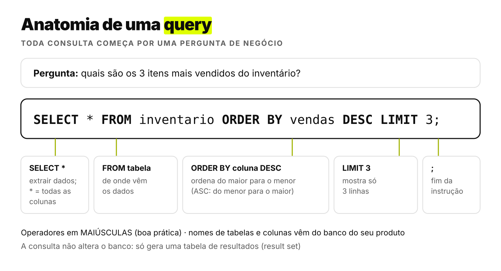

[← Tera · Digital Product Leadership · 02: Métricas para Produtos Digitais](README.md)

# Aula 9: SQL para PMs: comandos básicos para consultas rápidas / SQL for PMs

**Aula em texto** (sem vídeo) · autoria: Ajitesh e Jo Engreitz; tradução e adaptação: Time Tera · 4 seções

🇧🇷 **Objetivos (checklist da aula):** onde e para quê usar SQL na gestão de produtos digitais; os elementos e a sintaxe básica da linguagem; como usar operadores básicos para responder perguntas sobre o produto.

🇺🇸 **Summary:** SQL is the language for "talking" to relational databases. As a PM you mostly read data (the R in CRUD) with queries that start from a business question. Learning SELECT, FROM, WHERE, ORDER BY, LIMIT, IN, BETWEEN, LIKE, IS NULL and a few functions makes you more autonomous to follow KPIs and understand your product. If you lack access, ask a data or engineering colleague for read-only credentials.

## 9.1 O que é SQL / What SQL is

- 🇧🇷 Pense num banco de dados como uma planilha com **milhares de abas**, cada uma com milhares de colunas e linhas sendo preenchidas o tempo todo. Uma planilha não dá conta, e nossa mente também não.
- 🇧🇷 **SQL** é a linguagem criada para "conversar" com bancos de dados: selecionar trechos de uma tabela, juntar dados de tabelas diferentes e calcular valores.
- 🇧🇷 **Banco de dados relacional:** cada linha é um **registro** com um ID único, a **chave** (*key*); as colunas são **atributos**. O cruzamento de linhas e colunas gera os dados.
- 🇧🇷 Os dados ficam na nuvem; em vez de baixar o banco todo, fazemos **consultas** (*queries*) para ver recortes e cruzamentos.
- 🇧🇷 Cada empresa usa uma interface (ex.: SQLyog, MySQL Workbench, Sequel Pro), mas a linguagem é sempre SQL. Se a empresa não tem uma infraestrutura de dados organizada, comece por aí.
- 🇧🇷 **CRUD** (*Create, Retrieve, Update, Delete*): como PM, na maior parte das vezes você só vai **ler** (*retrieve*). Criar, atualizar e excluir fica com o time de desenvolvimento.

> 🇧🇷 **A parte mais importante de uma boa análise é saber fazer as perguntas certas.**

**Por que aprender SQL sendo PM (segundo a aula):**

| Motivo | O que significa |
|---|---|
| **Acompanhar seus KPIs de perto** | Monitorar, ajustar o que mede, achar oportunidades e manter stakeholders informados |
| **Ser autossuficiente** | Não depender (nem ocupar) analistas e devs para cada consulta: decisões mais rápidas. Importante em startups sem time de dados |
| **Entender o produto mais a fundo** | Saber onde estão os dados ajuda a antecipar tendências, medir lançamentos e experimentos e planejar campos novos nas tabelas |

🇧🇷 **E se eu não tiver acesso aos dados?** Chame alguém de desenvolvimento, engenharia ou dados para um café, explique a necessidade, entenda como os dados são guardados e peça credenciais. Descubra a interface usada e veja um tutorial básico sozinha, para não ocupar a pessoa especialista. **Permissão só de leitura** já basta. Com acesso, conheça as tabelas, as colunas e como elas se relacionam.

## 9.2 Fazendo consultas / Writing queries

🇧🇷 Uma *query* é seu código pedindo informação ao banco; a resposta vem como uma tabela (a **tabela de resultados**, ou *result set*). A consulta **não altera** os dados (já o `DELETE` apaga, se você tiver permissão).

🇧🇷 **Toda consulta começa por uma pergunta de negócio**, como: "Que porcentagem dos usuários vira cliente pagante em até 2 semanas após a inscrição?" ou "Qual é o lifetime value médio por cliente?".

**Quadro-resumo com os exemplos da aula:**

| Operador | Para que serve | Exemplo da aula |
|---|---|---|
| `SELECT … FROM …` | Escolher colunas de uma tabela (`*` = tudo) | `SELECT id_cliente, compras FROM pagamentos;` (quanto cada cliente gastou) |
| `LIMIT 1` | Dica para espiar as colunas de uma tabela | `SELECT * FROM nome_tabela LIMIT 1;` |
| `AS` | Dar um apelido (*alias*) à coluna; com mais de uma palavra, entre aspas | `SELECT nome_cliente, id_vendedor AS "Lista de Vendedores" FROM clientes;` |
| `ORDER BY … ASC/DESC` | Ordenar (pode combinar colunas, separadas por vírgula) | `SELECT * FROM clientes WHERE local = 'Belo Horizonte' ORDER BY transacoes_mensais DESC;` |
| `LIMIT n` | Mostrar só uma amostra | `SELECT * FROM inventario ORDER BY vendas DESC LIMIT 3;` |
| `WHERE` | Filtrar por condição: `=`, `<`, `>`, `<=`, `!=` | `SELECT * FROM clientes WHERE transacoes_mensais > 200;` |
| `AND` / `OR` | Combinar condições | `SELECT titulo FROM livros WHERE autor = 'José Saramago' AND primeira_publicacao < 2000;` |
| `IN` / `NOT IN` | Dentro ou fora de uma lista de valores | `… WHERE cidade NOT IN ('São Paulo', 'Rio de Janeiro')` |
| `BETWEEN … AND …` | Dentro de um intervalo | `… WHERE idade BETWEEN 18 AND 24;` |
| `LIKE` com `%` | Buscar termo parcial; `%` é o "coringa" (um ou mais caracteres) | `SELECT * FROM aulas WHERE nome LIKE '%dados%'` |
| `IS NULL` / `IS NOT NULL` | Campo vazio / preenchido | `… WHERE coluna IS NULL;` |

**Funções citadas:**
- 🇧🇷 `UPPER(nome)`: tudo em maiúsculas.
- 🇧🇷 `CONCAT(primeiro_nome, ' ', sobrenome) AS "Nome Completo"`: junta colunas.
- 🇧🇷 `REPLACE(estado, 'São Paulo', 'SP')`: troca valores.
- 🇧🇷 `AVG(custo) AS media`: média de uma coluna numérica. (O exemplo do texto da aula escreve `AVERAGE`, mas a função apresentada é `AVG()`.)

💡 **Boas práticas da aula:** operadores em **MAIÚSCULAS** (funcionam em minúsculas, mas ficam mais fáceis de ler); **`;`** no fim da instrução; os nomes de tabelas e colunas vêm da arquitetura de dados do seu produto.

> 🇧🇷 **Não precisa decorar.** O importante é entender o processo de consulta e saber onde voltar para relembrar. A linguagem fica na cabeça com o uso no dia a dia.

**Para aprofundar (indicações da aula, todas em inglês):** minicurso em vídeo *MySQL Tutorial for Beginners* (3 horas, gratuito); *SQL Tutorial* da W3Schools (para praticar); *Learn SQL* do Tutorials Point (guia rápido de sintaxe).

---

[← Tera · Digital Product Leadership · 02: Métricas para Produtos Digitais](README.md)
