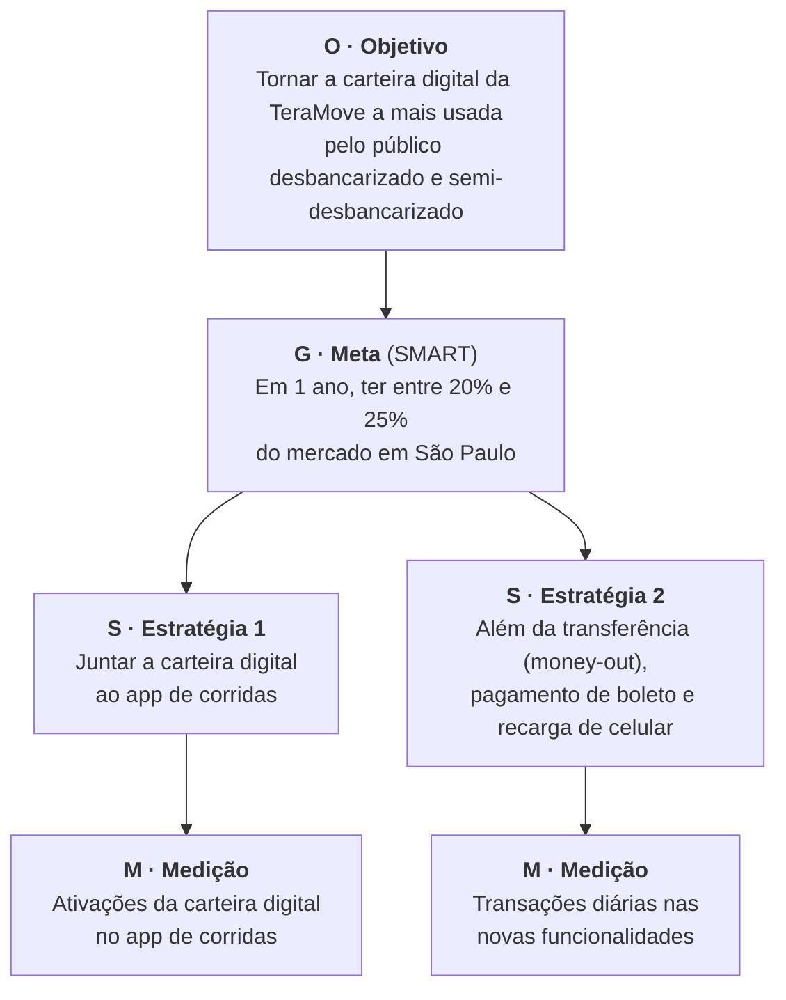

[← Tera · Digital Product Leadership · 02: Métricas para Produtos Digitais](README.md)

# Aula 11: Desafio: tomada de decisão com KPI / Challenge: KPI-based decision making

**Expert:** Henrique Santana (Head of Data and Machine Learning numa startup de atendimento), com um facilitador da Tera · 5 seções

🇧🇷 **Objetivo de aprendizagem:** aplicar o conceito de KPI para avaliar o crescimento de uma empresa.

🇺🇸 **Summary:** a fictional ride-hailing company, TeraMove, adds a digital wallet (bill payments, transfers, phone top-ups). The challenge: define goals and KPIs for both businesses. The expert's approach uses OGSM (Objectives, Goals, Strategies, Measures), with SMART goals: make the wallet the most used among the unbanked, reach 20–25% market share in São Paulo in one year, merge wallet and rides apps, and measure wallet activations and daily transactions of the new features.

## 11.1 O desafio / The challenge

🇧🇷 **TeraMove** (empresa fictícia) é um app de corridas compartilhadas: o cliente chama, o motorista leva do ponto A ao B, o pagamento é pelo app. A empresa lançou uma nova funcionalidade: **pagar boletos, transferir dinheiro para contas de outros apps e recarregar celular**. Ou seja, agora há **dois modelos de negócio**: corridas e serviços financeiros.

> 🇧🇷 **Tarefa:** definir os KPIs e os objetivos do negócio, considerando as métricas de corridas **e** as do serviço financeiro. Dica do expert: partir de **SMART** e **OKRs**.

🇧🇷 **Risco citado no vídeo:** com saída de dinheiro, aparece o **risco de fraude**. Exemplo: alguém com cartões roubados testa na plataforma e, quando o dinheiro cai, transfere de conta em conta até ficar difícil rastrear.

## 11.2 A abordagem do expert: OGSM / The expert's approach

🇧🇷 "Ferramenta muda": dá para usar OKRs, SMART ou outra. O expert escolheu a **OGSM**, que já usou em outras empresas.

| Letra | Significado | No desafio |
|---|---|---|
| **O** | *Objectives*, objetivo (a visão macro) | A carteira mais usada entre desbancarizados (muita gente ainda não tem conta e usa dinheiro físico) |
| **G** | *Goals*, meta (usando **SMART**: específica, mensurável, alcançável, relevante, com prazo) | 20% a 25% de *market share* em São Paulo, em 1 ano |
| **S** | *Strategies*, estratégias | Um app só, em vez de dois da mesma empresa; novas funções financeiras |
| **M** | *Measures*, medições (os KPIs) | Ativações da carteira (se não clicou na carteira, não é usuário ativo); transações diárias |

- 🇧🇷 **Por que medir ativações:** o **CAC** da carteira é baixo, porque a base de clientes já existe (não precisa buscar gente nova no mercado). O desafio é fazer essas pessoas **ativarem**.
- 🇧🇷 **Por que medir transações:** de nada adianta criar a carteira se todo mundo continuar usando só as corridas.
- 🇧🇷 **Prazo:** a OGSM é muito usada por grandes corporações para **objetivos de longo prazo** (aqui, 1 ano). Dá para quebrar em prazos menores, como nos OKRs, e usar outras metas (número de clientes, de ativações).

## 11.3 Dica final / Final tip

> 🇧🇷 **Invista na multidisciplinaridade.** Se você vem de dados, aproxime-se do negócio (métricas, metodologias, KPIs); se vem do negócio, aproxime-se de dados. Assim fica mais fácil entender as dores e resolver os problemas da empresa.

**Checklist da Tera:** como aplicar o conceito de KPI para avaliar o crescimento de uma empresa; como resolver o desafio de negócio proposto.

**Materiais da aula** (guardados no repositório privado): slides "KPI: Desafio Prático" em PDF.

---

[← Tera · Digital Product Leadership · 02: Métricas para Produtos Digitais](README.md)
