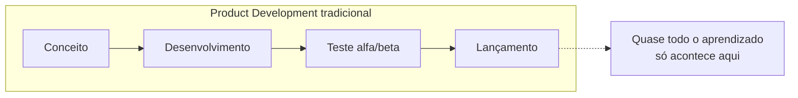
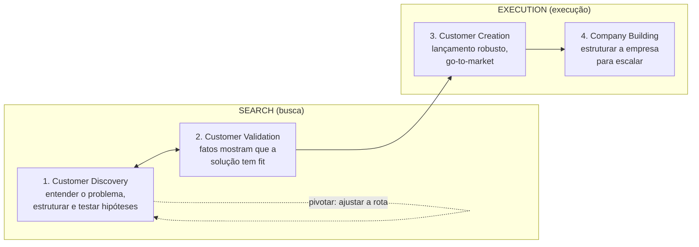

# Tera · Digital Product Leadership · 03: Introdução a Product Discovery

| Campo / Field | Valor / Value |
|---|---|
| Escola / School | Tera |
| Curso / Course | Digital Product Leadership (DPL), formação com 6 módulos / 6-module program |
| Módulo / Module | 03 · Introdução a Product Discovery |
| Situação / Status | 🟡 Em andamento · 2 de 21 aulas / In progress · 2 of 21 lessons |
| Fonte / Source | [Tera: Digital Product Leadership](https://plataforma.somostera.com/formations/digital-product-leadership) (login) |

🇧🇷 Sobre o módulo: depois das métricas (o que está acontecendo), o discovery busca o **porquê**: comportamentos, dores e motivações das pessoas, transformados em hipóteses para o negócio.

🇺🇸 About: metrics show what is happening; discovery explores why, through research, investigation and hypothesis generation.

## Aulas / Lessons

| # | Aula / Lesson | Professor(a) / Instructor | Situação / Status |
|---|---|---|---|
| 1 | Os dados levantam perguntas para explorar | Time Tera (vídeo de abertura) | ✅ |
| 2 | Customer Development | Eduardo Magalhães | ✅ |
| 3 | Product-Market Fit (PMF) | | ⬜ |
| 4 | Produto Mínimo Viável (MVP) | | ⬜ |
| 5 | Definição de hipóteses e leitura de dados | | ⬜ |
| 6 | Métodos de pesquisa | | ⬜ |
| 7 | Consolidação de pesquisa em produtos | | ⬜ |
| 8 | Personas | | ⬜ |
| 9 | Mapa da jornada de experiência | | ⬜ |
| 10 | Q&A: Persona | | ⬜ |
| 11 | Q&A: Mapa da jornada de experiência | | ⬜ |
| 12 | Cultura de experimentação | | ⬜ |
| 13 | Design de experimentos | | ⬜ |
| 14 | Q&A: Experimentação e mitigação de riscos | | ⬜ |
| 15 | Prototipagem rápida | | ⬜ |
| 16 | Arquitetura da informação na prototipagem de novas soluções | | ⬜ |
| 17 | Mitigação de riscos no processo de discovery | | ⬜ |
| 18 | Continuous Discovery na prática | | ⬜ |
| 19 | Q&A: Prototipagem rápida | | ⬜ |
| 20 | Conclusão: Introdução a Product Discovery (recap + teste) | Tera | ⬜ |
| 21 | Desafio do mercado: Product Discovery | | ⬜ |

---

## 1. Os dados levantam perguntas para explorar / Data raises questions to explore

**Vídeo curto de abertura do módulo** · 1 seção

🇧🇷 **Métricas mostram o que está acontecendo, mas não explicam o porquê.** Com o discovery, a pergunta muda de "o quê?" para "**por quê?**": sair do território dos números e entrar no da **curiosidade** e da **escuta ativa**.

- 🇧🇷 Discovery **não é ter ideias geniais**, é **fazer as perguntas certas**.
- 🇧🇷 É ir além da superfície dos dados e mergulhar em **comportamentos, dores, desejos e motivações** das pessoas, para transformar dados em **hipóteses** relevantes para o negócio.
- 🇧🇷 O módulo amplia o repertório com técnicas de **pesquisa, investigação e geração de hipóteses**, para liderar "com mais contexto e menos achismo".

🇺🇸 **Summary:** metrics tell you what; discovery asks why. It is about asking the right questions, not having genius ideas.

---

## 2. Customer Development

**Expert:** Eduardo "Dudu" Magalhães (GPM numa empresa de automação de marketing; antes, apps de entretenimento infantil e de serviços para pets), com a facilitadora Letícia Petarnela · 8 seções

🇧🇷 **Objetivos (checklist da aula):** entender o processo de desenvolvimento de clientes (*customer development*) a partir da identificação de problemas e tarefas; os benefícios desse modo de pensar para focar no produto certo e comunicar a visão de produto; como criar declarações de hipóteses e de JTBD (*jobs to be done*).

🇺🇸 **Summary:** build an initial view of the problem from facts and evidence, not just conviction. Use the CSD matrix (certainties, suppositions, doubts) and aim for a "plausible vision" through short learning cycles. Answer First (you already have the answers, go validate) vs Answer Last (you need discovery). Customer Development (Steve Blank) seeks product/market fit in four steps: customer discovery, customer validation, customer creation, company building. Jobs to be Done: customers "hire" products to get a job done; write jobs as action verb + object + context.

### 2.1 Quem já viveu essa situação? / Conviction vs evidence

🇧🇷 **A cena clássica:** numa reunião, alguém sugere "vamos fazer aquela feature do app chinês que faz sucesso". É uma ideia baseada só em **convicção**. Problemas:
- 🇧🇷 sem fatos e evidências, a chance de falhar é grande;
- 🇧🇷 o time não "compra" a ideia: a pessoa desenvolvedora não sabe para onde está indo, o designer pergunta "por que fazer isso?".

🇧🇷 **O caminho positivo: revisitar o que você já aprendeu** para montar uma visão inicial do problema:
- 🇧🇷 seu histórico pessoal e profissional; métricas de produto e de negócio;
- 🇧🇷 *discoveries* passados, entrevistas com clientes, usuários e stakeholders;
- 🇧🇷 outros produtos (concorrentes ou próximos) que resolveram bem o problema;
- 🇧🇷 conversas com mentores e referências; suas **falhas**; leituras, cursos e vídeos.

> 🇧🇷 A facilitadora reforça: **não use uma fonte só** (por exemplo, só benchmark). Um caminho só pode trazer exatamente a resposta que você queria ouvir.

**Matriz CSD:** organize o que você sabe em **Certezas** (sei que sei), **Suposições** e **Dúvidas** (sei que não sei). Dúvidas e suposições pedem análise e descoberta para serem respondidas, reforçadas ou refutadas.

**A matriz de visões do expert** (eixo vertical: convicção; eixo horizontal: evidências). Quanto mais para cima e para a direita, mais capital investido em descoberta e menos risco:

| Visão | Convicção × evidência | Armadilha |
|---|---|---|
| **Empírica** | Alta convicção, **baixa evidência** | Apaixonar-se pela solução e não perceber que está aqui: o **paradoxo do product manager** |
| **Validada** | Alta convicção, **alta evidência** | O "buraco do coelho": tentar validar todos os riscos e cair num **discovery eterno**. Faz mais sentido numa scale-up do que numa startup em estágio inicial |
| **Plausível** ✅ | Convicção **fortalecida** por evidências e aprendizados | É a meta: ciclos curtos de aprendizado, como propõe o Customer Development |

🇧🇷 **O paradoxo do product manager (história do foguete):** um time passa 90 dias desenhando a solução perfeita para levar pessoas do ponto A ao B: um foguete com 400 features. O cliente aprova, mas exige lançamento em 7 dias. O escopo cai para 4 features; o time segue apaixonado e gasta fortunas em divulgação (celebridades, intervalos caríssimos). No dia 100, lança; no 101, zero vendas, e o CAC fica proibitivo. Só no dia 113, ouvindo as pessoas, descobre que elas precisavam de uma **bicicleta e um capacete**.

**Answer First × Answer Last:**

| | Quando acontece | O que fazer |
|---|---|---|
| **Answer First** (respostas primeiro) | Você faz perguntas sobre o problema e **já tem as respostas** no que aprendeu; as certezas superam suposições e dúvidas | O discovery "já está feito": parta para **validar** a hipótese de solução. Ganha cadência. Cuidado: o desenvolvimento também precisa ser curto |
| **Answer Last** (respostas por último) | As perguntas **não têm resposta**; suposições e dúvidas dominam a matriz CSD | Faça **discovery**: use técnicas e métodos para aprender mais sobre o problema |

🇧🇷 **Caso contado pelo expert (Answer First):** numa plataforma de hospedagem de pets, o crescimento de clientes novos ano contra ano caía mês a mês (de 5× para 3× e depois 2×). Em uma hora, só com dados que já existiam, ele achou o problema nos mercados novos: a **taxa de entrega dos pushes** era baixa, a **taxa de resposta** dos anfitriões também, e poucos respondiam em até 10 minutos (o grupo que mais converte). Hipótese levada ao time: mandar o aviso também por **WhatsApp**. O time comprou a ideia, desenvolveu em uma tarde, testou num país só e teve a melhor semana regular naquele mercado.

🇧🇷 **Caso Answer Last, na mesma empresa:** a ideia de criar um novo serviço (creche, visita, veterinário em casa) esbarrava em perguntas sem resposta (ticket médio, quem são os clientes, que fricções existem), então rodaram um **discovery**.

> 🇧🇷 Com o racional estruturado em fatos ("nossas taxas de entrega, resposta e tempo de resposta estão derrubando os clientes novos; será que um aviso por WhatsApp melhora isso?"), o time entende o caminho e se engaja.

**Para aprofundar (indicações da aula):** vídeo curto de Steve Blank definindo Customer Development; o verbete "Método dedutivo" na Wikipédia (lógica dedutiva para formular hipóteses e argumentar).

### 2.2 Por que as empresas falham? / Why companies fail

🇧🇷 **A maior falha do expert** (num app global de entretenimento infantil, para crianças de 2 a 5 anos): para aumentar os usuários ativos mensais (MAU), criou um app irmão de desenhos com humor "mais ácido" para crianças de **5 a 10 anos**. O time tinha certeza: 3 meses de desenvolvimento + 1 mês de *go-to-market* caro, lançamento global com destaque nas lojas. Esperavam 1,5 a 2 milhões de MAU.
- 🇧🇷 1º mês: muitos downloads, mas só **15 mil MAU**; 2º mês: **2 mil**; 3º mês: o app foi **tirado das lojas**.

**Por que falhou:**
1. 🇧🇷 **Visão empírica** não reconhecida: todos estavam apaixonados pela ideia.
2. 🇧🇷 **Faixa de idade larga demais:** uma criança de 5 anos é muito diferente de uma de 8 ou 10; eram várias personas, com dores que ele não conhecia.
3. 🇧🇷 **Lançamento global e caro** antes de validar: CAC altíssimo.
4. 🇧🇷 **Aprendizado tardio** (só no 6º mês): nessa idade as crianças preferem **jogos** a desenhos.
5. 🇧🇷 Até houve teste de usabilidade, mas com **viés de confirmação**: ele "convenceu" as crianças de que o app era ótimo.
6. 🇧🇷 Era uma **vitamina** (*nice to have*), não um **analgésico** (*painkiller*, *need to have*): as crianças baixavam, viam um desenho e desinstalavam.

🇧🇷 No modelo clássico de *product development*, quase não se aprende nas fases de conceito, desenvolvimento e teste; o aprendizado chega só no **lançamento**, quando já se gastou muito.

> 🇧🇷 "Nada garante tanto que um produto vai falhar quanto entender mal o problema que ele resolve." (Lenny Rachitsky, citado na aula)
>
> 🇧🇷 "Dor + reflexão = progresso" (Ray Dalio, citado pelo expert): errar é aprendizado, mas é preciso **errar rápido**.

🇧🇷 **A virada (pivô):** aproveitando pequenos testes de jogos casuais que já existiam, o time reusou a estrutura do app que falhou e lançou uma primeira versão **mínima** (uma bandinha e um único jogo), **só num país**, sem barulho, focada em crianças de **5 e 6 anos**. Métrica: **retenção semanal**, que passou de 75% (no app que falhou era menor que 10%; amostra bem menor, ressalva o expert). Depois, foram somando jogos e personalizações a partir do feedback de pais e crianças e abrindo mercados: em 6 ou 7 meses, cerca de **2,5 milhões de MAU** e prêmios de melhor app infantil. É a **visão plausível** na prática.

> 🇧🇷 Pivotar é bom, diz o expert, "só não demorem seis meses para pivotar".

### 2.3 O que é Customer Development / What it is

🇧🇷 **Customer Development** (metodologia de **Steve Blank**, base do movimento Lean Startup) é o processo de buscar o alinhamento entre produto e mercado, o **product/market fit**: o produto resolve uma dor e o mercado responde (as pessoas compram e usam com recorrência).

- 🇧🇷 **Tudo começa no problema**, declarado de forma clara e objetiva, **sem viés de solução**. Mesmo quando chega um pedido de feature, nosso papel é entender que problema ele resolve.
- 🇧🇷 Soluções são **hipóteses**, não certezas: testar, validar e renovar em ciclos cada vez mais curtos.

> 🇧🇷 "Antes de começar a vender, você precisa investir tempo e dinheiro na tarefa de entender o que seu cliente precisa." (Steve Blank)

| Etapa | O que acontece |
|---|---|
| **Customer Discovery** | Entender o problema e estruturar a hipótese. "*Get out of the building*": saia do escritório (ou da sala do Zoom) e converse com as pessoas para validar ou refutar. Se a tese não se sustentar, **pivote** cedo, antes de investir capital ou escrever código |
| **Customer Validation** | Fatos e evidências mostram que a solução encontrou fit. Discovery e Validation formam um **ciclo**: refina-se a hipótese até validar |
| **Customer Creation** | Com o PMF, é hora do lançamento robusto: *go-to-market*, versão evoluída do MVP |
| **Company Building** | Montar as áreas da empresa (produto, tecnologia, atendimento…) e buscar investimento para escalar |

🇧🇷 **Exemplo do expert (MVP sem código):** os fundadores de uma plataforma de hospedagem de pets começaram com **duas landing pages**: uma para tutores que querem viajar e outra para quem quer hospedar cães. Com um pouco de tráfego pago, juntavam **à mão** tutor e anfitrião próximos e compatíveis num **grupo de WhatsApp**, onde negociavam; o pagamento era por boleto. O sinal de fit: a demanda cresceu tanto que o modelo artesanal não dava mais conta, com aquisição recorrente e um negócio repetível e escalável. Só então vieram a execução, a contratação do primeiro PM e as áreas da empresa.

**Exercício 1 da aula: entendimento do problema.** Responda com a máxima clareza:
1. 🇧🇷 Qual é o problema que seu produto tenta resolver?
2. 🇧🇷 Quem tem esse problema (persona ou protopersona)?
3. 🇧🇷 Como essas pessoas resolvem esse problema hoje? (Mostra as lacunas que seu produto pode preencher.)

**Exercício 2 da aula: elaboração de hipóteses.** Uma boa hipótese:
- 🇧🇷 **não é pergunta, é afirmação** (frase com ponto final);
- 🇧🇷 é **simples** e expressa o que se espera;
- 🇧🇷 **pode ser negada**;
- 🇧🇷 é **quantificável**.

> 🇧🇷 **Modelo:** Nós acreditamos que **[fazendo tal coisa]** para **[essas pessoas]** resultará **[nesse resultado]**. Saberemos que isso é verdade quando tivermos **[esse feedback do mercado]**.
>
> O resultado é um benefício mais emocional; o feedback do mercado é analítico, medido por métricas de negócio ou de produto.

🇧🇷 **Exemplo do vídeo:** contratados pelo Ministério da Saúde no início da pandemia: "Nós acreditamos que **um plano estruturado de vacinação** para **o grupo de risco** (profissionais de saúde, idosos, pessoas com comorbidades) resultará na **desaceleração dos casos ativos** (e, assim, menos mortes). Saberemos que é verdade quando a **média móvel de casos ativos** desse grupo cair **15% ou mais** semana a semana." Por que 15%? Segundo especialistas, variações de até 15% indicam estabilidade; acima disso, queda (ou alta).

### 2.4 Jobs to be Done (JTBD)

🇧🇷 Ao comprar um produto, você não compra o produto em si, mas a **tarefa** (*job*) que ele permite realizar. Exemplo do expert: ao contratar a hospedagem do cachorro, ele não comprou "o anfitrião", comprou a possibilidade de **viajar**.

- 🇧🇷 Conceito de **Clayton Christensen** (livro *Muito Além da Sorte*): você "contrata" um produto para realizar um *job*.
- 🇧🇷 JTBD é uma **lente** para observar como concorrentes e consumidores atendem às necessidades das pessoas: o foco sai de **o que o público quer comprar** para **o que ele quer resolver**.
- 🇧🇷 Erro comum: confundir *job* com **fluxo dentro do produto**.

> 🇧🇷 "Um job pode ser um objetivo, uma meta ou uma tarefa, um problema a ser resolvido, algo a ser evitado, uma meta de 'ser ou fazer', qualquer coisa que as pessoas estão tentando realizar." (Anthony Ulwick)
>
> 🇧🇷 "As pessoas não querem uma furadeira, querem um buraco na parede" (Theodore Levitt). E, no fundo, nem o buraco: querem **pendurar o quadro e deixar a sala mais bonita**. A facilitadora completa: comprou uma parafusadeira não para montar o móvel, mas para **ter** a mesa e jantar.

**Como escrever um job:** **VERBO DE AÇÃO + OBJETO DE AÇÃO + CONTEXTO** (atingindo um propósito).

| | Exemplo da aula | Por quê |
|---|---|---|
| ✅ Válido | **Ouvir música** enquanto vai ao trabalho | Reflete a tarefa (se entreter no metrô) |
| ❌ Inválido | Criar uma playlist no Spotify | É um **meio**, quase um fluxo de produto; dava para usar outro streaming, um podcast, um filme |

**Exercício 3 da aula:** defina o **job principal** do seu produto usando verbo + objeto + contexto.

**Para aprofundar (indicações da aula):** *Muito Além da Sorte*, de Clayton Christensen; *Jobs to be Done: Theory to Practice*, de Anthony W. Ulwick (em inglês); guia de Jobs to be Done (2022) do expert Sulivan Santiago, em duas partes.

### 2.5 Resumo da aula e perguntas e respostas / Recap and Q&A

> 🇧🇷 **Lembre-se:**
> - Estruture uma visão inicial do problema com base em **fatos e evidências**.
> - Saia da **visão empírica** para a **visão plausível**.
> - **Falhas geram aprendizado:** falhe rápido, em ciclos curtos.
> - O **JTBD** ajuda a entender a tarefa que as pessoas querem completar, para então trabalhar na solução.

🇧🇷 O que mais marcou a facilitadora: na vida de PM a gente erra; o pulo do gato é **reconhecer o erro e mudar a rota o quanto antes**, gastando menos e aumentando a chance de sucesso.

**Perguntas e respostas (resumo das respostas do expert):**

| Pergunta | Resposta |
|---|---|
| Como se sentiu ao descobrir que estava falhando? | Desesperado, com medo de ser demitido. Mas a cultura da empresa ajudou: não houve "caça às bruxas"; montaram juntos um plano de 90 dias, que gerou o pivô. A facilitadora lembra o conceito de **antifrágil** (Nassim Taleb): criar oportunidade a partir do caos |
| Em produtos que não são *painkillers* (ex.: rede social), a validação muda? | Não. Problema claro, nivelar o conhecimento, levantar hipóteses e testar, em qualquer mercado |
| Qual a relação entre Customer Development e Product Discovery? | O discovery faz parte do Customer Development: é o passo para **mitigar riscos** quando sua tese não tem dados suficientes (o *Answer Last*). Ash Maurya (*Running Lean*): discovery é essencialmente mitigar riscos |
| Faz sentido usar Customer Development para evoluir uma hipótese? | Sempre. Acertar "de primeira", só na fé, é raro, e o acerto seguinte tende a falhar |
| Preciso de uma linha de base para validar? | Sim: saber **qual métrica ou evidência** dirá se deu certo, e estabelecer a relação de **causalidade**. A hipótese deve ser respondida com **sim ou não**; um "não sei" no fim costuma vir de um problema mal declarado |
| E os problemas que geram monetização? | Product/market fit não é só resolver a dor: é achar um **modelo de negócio repetível e escalável**, em que as pessoas paguem. Pense no modelo de negócio desde o início |
| JTBD é do ciclo de vida ou do discovery? | Ajuda a **entender o problema**: qual tarefa a pessoa precisa cumprir para resolver a dor. A facilitadora: se o job é deixar a sala bonita, talvez uma fita dupla face resolva melhor que a furadeira |
| Um produto pode ter jobs principais e secundários? | Pode: o job do produto se desdobra em jobs de features. Cuidado para não criar job atrás de job e não sair do lugar |
| O job vem depois das hipóteses de dor? | O job ajuda a entender o problema; com problema claro e tarefa entendida, criam-se as hipóteses de solução |
| Então a playlist não deveria existir? | Deveria: ela é o **habilitador**, o meio para o job "ouvir música" |
| Um exemplo real de job? | No app infantil, o job é do **pai ou da mãe**: ter um momento de paz (no avião, no restaurante, no home office) enquanto a criança se entretém |
| Problema, job e hipóteses são do time ou da PM? | Depende do estilo; o expert envolve o time (diversidade de visões gera soluções melhores). A facilitadora: quando o time constrói junto, ele "compra" a ideia |

🇧🇷 **Dica de leitura citada pelo expert:** *The Making of a Manager*, de Julie Zhuo: escrever o próprio pensamento ajuda a ver se ele está claro. Por isso o expert insiste em **declarar** o problema e testar se outras pessoas entendem.

### 2.6 Conclusão / Wrap-up

> 🇧🇷 **Mensagem final:** a carreira de produto pede **aprendizado contínuo** e mentalidade de crescimento (*growth mindset*). A facilitadora: é nos erros que mais se aprende, não carregue a pressão de não poder errar.

🇧🇷 **Exercício sugerido pela facilitadora:** pense na motivação de produtos que você usa (um app de delivery, um streaming). Qual era a dor? Como se pedia pizza há alguns anos, e qual era o problema? Responda as três perguntas: **qual é o problema, para quem e como se resolve hoje?**

**Checklist da Tera:** o processo de *customer development* a partir de problemas e tarefas; os benefícios desse pensamento para focar no produto certo e comunicar a visão; como criar declarações de hipóteses e de JTBD.

**Materiais da aula** (guardados no repositório privado): slides "Customer Development" em PDF.
