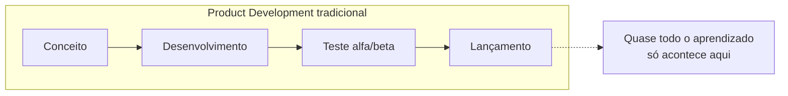
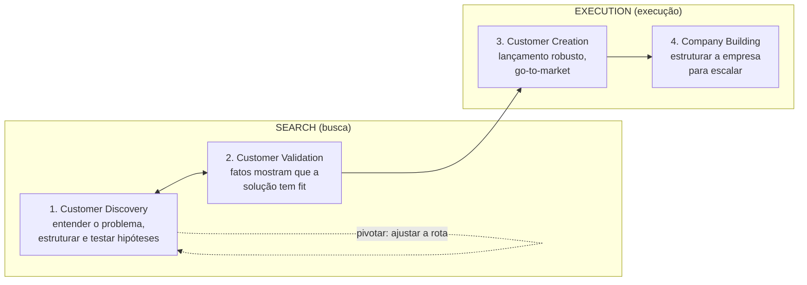
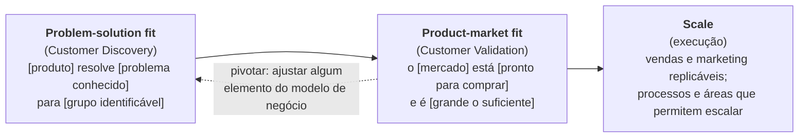
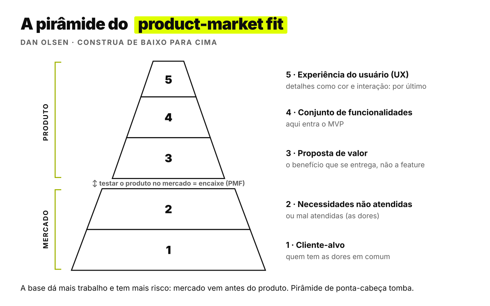
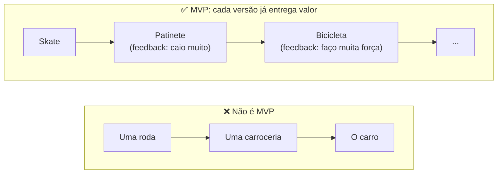
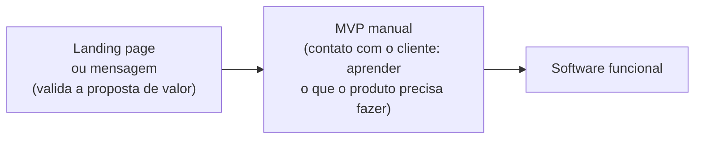

# Tera · Digital Product Leadership · 03: Introdução a Product Discovery

| Campo / Field | Valor / Value |
|---|---|
| Escola / School | Tera |
| Curso / Course | Digital Product Leadership (DPL), formação com 6 módulos / 6-module program |
| Módulo / Module | 03 · Introdução a Product Discovery |
| Situação / Status | 🟡 Em andamento · 4 de 21 aulas / In progress · 4 of 21 lessons |
| Fonte / Source | [Tera: Digital Product Leadership](https://plataforma.somostera.com/formations/digital-product-leadership) (login) |

🇧🇷 Sobre o módulo: depois das métricas (o que está acontecendo), o discovery busca o **porquê**: comportamentos, dores e motivações das pessoas, transformados em hipóteses para o negócio.

🇺🇸 About: metrics show what is happening; discovery explores why, through research, investigation and hypothesis generation.

## Aulas / Lessons

| # | Aula / Lesson | Professor(a) / Instructor | Situação / Status |
|---|---|---|---|
| 1 | Os dados levantam perguntas para explorar | Time Tera (vídeo de abertura) | ✅ |
| 2 | Customer Development | Eduardo Magalhães | ✅ |
| 3 | Product-Market Fit (PMF) | Frederico Lacerda | ✅ |
| 4 | Produto Mínimo Viável (MVP) | Frederico Lacerda | ✅ |
| 5 | Definição de hipóteses e leitura de dados | | ⬜ |
| 6 | Métodos de pesquisa | | ⬜ |
| 7 | Consolidação de pesquisa em produtos | | ⬜ |
| 8 | Personas | | ⬜ |
| 9 | Mapa da jornada de experiência | | ⬜ |
| 10 | Q&A: Persona | | ⬜ |
| 11 | Q&A: Mapa da jornada de experiência | | ⬜ |
| 12 | Cultura de experimentação | | ⬜ |
| 13 | Design de experimentos | | ⬜ |
| 14 | Q&A: Experimentação e mitigação de riscos | | ⬜ |
| 15 | Prototipagem rápida | | ⬜ |
| 16 | Arquitetura da informação na prototipagem de novas soluções | | ⬜ |
| 17 | Mitigação de riscos no processo de discovery | | ⬜ |
| 18 | Continuous Discovery na prática | | ⬜ |
| 19 | Q&A: Prototipagem rápida | | ⬜ |
| 20 | Conclusão: Introdução a Product Discovery (recap + teste) | Tera | ⬜ |
| 21 | Desafio do mercado: Product Discovery | | ⬜ |

---

## 1. Os dados levantam perguntas para explorar / Data raises questions to explore

**Vídeo curto de abertura do módulo** · 1 seção

🇧🇷 **Métricas mostram o que está acontecendo, mas não explicam o porquê.** Com o discovery, a pergunta muda de "o quê?" para "**por quê?**": sair do território dos números e entrar no da **curiosidade** e da **escuta ativa**.

- 🇧🇷 Discovery **não é ter ideias geniais**, é **fazer as perguntas certas**.
- 🇧🇷 É ir além da superfície dos dados e mergulhar em **comportamentos, dores, desejos e motivações** das pessoas, para transformar dados em **hipóteses** relevantes para o negócio.
- 🇧🇷 O módulo amplia o repertório com técnicas de **pesquisa, investigação e geração de hipóteses**, para liderar "com mais contexto e menos achismo".

🇺🇸 **Summary:** metrics tell you what; discovery asks why. It is about asking the right questions, not having genius ideas.

---

## 2. Customer Development

**Expert:** Eduardo "Dudu" Magalhães (GPM numa empresa de automação de marketing; antes, apps de entretenimento infantil e de serviços para pets), com a facilitadora Letícia Petarnela · 8 seções

🇧🇷 **Objetivos (checklist da aula):** entender o processo de desenvolvimento de clientes (*customer development*) a partir da identificação de problemas e tarefas; os benefícios desse modo de pensar para focar no produto certo e comunicar a visão de produto; como criar declarações de hipóteses e de JTBD (*jobs to be done*).

🇺🇸 **Summary:** build an initial view of the problem from facts and evidence, not just conviction. Use the CSD matrix (certainties, suppositions, doubts) and aim for a "plausible vision" through short learning cycles. Answer First (you already have the answers, go validate) vs Answer Last (you need discovery). Customer Development (Steve Blank) seeks product/market fit in four steps: customer discovery, customer validation, customer creation, company building. Jobs to be Done: customers "hire" products to get a job done; write jobs as action verb + object + context.

### 2.1 Quem já viveu essa situação? / Conviction vs evidence

🇧🇷 **A cena clássica:** numa reunião, alguém sugere "vamos fazer aquela feature do app chinês que faz sucesso". É uma ideia baseada só em **convicção**. Problemas:
- 🇧🇷 sem fatos e evidências, a chance de falhar é grande;
- 🇧🇷 o time não "compra" a ideia: a pessoa desenvolvedora não sabe para onde está indo, o designer pergunta "por que fazer isso?".

🇧🇷 **O caminho positivo: revisitar o que você já aprendeu** para montar uma visão inicial do problema:
- 🇧🇷 seu histórico pessoal e profissional; métricas de produto e de negócio;
- 🇧🇷 *discoveries* passados, entrevistas com clientes, usuários e stakeholders;
- 🇧🇷 outros produtos (concorrentes ou próximos) que resolveram bem o problema;
- 🇧🇷 conversas com mentores e referências; suas **falhas**; leituras, cursos e vídeos.

> 🇧🇷 A facilitadora reforça: **não use uma fonte só** (por exemplo, só benchmark). Um caminho só pode trazer exatamente a resposta que você queria ouvir.

**Matriz CSD:** organize o que você sabe em **Certezas** (sei que sei), **Suposições** e **Dúvidas** (sei que não sei). Dúvidas e suposições pedem análise e descoberta para serem respondidas, reforçadas ou refutadas.

**A matriz de visões do expert** (eixo vertical: convicção; eixo horizontal: evidências). Quanto mais para cima e para a direita, mais capital investido em descoberta e menos risco:

| Visão | Convicção × evidência | Armadilha |
|---|---|---|
| **Empírica** | Alta convicção, **baixa evidência** | Apaixonar-se pela solução e não perceber que está aqui: o **paradoxo do product manager** |
| **Validada** | Alta convicção, **alta evidência** | O "buraco do coelho": tentar validar todos os riscos e cair num **discovery eterno**. Faz mais sentido numa scale-up do que numa startup em estágio inicial |
| **Plausível** ✅ | Convicção **fortalecida** por evidências e aprendizados | É a meta: ciclos curtos de aprendizado, como propõe o Customer Development |

🇧🇷 **O paradoxo do product manager (história do foguete):** um time passa 90 dias desenhando a solução perfeita para levar pessoas do ponto A ao B: um foguete com 400 features. O cliente aprova, mas exige lançamento em 7 dias. O escopo cai para 4 features; o time segue apaixonado e gasta fortunas em divulgação (celebridades, intervalos caríssimos). No dia 100, lança; no 101, zero vendas, e o CAC fica proibitivo. Só no dia 113, ouvindo as pessoas, descobre que elas precisavam de uma **bicicleta e um capacete**.

**Answer First × Answer Last:**

| | Quando acontece | O que fazer |
|---|---|---|
| **Answer First** (respostas primeiro) | Você faz perguntas sobre o problema e **já tem as respostas** no que aprendeu; as certezas superam suposições e dúvidas | O discovery "já está feito": parta para **validar** a hipótese de solução. Ganha cadência. Cuidado: o desenvolvimento também precisa ser curto |
| **Answer Last** (respostas por último) | As perguntas **não têm resposta**; suposições e dúvidas dominam a matriz CSD | Faça **discovery**: use técnicas e métodos para aprender mais sobre o problema |

🇧🇷 **Caso contado pelo expert (Answer First):** numa plataforma de hospedagem de pets, o crescimento de clientes novos ano contra ano caía mês a mês (de 5× para 3× e depois 2×). Em uma hora, só com dados que já existiam, ele achou o problema nos mercados novos: a **taxa de entrega dos pushes** era baixa, a **taxa de resposta** dos anfitriões também, e poucos respondiam em até 10 minutos (o grupo que mais converte). Hipótese levada ao time: mandar o aviso também por **WhatsApp**. O time comprou a ideia, desenvolveu em uma tarde, testou num país só e teve a melhor semana regular naquele mercado.

🇧🇷 **Caso Answer Last, na mesma empresa:** a ideia de criar um novo serviço (creche, visita, veterinário em casa) esbarrava em perguntas sem resposta (ticket médio, quem são os clientes, que fricções existem), então rodaram um **discovery**.

> 🇧🇷 Com o racional estruturado em fatos ("nossas taxas de entrega, resposta e tempo de resposta estão derrubando os clientes novos; será que um aviso por WhatsApp melhora isso?"), o time entende o caminho e se engaja.

**Para aprofundar (indicações da aula):** vídeo curto de Steve Blank definindo Customer Development; o verbete "Método dedutivo" na Wikipédia (lógica dedutiva para formular hipóteses e argumentar).

### 2.2 Por que as empresas falham? / Why companies fail

🇧🇷 **A maior falha do expert** (num app global de entretenimento infantil, para crianças de 2 a 5 anos): para aumentar os usuários ativos mensais (MAU), criou um app irmão de desenhos com humor "mais ácido" para crianças de **5 a 10 anos**. O time tinha certeza: 3 meses de desenvolvimento + 1 mês de *go-to-market* caro, lançamento global com destaque nas lojas. Esperavam 1,5 a 2 milhões de MAU.
- 🇧🇷 1º mês: muitos downloads, mas só **15 mil MAU**; 2º mês: **2 mil**; 3º mês: o app foi **tirado das lojas**.

**Por que falhou:**
1. 🇧🇷 **Visão empírica** não reconhecida: todos estavam apaixonados pela ideia.
2. 🇧🇷 **Faixa de idade larga demais:** uma criança de 5 anos é muito diferente de uma de 8 ou 10; eram várias personas, com dores que ele não conhecia.
3. 🇧🇷 **Lançamento global e caro** antes de validar: CAC altíssimo.
4. 🇧🇷 **Aprendizado tardio** (só no 6º mês): nessa idade as crianças preferem **jogos** a desenhos.
5. 🇧🇷 Até houve teste de usabilidade, mas com **viés de confirmação**: ele "convenceu" as crianças de que o app era ótimo.
6. 🇧🇷 Era uma **vitamina** (*nice to have*), não um **analgésico** (*painkiller*, *need to have*): as crianças baixavam, viam um desenho e desinstalavam.

🇧🇷 No modelo clássico de *product development*, quase não se aprende nas fases de conceito, desenvolvimento e teste; o aprendizado chega só no **lançamento**, quando já se gastou muito.

> 🇧🇷 "Nada garante tanto que um produto vai falhar quanto entender mal o problema que ele resolve." (Lenny Rachitsky, citado na aula)
>
> 🇧🇷 "Dor + reflexão = progresso" (Ray Dalio, citado pelo expert): errar é aprendizado, mas é preciso **errar rápido**.

🇧🇷 **A virada (pivô):** aproveitando pequenos testes de jogos casuais que já existiam, o time reusou a estrutura do app que falhou e lançou uma primeira versão **mínima** (uma bandinha e um único jogo), **só num país**, sem barulho, focada em crianças de **5 e 6 anos**. Métrica: **retenção semanal**, que passou de 75% (no app que falhou era menor que 10%; amostra bem menor, ressalva o expert). Depois, foram somando jogos e personalizações a partir do feedback de pais e crianças e abrindo mercados: em 6 ou 7 meses, cerca de **2,5 milhões de MAU** e prêmios de melhor app infantil. É a **visão plausível** na prática.

> 🇧🇷 Pivotar é bom, diz o expert, "só não demorem seis meses para pivotar".

### 2.3 O que é Customer Development / What it is

🇧🇷 **Customer Development** (metodologia de **Steve Blank**, base do movimento Lean Startup) é o processo de buscar o alinhamento entre produto e mercado, o **product/market fit**: o produto resolve uma dor e o mercado responde (as pessoas compram e usam com recorrência).

- 🇧🇷 **Tudo começa no problema**, declarado de forma clara e objetiva, **sem viés de solução**. Mesmo quando chega um pedido de feature, nosso papel é entender que problema ele resolve.
- 🇧🇷 Soluções são **hipóteses**, não certezas: testar, validar e renovar em ciclos cada vez mais curtos.

> 🇧🇷 "Antes de começar a vender, você precisa investir tempo e dinheiro na tarefa de entender o que seu cliente precisa." (Steve Blank)

| Etapa | O que acontece |
|---|---|
| **Customer Discovery** | Entender o problema e estruturar a hipótese. "*Get out of the building*": saia do escritório (ou da sala do Zoom) e converse com as pessoas para validar ou refutar. Se a tese não se sustentar, **pivote** cedo, antes de investir capital ou escrever código |
| **Customer Validation** | Fatos e evidências mostram que a solução encontrou fit. Discovery e Validation formam um **ciclo**: refina-se a hipótese até validar |
| **Customer Creation** | Com o PMF, é hora do lançamento robusto: *go-to-market*, versão evoluída do MVP |
| **Company Building** | Montar as áreas da empresa (produto, tecnologia, atendimento…) e buscar investimento para escalar |

🇧🇷 **Exemplo do expert (MVP sem código):** os fundadores de uma plataforma de hospedagem de pets começaram com **duas landing pages**: uma para tutores que querem viajar e outra para quem quer hospedar cães. Com um pouco de tráfego pago, juntavam **à mão** tutor e anfitrião próximos e compatíveis num **grupo de WhatsApp**, onde negociavam; o pagamento era por boleto. O sinal de fit: a demanda cresceu tanto que o modelo artesanal não dava mais conta, com aquisição recorrente e um negócio repetível e escalável. Só então vieram a execução, a contratação do primeiro PM e as áreas da empresa.

**Exercício 1 da aula: entendimento do problema.** Responda com a máxima clareza:
1. 🇧🇷 Qual é o problema que seu produto tenta resolver?
2. 🇧🇷 Quem tem esse problema (persona ou protopersona)?
3. 🇧🇷 Como essas pessoas resolvem esse problema hoje? (Mostra as lacunas que seu produto pode preencher.)

**Exercício 2 da aula: elaboração de hipóteses.** Uma boa hipótese:
- 🇧🇷 **não é pergunta, é afirmação** (frase com ponto final);
- 🇧🇷 é **simples** e expressa o que se espera;
- 🇧🇷 **pode ser negada**;
- 🇧🇷 é **quantificável**.

> 🇧🇷 **Modelo:** Nós acreditamos que **[fazendo tal coisa]** para **[essas pessoas]** resultará **[nesse resultado]**. Saberemos que isso é verdade quando tivermos **[esse feedback do mercado]**.
>
> O resultado é um benefício mais emocional; o feedback do mercado é analítico, medido por métricas de negócio ou de produto.

🇧🇷 **Exemplo do vídeo:** contratados pelo Ministério da Saúde no início da pandemia: "Nós acreditamos que **um plano estruturado de vacinação** para **o grupo de risco** (profissionais de saúde, idosos, pessoas com comorbidades) resultará na **desaceleração dos casos ativos** (e, assim, menos mortes). Saberemos que é verdade quando a **média móvel de casos ativos** desse grupo cair **15% ou mais** semana a semana." Por que 15%? Segundo especialistas, variações de até 15% indicam estabilidade; acima disso, queda (ou alta).

### 2.4 Jobs to be Done (JTBD)

🇧🇷 Ao comprar um produto, você não compra o produto em si, mas a **tarefa** (*job*) que ele permite realizar. Exemplo do expert: ao contratar a hospedagem do cachorro, ele não comprou "o anfitrião", comprou a possibilidade de **viajar**.

- 🇧🇷 Conceito de **Clayton Christensen** (livro *Muito Além da Sorte*): você "contrata" um produto para realizar um *job*.
- 🇧🇷 JTBD é uma **lente** para observar como concorrentes e consumidores atendem às necessidades das pessoas: o foco sai de **o que o público quer comprar** para **o que ele quer resolver**.
- 🇧🇷 Erro comum: confundir *job* com **fluxo dentro do produto**.

> 🇧🇷 "Um job pode ser um objetivo, uma meta ou uma tarefa, um problema a ser resolvido, algo a ser evitado, uma meta de 'ser ou fazer', qualquer coisa que as pessoas estão tentando realizar." (Anthony Ulwick)
>
> 🇧🇷 "As pessoas não querem uma furadeira, querem um buraco na parede" (Theodore Levitt). E, no fundo, nem o buraco: querem **pendurar o quadro e deixar a sala mais bonita**. A facilitadora completa: comprou uma parafusadeira não para montar o móvel, mas para **ter** a mesa e jantar.

**Como escrever um job:** **VERBO DE AÇÃO + OBJETO DE AÇÃO + CONTEXTO** (atingindo um propósito).

| | Exemplo da aula | Por quê |
|---|---|---|
| ✅ Válido | **Ouvir música** enquanto vai ao trabalho | Reflete a tarefa (se entreter no metrô) |
| ❌ Inválido | Criar uma playlist no Spotify | É um **meio**, quase um fluxo de produto; dava para usar outro streaming, um podcast, um filme |

**Exercício 3 da aula:** defina o **job principal** do seu produto usando verbo + objeto + contexto.

**Para aprofundar (indicações da aula):** *Muito Além da Sorte*, de Clayton Christensen; *Jobs to be Done: Theory to Practice*, de Anthony W. Ulwick (em inglês); guia de Jobs to be Done (2022) do expert Sulivan Santiago, em duas partes.

### 2.5 Resumo da aula e perguntas e respostas / Recap and Q&A

> 🇧🇷 **Lembre-se:**
> - Estruture uma visão inicial do problema com base em **fatos e evidências**.
> - Saia da **visão empírica** para a **visão plausível**.
> - **Falhas geram aprendizado:** falhe rápido, em ciclos curtos.
> - O **JTBD** ajuda a entender a tarefa que as pessoas querem completar, para então trabalhar na solução.

🇧🇷 O que mais marcou a facilitadora: na vida de PM a gente erra; o pulo do gato é **reconhecer o erro e mudar a rota o quanto antes**, gastando menos e aumentando a chance de sucesso.

**Perguntas e respostas (resumo das respostas do expert):**

| Pergunta | Resposta |
|---|---|
| Como se sentiu ao descobrir que estava falhando? | Desesperado, com medo de ser demitido. Mas a cultura da empresa ajudou: não houve "caça às bruxas"; montaram juntos um plano de 90 dias, que gerou o pivô. A facilitadora lembra o conceito de **antifrágil** (Nassim Taleb): criar oportunidade a partir do caos |
| Em produtos que não são *painkillers* (ex.: rede social), a validação muda? | Não. Problema claro, nivelar o conhecimento, levantar hipóteses e testar, em qualquer mercado |
| Qual a relação entre Customer Development e Product Discovery? | O discovery faz parte do Customer Development: é o passo para **mitigar riscos** quando sua tese não tem dados suficientes (o *Answer Last*). Ash Maurya (*Running Lean*): discovery é essencialmente mitigar riscos |
| Faz sentido usar Customer Development para evoluir uma hipótese? | Sempre. Acertar "de primeira", só na fé, é raro, e o acerto seguinte tende a falhar |
| Preciso de uma linha de base para validar? | Sim: saber **qual métrica ou evidência** dirá se deu certo, e estabelecer a relação de **causalidade**. A hipótese deve ser respondida com **sim ou não**; um "não sei" no fim costuma vir de um problema mal declarado |
| E os problemas que geram monetização? | Product/market fit não é só resolver a dor: é achar um **modelo de negócio repetível e escalável**, em que as pessoas paguem. Pense no modelo de negócio desde o início |
| JTBD é do ciclo de vida ou do discovery? | Ajuda a **entender o problema**: qual tarefa a pessoa precisa cumprir para resolver a dor. A facilitadora: se o job é deixar a sala bonita, talvez uma fita dupla face resolva melhor que a furadeira |
| Um produto pode ter jobs principais e secundários? | Pode: o job do produto se desdobra em jobs de features. Cuidado para não criar job atrás de job e não sair do lugar |
| O job vem depois das hipóteses de dor? | O job ajuda a entender o problema; com problema claro e tarefa entendida, criam-se as hipóteses de solução |
| Então a playlist não deveria existir? | Deveria: ela é o **habilitador**, o meio para o job "ouvir música" |
| Um exemplo real de job? | No app infantil, o job é do **pai ou da mãe**: ter um momento de paz (no avião, no restaurante, no home office) enquanto a criança se entretém |
| Problema, job e hipóteses são do time ou da PM? | Depende do estilo; o expert envolve o time (diversidade de visões gera soluções melhores). A facilitadora: quando o time constrói junto, ele "compra" a ideia |

🇧🇷 **Dica de leitura citada pelo expert:** *The Making of a Manager*, de Julie Zhuo: escrever o próprio pensamento ajuda a ver se ele está claro. Por isso o expert insiste em **declarar** o problema e testar se outras pessoas entendem.

### 2.6 Conclusão / Wrap-up

> 🇧🇷 **Mensagem final:** a carreira de produto pede **aprendizado contínuo** e mentalidade de crescimento (*growth mindset*). A facilitadora: é nos erros que mais se aprende, não carregue a pressão de não poder errar.

🇧🇷 **Exercício sugerido pela facilitadora:** pense na motivação de produtos que você usa (um app de delivery, um streaming). Qual era a dor? Como se pedia pizza há alguns anos, e qual era o problema? Responda as três perguntas: **qual é o problema, para quem e como se resolve hoje?**

**Checklist da Tera:** o processo de *customer development* a partir de problemas e tarefas; os benefícios desse pensamento para focar no produto certo e comunicar a visão; como criar declarações de hipóteses e de JTBD.

**Materiais da aula** (guardados no repositório privado): slides "Customer Development" em PDF.

---

## 3. Product-Market Fit (PMF)

**Expert:** Frederico "Fred" Lacerda (cofundador de uma aceleradora de startups e CEO de uma HR tech), com uma facilitadora da Tera · 5 seções

🇧🇷 **Objetivos (checklist da aula):** o que é product-market fit e por que ter clareza sobre esse "encaixe" é importante no ciclo de um produto ou negócio; como o PMF se relaciona com o customer development; qual é a responsabilidade de PMs na busca pelo PMF.

🇺🇸 **Summary:** product-market fit is the second stage of Customer Development (after problem-solution fit, before scale). Different authors stress the market (Andreessen), the value hypothesis (Rachleff), the fit between customer profile and value map (Osterwalder) or delivering more value than alternatives (Olsen, with his PMF pyramid). PMF is not binary: measure it with acquisition, retention, revenue, unit economics, NPS and the Sean Ellis 40% test, avoiding vanity metrics and HiPPOs. It is not eternal and is full of traps; the PM's job is to reduce uncertainty, starting with the biggest risk (product, customer, market).

### 3.1 O que é Product-Market Fit / What PMF is

🇧🇷 O PMF fica dentro do **Customer Development** (Steve Blank, livro *The Startup Owner's Manual*), na fase de **Customer Validation**. O framework tem duas grandes etapas: **busca** (iterar até achar um negócio viável) e **execução** (escalar e crescer).

- 🇧🇷 **Não faz sentido buscar PMF sem problem-solution fit.** Problem-solution fit responde: "**você tem um problema que vale a pena resolver?**" com três palavras-chave: é *must have* (dor grande o bastante), é **viável** (alguém vai pagar?), é **factível** (há tecnologia e custo para resolver? muitas empresas erraram o *timing*).
- 🇧🇷 **PMF responde: "você construiu algo que as pessoas querem?"** O produto já está no mercado, com clientes reais (muitas vezes *early adopters*). Três perguntas: consegue **adquirir** clientes? consegue **retê-los**? está sendo **pago**?
- 🇧🇷 "Novo produto" pode ser também um produto reinventado ou uma feature, em qualquer fase do ciclo de vida, desde que haja **incerteza**.

> 🇧🇷 "Quando não temos incertezas, não precisamos de customer development. O framework atua nas incertezas, para reduzir as chances de fazer as coisas erradas, ter desperdícios e construir um produto que ninguém quer." (Frederico Lacerda)
>
> 🇧🇷 "Tudo começa no problema." O expert gosta de pensar na PM como **empreendedora**, "CEO do produto", que corre o risco junto.

**Diferentes visões de PMF:**

| Autor | Ênfase | Ideia |
|---|---|---|
| **Marc Andreessen** | **Mercado** | "Estar em um bom mercado com um produto que satisfaça esse mercado." Com time e produto razoáveis, um ótimo mercado tende ao sucesso; um mercado ruim, ao fracasso. Foco só nas features, "dentro do escritório", falha: a resposta está fora |
| **Andy Rachleff** | **Produto** (hipótese de valor) | Uma **hipótese de valor convincente**: os clientes querem tanto o produto que, mesmo com execução falha, a empresa dá certo. O que importa é o **benefício**, não a cor do botão |
| **Alexander Osterwalder** | Encaixe entre os dois | No **Canvas da Proposta de Valor** (perfil do cliente: tarefas, dores, ganhos; mapa de valor: produtos, aliviadores de dor, criadores de ganho). Encaixe do produto para o cliente = *problem-solution fit*; o **mercado correndo atrás do produto** (tração) = *product-market fit* |
| **Dan Olsen** | Valor percebido | "Validar que seus clientes concordam que você criou valor real." Sempre existem **soluções alternativas** (até manuais: sem remédio, a pessoa com enxaqueca deita no quarto escuro com uma toalha na cabeça). A questão é atender **melhor** que elas |

🇧🇷 **A pirâmide do PMF (Dan Olsen):** a base é mais larga e dá mais trabalho, por isso **o mercado vem antes do produto**. **Mercado** = um grupo identificável (pessoas ou empresas, B2C ou B2B) com uma **dor em comum**; um cliente sem dor não compra. Depois vem o produto: **proposta de valor** (ninguém escolhe um produto por uma lista de funcionalidades, e sim pelo valor que ele gera), **funcionalidades** (o MVP) e, por último, **UX** (cor, forma, o que o botão faz). Começar pelo topo é pôr a pirâmide de ponta-cabeça: ela tomba. Quando o produto testado se encaixa no mercado, há PMF.

**Para aprofundar (indicações da aula):** *Value Proposition Design* (Osterwalder, 2019); *The Lean Product Playbook* (Dan Olsen, 2015); *The Startup Owner's Manual* (Steve Blank).

### 3.2 Como medir se atingi product-market fit / Measuring PMF

🇧🇷 **PMF não é eterno.** O caso citado na aula: uma empresa de cupons chamada de "a que cresceu mais rápido no mundo", que recusou uma oferta de US$ 6 bilhões do Google, foi copiada por rivais maiores e com mais capital (o modelo não tinha barreira de entrada) e entrou em queda. Além do PMF, é preciso:
- 🇧🇷 **estratégia de distribuição** eficaz (achar e adquirir clientes de forma economicamente viável);
- 🇧🇷 **economics favoráveis** (modelo de negócio que feche a conta no médio e longo prazo);
- 🇧🇷 **mercado grande e em crescimento** (espaço para crescer).

**Critérios de saída de Steve Blank** (para passar do PMF à escala):
1. 🇧🇷 Dá para provar que os clientes **não vivem mais sem** o produto?
2. 🇧🇷 Há clareza sobre **CAC, LTV, ROI**?
3. 🇧🇷 Há **pedidos** (dinheiro) validando o roadmap de vendas?
4. 🇧🇷 O **modelo financeiro** faz sentido: o negócio é viável?

**Como medir (não existe um "termômetro" binário; combine sinais):**

| Ferramenta | O que diz a aula |
|---|---|
| **Métricas, não HiPPOs** | *HiPPO* = *highest paid person's opinion*, a opinião de quem ganha mais na sala. Métricas são a forma de sair da discussão de opinião |
| **Fugir de métricas de vaidade** | Downloads, visitas, likes parecem bonitos mas não dizem muito. Dica: **parear métricas** (downloads + usuários ativos ou desinstalações) |
| **AARRR (funil pirata, Dave McClure)** | Aquisição (como te encontram?), Ativação (boa primeira experiência? de preferência, uso que gera o valor prometido, como a primeira corrida num app de transporte), Retenção (voltam?), Recomendação (indicam?), Receita (como você ganha dinheiro? produto gratuito também "cobra" em tempo, dados, atenção). Quanto mais **reto** o funil, mais perto do PMF |
| **Unit economics** | Receita direta × custos de adquirir e manter **um** cliente. Num SaaS: **LTV ÷ CAC**. Exemplo da aula: LTV de R$ 1.000 e CAC de R$ 200 = **5×** (num SaaS, a partir de 3× a conta costuma ser favorável). Abaixo de zero, o negócio não é viável: é hora de pivotar (preço, canais, custos) |
| **Product economic fit** | Crescer **mantendo** os economics positivos: CAC baixo comparado ao valor que se recupera do cliente |
| **NPS** | Mede o "amor" do cliente; há forte correlação entre NPS alto e retenção. Promotores: 9 e 10; neutros: 7 e 8; detratores: 0 a 6. Vai de −100 a +100; busca-se acima de +50, de preferência +70 |
| **Teste de Sean Ellis** (criador do termo *growth hacking*) | Se **40% ou mais** disserem que ficariam **muito desapontados** sem o produto, há PMF. Simplista se usado sozinho |

> 🇧🇷 No fim, o melhor sinal é o cliente dizer: "**fica quieto e pega meu dinheiro**", e haver gente suficiente dizendo isso num mercado bom.

**Erros e armadilhas na busca pelo PMF:**
1. 🇧🇷 **Não ser objetivo diante da evidência negativa.**
2. 🇧🇷 **Perseguir o mercado *mainstream* antes de conquistar os *early adopters*** (livro *Crossing the Chasm*): sem eles não dá para testar soluções incompletas; uma grande empresa exige integrações e customização que um MVP não tem.
3. 🇧🇷 **"Comprar crescimento":** muito investimento em aquisição dá falsa sensação de PMF. Teste máximo: **desligue a aquisição paga** e veja se a base cai.
4. 🇧🇷 **Achar que o PMF é eterno:** é preciso continuar ouvindo feedbacks e métricas.
5. 🇧🇷 **Cair nos mitos:** que é um "Big Bang" (é um processo, mesmo que exista um *aha moment*); que é óbvio; que, uma vez atingido, não se perde; que não é preciso se preocupar com concorrência (depois do PMF você vira o benchmark que todos copiam).
6. 🇧🇷 **Achar que só vale para startups de tecnologia:** vale para qualquer empresa que tenha clientes com necessidades.

🇧🇷 **Empresa grande × pequena:** a grande tem mais recursos e um produto com usuários reais (mais dados para iterar), mas o desafio é a **cultura** (medo de rodar MVP, decisões por HiPPO). A pequena tem velocidade e menos aversão a risco.

**O produto muda conforme quem olha** (a partir do **Lean Canvas** de Ash Maurya, que separa **problema**, **proposta de valor** e **solução**, e inclui as **alternativas existentes**):

| Quem olha | Como vê o produto |
|---|---|
| **Quem cria** (PM, fundadores) | Apaixonado pela **solução**, quer ser diferente, pensa em sobrevivência |
| **Quem banca** (investidores, financeiro) | Não liga para a solução: quer **barreiras de entrada**, tamanho de mercado, tração e margem |
| **Quem compra** (cliente) | Não sabe nomear o problema e não liga para a solução: quer a **promessa de valor**, se identificar com uma "tribo" e um bom **custo-benefício** |

🇧🇷 O verdadeiro trabalho de quem cria é encarar o canvas como **cheio de pontos de interrogação** e reduzir as incertezas, começando pelo **maior risco** no momento do produto.

> 🇧🇷 "Construir um produto bem-sucedido é fundamentalmente mitigar riscos." (Ash Maurya)

| Risco | Pergunta | Como mitigar (segundo a aula) |
|---|---|---|
| **Do produto** | Criei o produto certo? | Ter um problema que vale a pena resolver → definir a menor solução (MVP) → validar em pequena escala (a proposta de valor única) → verificar em larga escala |
| **Do cliente** | Construí um caminho até os clientes? | Identificar quem tem a dor → focar nos *early adopters* → começar com canais pagos (*outbound*) se preciso, mas desenvolver cedo canais **orgânicos** (*inbound*) |
| **Do mercado** | Construí um negócio viável? | Mapear a concorrência pelas alternativas existentes e definir preço → testar o preço pelo que os clientes **dizem** e depois pelo que **fazem** (compram) → otimizar a estrutura de custos |

🇧🇷 **A vida útil dos produtos está encurtando:** o que durava 10 ou 20 anos hoje dura cerca de um. Por isso o customer development precisa correr **em paralelo** ao desenvolvimento, verificando sempre se o mercado continua bom, a proposta de valor convincente e a solução melhor que as alternativas.

**Para aprofundar (indicações da aula):** modelo editável do Lean Canvas; *Running Lean* (Ash Maurya); *A Startup Enxuta* (Eric Ries).

### 3.3 Resumo da aula / Takeaways

> 🇧🇷 **Lembre-se:**
> - O PMF **não é acaso**: é resultado de um processo estruturado, que depende principalmente do **mercado** e da **proposta única de valor**.
> - A busca é **iterativa**: não há número certo de pivôs, há o necessário.
> - O **MVP** é mais que uma ferramenta (MVP, MLP, MMP…): é uma **mentalidade** de validar a hipótese de valor com o menor desperdício possível.
> - O PMF **não é binário**: meça com uma combinação de métricas (aquisição, retenção, unit economics, NPS…).
> - O PMF **não é eterno** e está cheio de armadilhas, como a **validação falsa** (por viés de confirmação, paixão pela solução ou por já ter investido demais). Tente se provar errado: quanto mais, menos você constrói coisas que ninguém quer.

**Checklist da Tera:** o que é PMF e por que ter clareza sobre esse encaixe é importante; como ele se relaciona ao customer development; qual é a responsabilidade de PMs na busca pelo PMF.

**Materiais da aula** (guardados no repositório privado): slides "Product-Market Fit" em PDF.

---

## 4. Produto Mínimo Viável (MVP) / Minimum Viable Product

**Expert:** Frederico Lacerda, com uma facilitadora da Tera · 4 seções

🇧🇷 **Objetivos (checklist da aula):** o que é MVP e como empresas do mercado usaram o conceito para testar propostas de valor; alguns tipos de MVP e suas aplicações; a relação entre MVP e o negócio.

🇺🇸 **Summary:** an MVP validates a hypothesis with the least effort, cutting the time between a decision and its real-world test from months to days. Small cycles accumulate learning instead of risk (build-measure-learn). It must be a version of the solution that already delivers value, generates desire to use and buy, retains early adopters and yields feedback. Types: landing page (Buffer), pre-order/crowdfunding (Pebble), explainer video (Dropbox), piecemeal (Groupon), SaaS/PaaS building blocks, manual or "Wizard of Oz" (Zappos). MVPs progress as uncertainty drops.

### 4.1 MVP como ferramenta na busca por market fit / MVP as a tool

🇧🇷 **MVP = mínimo produto viável.** O essencial: **validar uma hipótese com o menor esforço possível** (geralmente, a de que a solução entrega valor a um segmento). O Customer Development existe para **reduzir o desperdício** de tempo, recursos e dinheiro construindo a coisa errada.

- 🇧🇷 Encurtar a distância entre a **decisão** (sempre otimista) e a **realização** de que ela funciona ou não: **de meses para dias**.
- 🇧🇷 "Não existe MVP de meses e que precisa ser aprovado por comitês." (Frederico Lacerda)
- 🇧🇷 Quanto maior o escopo e mais tempo "no escritório", **mais risco acumulado**. Em entregas menores e em ciclos, acumula-se **aprendizado por validação**, não risco: é o *construir → medir → aprender* da **Startup Enxuta** (Eric Ries).
- 🇧🇷 **Com certeza total, não precisa de MVP** (nem de customer development): é só executar. O MVP existe para mitigar **incerteza**.

**O que o MVP deve fazer:** ser uma **versão da solução** que exige o menor esforço e **já entrega valor** (o "mínimo" vem do esforço; o "viável", da entrega de valor). E:
1. 🇧🇷 **gerar vontade de usar e comprar;**
2. 🇧🇷 **reter os *early adopters*** (segundo *Crossing the Chasm*, cerca de 15% de um mercado, gente disposta a testar produtos imperfeitos; testar com o público errado é um erro comum);
3. 🇧🇷 **obter feedback.**

🇧🇷 **A analogia do carro:** a proposta de valor é ir do ponto A ao B mais rápido e com menos esforço. Uma roda ou uma carroceria não entregam isso; um skate entrega (melhor que andar, a alternativa atual). Com o feedback dos *early adopters*, vem o guidão (patinete), depois a bicicleta, e assim por diante, sem jogar fora o dinheiro de construir o carro inteiro quando ainda havia muita incerteza.

> 🇧🇷 **Procure o meio ideal de aprendizado, não o MVP ideal:** o que validar depende do estágio do produto.

**Tipos de MVP e os casos da aula:**

| Tipo | Caso | Como foi | O que valida |
|---|---|---|---|
| **Landing page** | Buffer (agendar posts no Twitter) | Página com a proposta de valor e o botão "ver planos e preços" → página de planos (grátis, US$ 5, US$ 20) → "ainda não lançamos, deixe seu e-mail". Três validações, como um funil | Interesse na proposta de valor e no preço. Simples, sem programar, mas é uma validação **fraca** (seria mais forte pedir o cartão de crédito) |
| **Pré-venda / crowdfunding** | Pebble (um dos primeiros smartwatches) | Pessoas pagaram antes de o produto existir (com devolução se não saísse); a meta foi superada em semanas | Intenção de compra real. O expert já usou clientes B2B para financiar o roadmap |
| **Vídeo explicativo** | Dropbox | Vídeo de 3 minutos explicando a proposta; os interessados saltaram de 5 mil para 75 mil numa noite, o que ajudou a levantar investimento | Proposta de valor **e o canal certo**: o vídeo foi para uma comunidade de desenvolvedores, os *early adopters* da época |
| **Piecemeal** (juntar peças prontas) | Groupon | Blog em WordPress + gerador de cupons em PDF; os fundadores geravam e enviavam os cupons por e-mail à mão até não dar mais conta | Já valida a **solução**. Não precisa ser bonito, precisa funcionar |
| **SaaS e PaaS** (construir sobre outros serviços) | A HR tech do expert | Começou com a versão gratuita de uma ferramenta de questionários online; depois a paga, sem a marca; só desenvolveu a própria plataforma com clientes pagantes. Também usou ferramentas de e-mail marketing, de disparo de e-mails e de armazenamento em nuvem | A solução, com risco muito reduzido antes de investir em desenvolvimento |
| **Manual ou "Mágico de Oz"** (*Wizard of Oz*) | Zappos (primeiro e-commerce de sapatos) | Site-vitrine com fotos tiradas em lojas, sem estoque nem logística. A cada pedido, o fundador comprava o sapato na loja e postava no correio | Se as pessoas comprariam sapato online. Muito efetivo para **validar**, nada para **escalar**. O expert já testou até recursos de inteligência artificial com pessoas fazendo o trabalho |

> 🇧🇷 "Primeiro faça coisas que não escalam." (Paul Graham, fundador da Y Combinator)
>
> 🇧🇷 "Se você não tem vergonha da primeira versão do seu produto, demorou demais para lançar." (Reid Hoffman, fundador do LinkedIn, citado na aula)

🇧🇷 **MVP também é progressão:** conforme a incerteza diminui, cada novo MVP fica um pouco mais complexo. Entrevistas, demos e protótipos também são meios de aprendizado.

**Para aprofundar (indicações da aula):** *A Startup Enxuta*, de Eric Ries; "Faça coisas que não escalam", tradução da Qulture Rocks para o artigo *Do things that don't scale*, de Paul Graham.

### 4.2 Perguntas e respostas / Q&A

| Pergunta | Resposta do expert |
|---|---|
| Pivotar é mudar drasticamente o produto? | Não necessariamente: é ajustar **qualquer bloco do canvas**, às vezes um ajuste fino (forma de cobrança, modelo de negócio, tamanho do cliente, a solução inteira). O sinal vem do feedback do mercado (qualitativo ou métricas): poucas compras, churn, retenção ruim |
| Quando buscar PMF? | Com o produto **lançado e em uso**, depois de validar que o problema é grande e que a solução (ao menos via MVP) o resolve |
| O que é um "ótimo mercado"? | **Grande** (cálculo *bottom-up*: ticket médio × quantas pessoas ou empresas pagariam; o TAM da indústria inteira é armadilha), **em crescimento** (tendência) e **não saturado** (muitos concorrentes não significa saturação se atendem mal a dor) |
| A PM responde pela pirâmide inteira? | Sim, com visão holística, como "CEO do produto", mas não sozinha: envolve UX e o squad em diferentes intensidades |
| MVP × MMP × MLP? | **MMP** (*minimum marketable product*): o mínimo que o mercado aceita, em setores que não podem "quebrar" (saúde, finanças). **MLP** (*minimum lovable product*): tão viável que já é amado. O que importa é a essência: versão menor, menos esforço, aprender validando |
| Quanto tempo e recurso para um MVP? | O mínimo possível, de preferência **dias** (já viu MVPs complexos desenhados em duas semanas e rodando em outras duas). Em empresas grandes, crie processos de *fast track* (por exemplo, com o jurídico) |
| Como convencer a liderança a lançar algo incompleto? | Construir **cases**: benchmarks e ganhos internos. Para o risco de marca, dá para testar com outra marca, desassociada da principal |
| Quanto tempo insistir antes de pivotar? | Não há resposta certa. É como **pegar uma onda**: remar cedo demais e ela estoura em cima de você (o dinheiro acaba); tarde demais e você a perde (o concorrente chega antes) |
| PMF é estar no lugar certo, na hora certa? | Sim e não. Há *timing* (buscadores e streaming só deram certo quando processamento e banda larga ficaram baratos), mas isso vem de muita análise e validação, não de sorte |
| Qual o sinal mais claro de PMF? | Citando o presidente da Y Combinator: "quando **tudo começa a quebrar**", ou seja, a demanda supera o que o produto aguenta, de forma consistente |
| Como manter o PMF? | Aceitar que ele pode ser perdido a qualquer momento e que, ao virar líder, você vira benchmark e é copiado. O PMF é **papel contínuo** da PM, em paralelo ao desenvolvimento |

### 4.3 Conclusão / Wrap-up

> 🇧🇷 **Mensagem final do expert:** quem constrói produto tem a responsabilidade de colocar o **cliente no centro**: por trás de qualquer solução existe alguém com um problema real. Ter isso em mente ajuda a perseguir o PMF, que é um processo difícil, cheio de tombos e armadilhas.

**Checklist da Tera:** o que é MVP e como empresas usaram o conceito para testar propostas de valor; tipos de MVP e aplicações; a relação entre MVP e o negócio.

**Materiais da aula** (guardados no repositório privado): slides "Produto mínimo viável (MVP)" em PDF.
