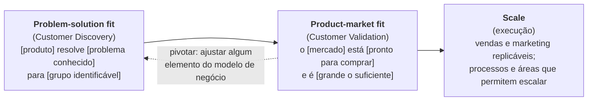
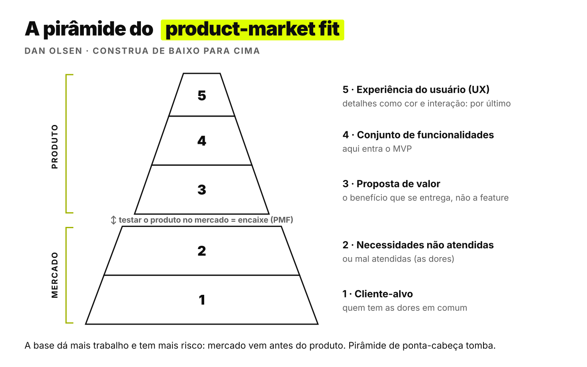

[← Tera · Digital Product Leadership · 03: Introdução a Product Discovery](README.md)

# Aula 3: Product-Market Fit (PMF)

**Expert:** Frederico "Fred" Lacerda (cofundador de uma aceleradora de startups e CEO de uma HR tech), com uma facilitadora da Tera · 5 seções

🇧🇷 **Objetivos (checklist da aula):** o que é product-market fit e por que ter clareza sobre esse "encaixe" é importante no ciclo de um produto ou negócio; como o PMF se relaciona com o customer development; qual é a responsabilidade de PMs na busca pelo PMF.

🇺🇸 **Summary:** product-market fit is the second stage of Customer Development (after problem-solution fit, before scale). Different authors stress the market (Andreessen), the value hypothesis (Rachleff), the fit between customer profile and value map (Osterwalder) or delivering more value than alternatives (Olsen, with his PMF pyramid). PMF is not binary: measure it with acquisition, retention, revenue, unit economics, NPS and the Sean Ellis 40% test, avoiding vanity metrics and HiPPOs. It is not eternal and is full of traps; the PM's job is to reduce uncertainty, starting with the biggest risk (product, customer, market).

## 3.1 O que é Product-Market Fit / What PMF is

🇧🇷 O PMF fica dentro do **Customer Development** (Steve Blank, livro *The Startup Owner's Manual*), na fase de **Customer Validation**. O framework tem duas grandes etapas: **busca** (iterar até achar um negócio viável) e **execução** (escalar e crescer).

- 🇧🇷 **Não faz sentido buscar PMF sem problem-solution fit.** Problem-solution fit responde: "**você tem um problema que vale a pena resolver?**" com três palavras-chave: é *must have* (dor grande o bastante), é **viável** (alguém vai pagar?), é **factível** (há tecnologia e custo para resolver? muitas empresas erraram o *timing*).
- 🇧🇷 **PMF responde: "você construiu algo que as pessoas querem?"** O produto já está no mercado, com clientes reais (muitas vezes *early adopters*). Três perguntas: consegue **adquirir** clientes? consegue **retê-los**? está sendo **pago**?
- 🇧🇷 "Novo produto" pode ser também um produto reinventado ou uma feature, em qualquer fase do ciclo de vida, desde que haja **incerteza**.

> 🇧🇷 "Quando não temos incertezas, não precisamos de customer development. O framework atua nas incertezas, para reduzir as chances de fazer as coisas erradas, ter desperdícios e construir um produto que ninguém quer." (Frederico Lacerda)
>
> 🇧🇷 "Tudo começa no problema." O expert gosta de pensar na PM como **empreendedora**, "CEO do produto", que corre o risco junto.

**Diferentes visões de PMF:**

| Autor | Ênfase | Ideia |
|---|---|---|
| **Marc Andreessen** | **Mercado** | "Estar em um bom mercado com um produto que satisfaça esse mercado." Com time e produto razoáveis, um ótimo mercado tende ao sucesso; um mercado ruim, ao fracasso. Foco só nas features, "dentro do escritório", falha: a resposta está fora |
| **Andy Rachleff** | **Produto** (hipótese de valor) | Uma **hipótese de valor convincente**: os clientes querem tanto o produto que, mesmo com execução falha, a empresa dá certo. O que importa é o **benefício**, não a cor do botão |
| **Alexander Osterwalder** | Encaixe entre os dois | No **Canvas da Proposta de Valor** (perfil do cliente: tarefas, dores, ganhos; mapa de valor: produtos, aliviadores de dor, criadores de ganho). Encaixe do produto para o cliente = *problem-solution fit*; o **mercado correndo atrás do produto** (tração) = *product-market fit* |
| **Dan Olsen** | Valor percebido | "Validar que seus clientes concordam que você criou valor real." Sempre existem **soluções alternativas** (até manuais: sem remédio, a pessoa com enxaqueca deita no quarto escuro com uma toalha na cabeça). A questão é atender **melhor** que elas |

🇧🇷 **A pirâmide do PMF (Dan Olsen):** a base é mais larga e dá mais trabalho, por isso **o mercado vem antes do produto**. **Mercado** = um grupo identificável (pessoas ou empresas, B2C ou B2B) com uma **dor em comum**; um cliente sem dor não compra. Depois vem o produto: **proposta de valor** (ninguém escolhe um produto por uma lista de funcionalidades, e sim pelo valor que ele gera), **funcionalidades** (o MVP) e, por último, **UX** (cor, forma, o que o botão faz). Começar pelo topo é pôr a pirâmide de ponta-cabeça: ela tomba. Quando o produto testado se encaixa no mercado, há PMF.

**Para aprofundar (indicações da aula):** *Value Proposition Design* (Osterwalder, 2019); *The Lean Product Playbook* (Dan Olsen, 2015); *The Startup Owner's Manual* (Steve Blank).

## 3.2 Como medir se atingi product-market fit / Measuring PMF

🇧🇷 **PMF não é eterno.** O caso citado na aula: uma empresa de cupons chamada de "a que cresceu mais rápido no mundo", que recusou uma oferta de US$ 6 bilhões do Google, foi copiada por rivais maiores e com mais capital (o modelo não tinha barreira de entrada) e entrou em queda. Além do PMF, é preciso:
- 🇧🇷 **estratégia de distribuição** eficaz (achar e adquirir clientes de forma economicamente viável);
- 🇧🇷 **economics favoráveis** (modelo de negócio que feche a conta no médio e longo prazo);
- 🇧🇷 **mercado grande e em crescimento** (espaço para crescer).

**Critérios de saída de Steve Blank** (para passar do PMF à escala):
1. 🇧🇷 Dá para provar que os clientes **não vivem mais sem** o produto?
2. 🇧🇷 Há clareza sobre **CAC, LTV, ROI**?
3. 🇧🇷 Há **pedidos** (dinheiro) validando o roadmap de vendas?
4. 🇧🇷 O **modelo financeiro** faz sentido: o negócio é viável?

**Como medir (não existe um "termômetro" binário; combine sinais):**

| Ferramenta | O que diz a aula |
|---|---|
| **Métricas, não HiPPOs** | *HiPPO* = *highest paid person's opinion*, a opinião de quem ganha mais na sala. Métricas são a forma de sair da discussão de opinião |
| **Fugir de métricas de vaidade** | Downloads, visitas, likes parecem bonitos mas não dizem muito. Dica: **parear métricas** (downloads + usuários ativos ou desinstalações) |
| **AARRR (funil pirata, Dave McClure)** | Aquisição (como te encontram?), Ativação (boa primeira experiência? de preferência, uso que gera o valor prometido, como a primeira corrida num app de transporte), Retenção (voltam?), Recomendação (indicam?), Receita (como você ganha dinheiro? produto gratuito também "cobra" em tempo, dados, atenção). Quanto mais **reto** o funil, mais perto do PMF |
| **Unit economics** | Receita direta × custos de adquirir e manter **um** cliente. Num SaaS: **LTV ÷ CAC**. Exemplo da aula: LTV de R$ 1.000 e CAC de R$ 200 = **5×** (num SaaS, a partir de 3× a conta costuma ser favorável). Abaixo de zero, o negócio não é viável: é hora de pivotar (preço, canais, custos) |
| **Product economic fit** | Crescer **mantendo** os economics positivos: CAC baixo comparado ao valor que se recupera do cliente |
| **NPS** | Mede o "amor" do cliente; há forte correlação entre NPS alto e retenção. Promotores: 9 e 10; neutros: 7 e 8; detratores: 0 a 6. Vai de −100 a +100; busca-se acima de +50, de preferência +70 |
| **Teste de Sean Ellis** (criador do termo *growth hacking*) | Se **40% ou mais** disserem que ficariam **muito desapontados** sem o produto, há PMF. Simplista se usado sozinho |

> 🇧🇷 No fim, o melhor sinal é o cliente dizer: "**fica quieto e pega meu dinheiro**", e haver gente suficiente dizendo isso num mercado bom.

**Erros e armadilhas na busca pelo PMF:**
1. 🇧🇷 **Não ser objetivo diante da evidência negativa.**
2. 🇧🇷 **Perseguir o mercado *mainstream* antes de conquistar os *early adopters*** (livro *Crossing the Chasm*): sem eles não dá para testar soluções incompletas; uma grande empresa exige integrações e customização que um MVP não tem.
3. 🇧🇷 **"Comprar crescimento":** muito investimento em aquisição dá falsa sensação de PMF. Teste máximo: **desligue a aquisição paga** e veja se a base cai.
4. 🇧🇷 **Achar que o PMF é eterno:** é preciso continuar ouvindo feedbacks e métricas.
5. 🇧🇷 **Cair nos mitos:** que é um "Big Bang" (é um processo, mesmo que exista um *aha moment*); que é óbvio; que, uma vez atingido, não se perde; que não é preciso se preocupar com concorrência (depois do PMF você vira o benchmark que todos copiam).
6. 🇧🇷 **Achar que só vale para startups de tecnologia:** vale para qualquer empresa que tenha clientes com necessidades.

🇧🇷 **Empresa grande × pequena:** a grande tem mais recursos e um produto com usuários reais (mais dados para iterar), mas o desafio é a **cultura** (medo de rodar MVP, decisões por HiPPO). A pequena tem velocidade e menos aversão a risco.

**O produto muda conforme quem olha** (a partir do **Lean Canvas** de Ash Maurya, que separa **problema**, **proposta de valor** e **solução**, e inclui as **alternativas existentes**):

| Quem olha | Como vê o produto |
|---|---|
| **Quem cria** (PM, fundadores) | Apaixonado pela **solução**, quer ser diferente, pensa em sobrevivência |
| **Quem banca** (investidores, financeiro) | Não liga para a solução: quer **barreiras de entrada**, tamanho de mercado, tração e margem |
| **Quem compra** (cliente) | Não sabe nomear o problema e não liga para a solução: quer a **promessa de valor**, se identificar com uma "tribo" e um bom **custo-benefício** |

🇧🇷 O verdadeiro trabalho de quem cria é encarar o canvas como **cheio de pontos de interrogação** e reduzir as incertezas, começando pelo **maior risco** no momento do produto.

> 🇧🇷 "Construir um produto bem-sucedido é fundamentalmente mitigar riscos." (Ash Maurya)

| Risco | Pergunta | Como mitigar (segundo a aula) |
|---|---|---|
| **Do produto** | Criei o produto certo? | Ter um problema que vale a pena resolver → definir a menor solução (MVP) → validar em pequena escala (a proposta de valor única) → verificar em larga escala |
| **Do cliente** | Construí um caminho até os clientes? | Identificar quem tem a dor → focar nos *early adopters* → começar com canais pagos (*outbound*) se preciso, mas desenvolver cedo canais **orgânicos** (*inbound*) |
| **Do mercado** | Construí um negócio viável? | Mapear a concorrência pelas alternativas existentes e definir preço → testar o preço pelo que os clientes **dizem** e depois pelo que **fazem** (compram) → otimizar a estrutura de custos |

🇧🇷 **A vida útil dos produtos está encurtando:** o que durava 10 ou 20 anos hoje dura cerca de um. Por isso o customer development precisa correr **em paralelo** ao desenvolvimento, verificando sempre se o mercado continua bom, a proposta de valor convincente e a solução melhor que as alternativas.

**Para aprofundar (indicações da aula):** modelo editável do Lean Canvas; *Running Lean* (Ash Maurya); *A Startup Enxuta* (Eric Ries).

## 3.3 Resumo da aula / Takeaways

> 🇧🇷 **Lembre-se:**
> - O PMF **não é acaso**: é resultado de um processo estruturado, que depende principalmente do **mercado** e da **proposta única de valor**.
> - A busca é **iterativa**: não há número certo de pivôs, há o necessário.
> - O **MVP** é mais que uma ferramenta (MVP, MLP, MMP…): é uma **mentalidade** de validar a hipótese de valor com o menor desperdício possível.
> - O PMF **não é binário**: meça com uma combinação de métricas (aquisição, retenção, unit economics, NPS…).
> - O PMF **não é eterno** e está cheio de armadilhas, como a **validação falsa** (por viés de confirmação, paixão pela solução ou por já ter investido demais). Tente se provar errado: quanto mais, menos você constrói coisas que ninguém quer.

**Checklist da Tera:** o que é PMF e por que ter clareza sobre esse encaixe é importante; como ele se relaciona ao customer development; qual é a responsabilidade de PMs na busca pelo PMF.

**Materiais da aula** (guardados no repositório privado): slides "Product-Market Fit" em PDF.

---

[← Tera · Digital Product Leadership · 03: Introdução a Product Discovery](README.md)
