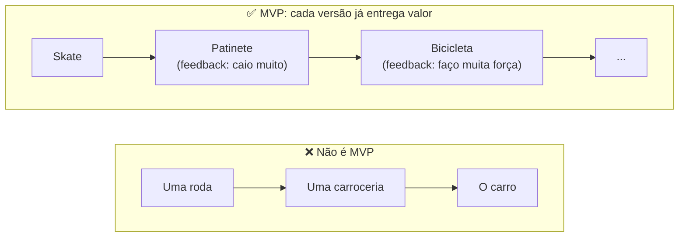
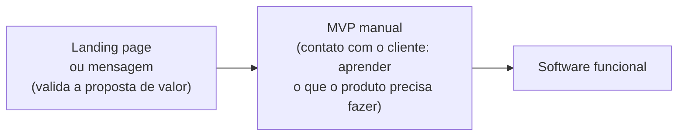

[← Tera · Digital Product Leadership · 03: Introdução a Product Discovery](README.md)

# Aula 4: Produto Mínimo Viável (MVP) / Minimum Viable Product

**Expert:** Frederico Lacerda, com uma facilitadora da Tera · 4 seções

🇧🇷 **Objetivos (checklist da aula):** o que é MVP e como empresas do mercado usaram o conceito para testar propostas de valor; alguns tipos de MVP e suas aplicações; a relação entre MVP e o negócio.

🇺🇸 **Summary:** an MVP validates a hypothesis with the least effort, cutting the time between a decision and its real-world test from months to days. Small cycles accumulate learning instead of risk (build-measure-learn). It must be a version of the solution that already delivers value, generates desire to use and buy, retains early adopters and yields feedback. Types: landing page (Buffer), pre-order/crowdfunding (Pebble), explainer video (Dropbox), piecemeal (Groupon), SaaS/PaaS building blocks, manual or "Wizard of Oz" (Zappos). MVPs progress as uncertainty drops.

## 4.1 MVP como ferramenta na busca por market fit / MVP as a tool

🇧🇷 **MVP = mínimo produto viável.** O essencial: **validar uma hipótese com o menor esforço possível** (geralmente, a de que a solução entrega valor a um segmento). O Customer Development existe para **reduzir o desperdício** de tempo, recursos e dinheiro construindo a coisa errada.

- 🇧🇷 Encurtar a distância entre a **decisão** (sempre otimista) e a **realização** de que ela funciona ou não: **de meses para dias**.
- 🇧🇷 "Não existe MVP de meses e que precisa ser aprovado por comitês." (Frederico Lacerda)
- 🇧🇷 Quanto maior o escopo e mais tempo "no escritório", **mais risco acumulado**. Em entregas menores e em ciclos, acumula-se **aprendizado por validação**, não risco: é o *construir → medir → aprender* da **Startup Enxuta** (Eric Ries).
- 🇧🇷 **Com certeza total, não precisa de MVP** (nem de customer development): é só executar. O MVP existe para mitigar **incerteza**.

**O que o MVP deve fazer:** ser uma **versão da solução** que exige o menor esforço e **já entrega valor** (o "mínimo" vem do esforço; o "viável", da entrega de valor). E:
1. 🇧🇷 **gerar vontade de usar e comprar;**
2. 🇧🇷 **reter os *early adopters*** (segundo *Crossing the Chasm*, cerca de 15% de um mercado, gente disposta a testar produtos imperfeitos; testar com o público errado é um erro comum);
3. 🇧🇷 **obter feedback.**

🇧🇷 **A analogia do carro:** a proposta de valor é ir do ponto A ao B mais rápido e com menos esforço. Uma roda ou uma carroceria não entregam isso; um skate entrega (melhor que andar, a alternativa atual). Com o feedback dos *early adopters*, vem o guidão (patinete), depois a bicicleta, e assim por diante, sem jogar fora o dinheiro de construir o carro inteiro quando ainda havia muita incerteza.

> 🇧🇷 **Procure o meio ideal de aprendizado, não o MVP ideal:** o que validar depende do estágio do produto.

**Tipos de MVP e os casos da aula:**

| Tipo | Caso | Como foi | O que valida |
|---|---|---|---|
| **Landing page** | Buffer (agendar posts no Twitter) | Página com a proposta de valor e o botão "ver planos e preços" → página de planos (grátis, US$ 5, US$ 20) → "ainda não lançamos, deixe seu e-mail". Três validações, como um funil | Interesse na proposta de valor e no preço. Simples, sem programar, mas é uma validação **fraca** (seria mais forte pedir o cartão de crédito) |
| **Pré-venda / crowdfunding** | Pebble (um dos primeiros smartwatches) | Pessoas pagaram antes de o produto existir (com devolução se não saísse); a meta foi superada em semanas | Intenção de compra real. O expert já usou clientes B2B para financiar o roadmap |
| **Vídeo explicativo** | Dropbox | Vídeo de 3 minutos explicando a proposta; os interessados saltaram de 5 mil para 75 mil numa noite, o que ajudou a levantar investimento | Proposta de valor **e o canal certo**: o vídeo foi para uma comunidade de desenvolvedores, os *early adopters* da época |
| **Piecemeal** (juntar peças prontas) | Groupon | Blog em WordPress + gerador de cupons em PDF; os fundadores geravam e enviavam os cupons por e-mail à mão até não dar mais conta | Já valida a **solução**. Não precisa ser bonito, precisa funcionar |
| **SaaS e PaaS** (construir sobre outros serviços) | A HR tech do expert | Começou com a versão gratuita de uma ferramenta de questionários online; depois a paga, sem a marca; só desenvolveu a própria plataforma com clientes pagantes. Também usou ferramentas de e-mail marketing, de disparo de e-mails e de armazenamento em nuvem | A solução, com risco muito reduzido antes de investir em desenvolvimento |
| **Manual ou "Mágico de Oz"** (*Wizard of Oz*) | Zappos (primeiro e-commerce de sapatos) | Site-vitrine com fotos tiradas em lojas, sem estoque nem logística. A cada pedido, o fundador comprava o sapato na loja e postava no correio | Se as pessoas comprariam sapato online. Muito efetivo para **validar**, nada para **escalar**. O expert já testou até recursos de inteligência artificial com pessoas fazendo o trabalho |

> 🇧🇷 "Primeiro faça coisas que não escalam." (Paul Graham, fundador da Y Combinator)
>
> 🇧🇷 "Se você não tem vergonha da primeira versão do seu produto, demorou demais para lançar." (Reid Hoffman, fundador do LinkedIn, citado na aula)

🇧🇷 **MVP também é progressão:** conforme a incerteza diminui, cada novo MVP fica um pouco mais complexo. Entrevistas, demos e protótipos também são meios de aprendizado.

**Para aprofundar (indicações da aula):** *A Startup Enxuta*, de Eric Ries; "Faça coisas que não escalam", tradução da Qulture Rocks para o artigo *Do things that don't scale*, de Paul Graham.

## 4.2 Perguntas e respostas / Q&A

| Pergunta | Resposta do expert |
|---|---|
| Pivotar é mudar drasticamente o produto? | Não necessariamente: é ajustar **qualquer bloco do canvas**, às vezes um ajuste fino (forma de cobrança, modelo de negócio, tamanho do cliente, a solução inteira). O sinal vem do feedback do mercado (qualitativo ou métricas): poucas compras, churn, retenção ruim |
| Quando buscar PMF? | Com o produto **lançado e em uso**, depois de validar que o problema é grande e que a solução (ao menos via MVP) o resolve |
| O que é um "ótimo mercado"? | **Grande** (cálculo *bottom-up*: ticket médio × quantas pessoas ou empresas pagariam; o TAM da indústria inteira é armadilha), **em crescimento** (tendência) e **não saturado** (muitos concorrentes não significa saturação se atendem mal a dor) |
| A PM responde pela pirâmide inteira? | Sim, com visão holística, como "CEO do produto", mas não sozinha: envolve UX e o squad em diferentes intensidades |
| MVP × MMP × MLP? | **MMP** (*minimum marketable product*): o mínimo que o mercado aceita, em setores que não podem "quebrar" (saúde, finanças). **MLP** (*minimum lovable product*): tão viável que já é amado. O que importa é a essência: versão menor, menos esforço, aprender validando |
| Quanto tempo e recurso para um MVP? | O mínimo possível, de preferência **dias** (já viu MVPs complexos desenhados em duas semanas e rodando em outras duas). Em empresas grandes, crie processos de *fast track* (por exemplo, com o jurídico) |
| Como convencer a liderança a lançar algo incompleto? | Construir **cases**: benchmarks e ganhos internos. Para o risco de marca, dá para testar com outra marca, desassociada da principal |
| Quanto tempo insistir antes de pivotar? | Não há resposta certa. É como **pegar uma onda**: remar cedo demais e ela estoura em cima de você (o dinheiro acaba); tarde demais e você a perde (o concorrente chega antes) |
| PMF é estar no lugar certo, na hora certa? | Sim e não. Há *timing* (buscadores e streaming só deram certo quando processamento e banda larga ficaram baratos), mas isso vem de muita análise e validação, não de sorte |
| Qual o sinal mais claro de PMF? | Citando o presidente da Y Combinator: "quando **tudo começa a quebrar**", ou seja, a demanda supera o que o produto aguenta, de forma consistente |
| Como manter o PMF? | Aceitar que ele pode ser perdido a qualquer momento e que, ao virar líder, você vira benchmark e é copiado. O PMF é **papel contínuo** da PM, em paralelo ao desenvolvimento |

## 4.3 Conclusão / Wrap-up

> 🇧🇷 **Mensagem final do expert:** quem constrói produto tem a responsabilidade de colocar o **cliente no centro**: por trás de qualquer solução existe alguém com um problema real. Ter isso em mente ajuda a perseguir o PMF, que é um processo difícil, cheio de tombos e armadilhas.

**Checklist da Tera:** o que é MVP e como empresas usaram o conceito para testar propostas de valor; tipos de MVP e aplicações; a relação entre MVP e o negócio.

**Materiais da aula** (guardados no repositório privado): slides "Produto mínimo viável (MVP)" em PDF.

---

[← Tera · Digital Product Leadership · 03: Introdução a Product Discovery](README.md)
