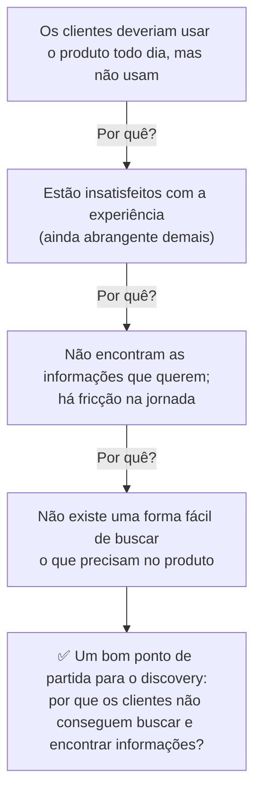
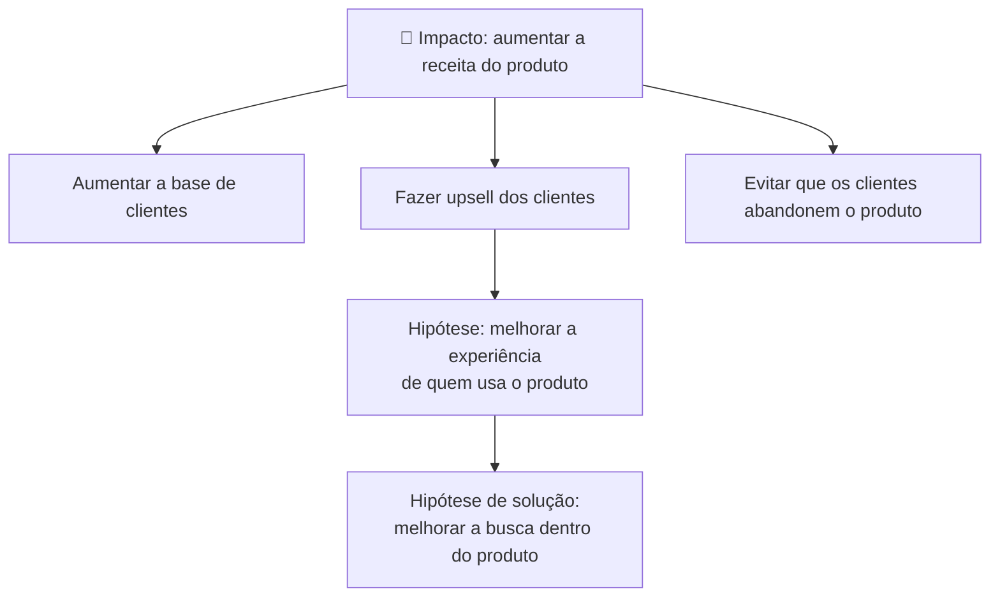
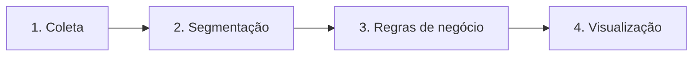

[← Tera · Digital Product Leadership · 03: Introdução a Product Discovery](README.md)

# Aula 5: Definição de hipóteses e leitura de dados / Defining hypotheses and reading data

**Expert:** Ana Rodrigues (Group Product Manager, mais de 10 anos em tecnologia), com uma facilitadora da Tera · 6 seções

🇧🇷 **Objetivos (checklist da aula):** a importância de definir um problema de negócio a partir das dores e necessidades das pessoas; a importância de coletar evidências para validar ou invalidar o problema; técnicas e ferramentas para elaborar hipóteses e explorar o problema.

🇺🇸 **Summary:** start discovery by framing the problem: connect the business goal (the "pointer" to move) with the customer's pain, using techniques like the 5 whys. Structure hypotheses with an opportunity solution tree (top-down: "how?"; bottom-up: "why?") and a CSD matrix. Validate them through data in four stages: collection, segmentation, business rules and visualization (adapted to each stakeholder). Keep the product instrumented. Invalidating a hypothesis should feel as good as validating it.

## 5.1 Definindo o problema / Framing the problem

🇧🇷 O discovery começa entendendo a **dor do cliente** (o que o deixa insatisfeito, talvez sem que a gente saiba) **junto com o negócio** (aonde a empresa quer chegar). Comece pelo negócio: **qual "ponteiro" a empresa quer mexer?** Quais são os objetivos e indicadores do trimestre ou semestre?

🇧🇷 **Cenário hipotético da aula:** a empresa quer **aumentar a receita**; os clientes compraram o produto para usá-lo **todo dia**, mas não estão usando. A cadeia de valor: quem usa diariamente explora mais partes do produto e acaba investindo mais.

🇧🇷 **Framing do problema** é a habilidade de definir bem o problema a resolver, muito valorizada hoje na carreira de produto. A técnica preferida da expert é a dos **5 porquês** (criada por um dos fundadores do sistema Toyota): perguntar "por quê?" a cada resposta, até chegar à causa.

🇧🇷 As respostas vêm de clientes, stakeholders, do atendimento (até num café) e do contato contínuo com os usuários. Repare que a pergunta final já aponta para **uma parte específica** do produto.

🇧🇷 **Varia com o momento do produto:** em produtos novos, com poucos usuários e usos, os problemas costumam ser mais fáceis de mapear; em produtos maiores, os usuários podem usar o produto de jeitos que o time nunca imaginou. A facilitadora conta que, criando um produto do zero, sem dados ainda, descobre problemas por **conversas, entrevistas e levantamento de hipóteses**, e tudo bem.

**Para aprofundar (indicações da aula):** "Os 5 porquês te levam à causa-raiz dos seus problemas" (Hubblefy); "Problem Framing: por que é necessário fazer as perguntas certas?" (UDS Tecnologia); "Multiple Perspective Problem Framing: as várias faces de um problema" (Editora Aela); "Enquadramento de oportunidade/problema (Framing)", de Augusto Rückert (espaço do problema × espaço da solução).

## 5.2 Elaboração de hipóteses / Building hypotheses

🇧🇷 No discovery, fazemos muitas perguntas e temos poucas respostas. Com o problema identificado, é hora de pensar **por que** ele acontece.

**Árvore de oportunidades** (acompanha o discovery do começo ao fim). É uma árvore **invertida**: a "raiz" fica no topo.

- 🇧🇷 **De cima para baixo**, cada galho responde **"como?"** (aumentar a receita → como? fazendo upsell → como?…).
- 🇧🇷 **De baixo para cima**, cada galho responde **"por quê?"** (melhorar a busca → por quê? os clientes não acham as informações → por quê? queremos fazer upsell). Se a conexão se mantém, você não se desvia do impacto esperado.
- 🇧🇷 **Quando parar?** Não há regra: invista nos galhos que ficam mais "populosos" (perto das folhas estão as hipóteses de solução). Boa prática: **fazer experimentos e entregas durante o discovery**. O time da expert alimenta uma mesma árvore há seis meses, com várias hipóteses já validadas: a árvore vive enquanto o impacto buscado existir.

**Matriz CSD** (mais simples; pode partir de uma pergunta específica e até alimentar a árvore):

| Coluna | O que entra | Exemplos da aula |
|---|---|---|
| **Certezas** | O que já foi validado por dados | Ninguém usou a busca nos últimos dois meses; a última nota de NPS foi X |
| **Suposições** | Intuições ainda sem validação (dica: use o próprio produto) | "Acho que é difícil achar a busca"; "acho que nesse ponto da jornada há dificuldade" |
| **Dúvidas** | O que você não sabe e gostaria de saber | "Será que o cliente pagaria mais para ter uma busca?" |

🇧🇷 Pode ser feita com o time (atendimento, engenharia, design) ou com os próprios usuários. O resultado: certezas que podem gerar **hipóteses de solução**, **perguntas para os usuários** e **dúvidas a investigar**. As informações vão migrando entre as colunas ao longo de toda a vida do produto.

**Para aprofundar (indicações da aula):** *Opportunity solution trees: visualize your thinking*, de Teresa Torres (em inglês); "Matriz CSD: tudo o que você precisa saber", de Kakau Fonseca.

## 5.3 Leitura de dados / Reading data

🇧🇷 Hora de validar as hipóteses: garantir que levam a soluções que resolvem o problema do usuário **e** atendem ao negócio. Quatro etapas:

| Etapa | O que fazer (segundo a aula) |
|---|---|
| **1. Coleta** | Ferramentas de *product analytics* que mostram o comportamento dos usuários (onde atuam mais, onde travam); **pesquisas** e entrevistas com clientes e times internos (atendimento, comercial), **sem viés**: perguntas abertas, para validar e não reforçar a hipótese (traga design e UX, e teste o roteiro com alguém do time); avaliações, chamados de suporte, motivos de vendas ganhas e perdidas, NPS e CSAT; **dinâmicas** com o time e até com clientes (mapeamento, blueprint, design sprint); e o **mercado**: o que os concorrentes fazem, mesmo para uma funcionalidade pequena |
| **2. Segmentação** | Agrupar os dados quanti e quali, de preferência com alguém bom em análise (mesmo de outra área). É aqui que aparecem os **padrões** e "as luzinhas acendem": o mesmo achado em várias fontes fortalece a hipótese |
| **3. Regras de negócio** | Os dados são estáticos: valide os insights contra o contexto do negócio (os clientes certos? os concorrentes certos? perguntas sem viés?). Ajuda também a **priorizar** o que gera mais valor agora |
| **4. Visualização** | A forma de mostrar influencia a interpretação: escolha uma visualização que leve as pessoas a uma leitura parecida com a sua. **Adapte ao stakeholder**: quem é de negócio quer ver impacto e decidir; quem é de experiência pode querer ver a jornada e o processo |

> 🇧🇷 "Mesmo quando você realiza o discovery de uma pequena funcionalidade, observe o que o mercado está fazendo." (Ana Rodrigues). A facilitadora dá um exemplo: perceberam que todas as escolas tinham um botão de login no site e a delas não; analisaram e criaram.
>
> 🇧🇷 "Mantenha o seu produto sempre instrumentalizado. Ter os dados registrados pode fazer com que o seu discovery aconteça muito mais rápido." (Ana Rodrigues). Ao pensar numa funcionalidade, pense já nas perguntas que vai querer responder com dados.

**Para aprofundar (indicações da aula):** "Meu produto, meus dados: como iniciar um plano de análise de dados?", de Marcos Fabrício; "10 erros de instrumentação de produto e o que aprendemos com eles", de Sérgio Schuler; *Product Management: The Role of Analytics* (Cleverism), com tradução da Tera.

## 5.4 Resumo da aula / Takeaways

> 🇧🇷 **Lembre-se:**
> - É preciso ter muita **clareza sobre o problema** que estamos tentando resolver.
> - É importante **levantar hipóteses e dados** para entender o que sabemos sobre esse problema. **Invalidar uma hipótese deveria ser tão bom quanto validar**: elimina uma possibilidade e aproxima do que resolve de verdade.
> - Fazemos discovery para **mitigar riscos** e validar que o que será construído entrega valor **para o cliente e para o negócio**.

**Checklist da Tera:** a importância de definir um problema de negócio a partir de dores e necessidades das pessoas; a importância de coletar evidências para validar ou invalidar o problema; técnicas e ferramentas para elaborar hipóteses e explorar o problema.

**Materiais da aula** (guardados no repositório privado): slides "Definição de hipóteses e leitura de dados".

---

[← Tera · Digital Product Leadership · 03: Introdução a Product Discovery](README.md)
