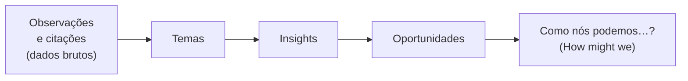
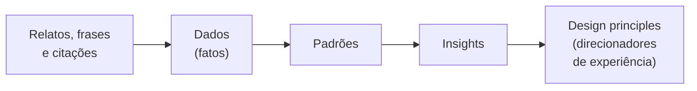

[← Tera · Digital Product Leadership · 03: Introdução a Product Discovery](README.md)

# Aula 7: Consolidação de pesquisa em produtos / Research synthesis

**Expert:** Renata Tonezi (especialista em pesquisa) · 6 seções

🇧🇷 **Objetivos (checklist da aula):** a importância de uma boa consolidação de pesquisa; técnicas de registro, organização, agrupamento e comunicação dos dados e insights.

🇺🇸 **Summary:** after collecting data, synthesis is where "the magic happens": making sense of findings, prioritizing learnings and reaching team consensus on the as-is journey. Insights are unexpected revelations backed by real data; capture them on insight cards and move from raw data to themes, insights, opportunities and "How might we…?" questions, using a point-of-view statement. Debrief soon after each interview, organize the chaos (colors, tags, one participant at a time), protect sensitive data, and use affinity mapping to find patterns. Share the insights widely. Love the problem, not the solution.

## 7.1 Consolidação de pesquisa / Synthesis

🇧🇷 No **duplo diamante**, estamos no fim do primeiro diamante (discovery): depois de **divergir** (roteiro, campo, conversas, benchmark, formulários), é hora de **convergir**: analisar e **sintetizar** para enxergar **padrões** e organizar **insights** que orientem o produto (e até decisões estratégicas).

🇧🇷 **Síntese** = criar sentido: priorizar achados e aprendizados, **compartilhar histórias**, criar um resumo coerente do que se aprendeu. Raramente se faz sozinha: o objetivo é **consenso com o time** e **evidências reais** de usuários reais. Ela permite diagnosticar a jornada **"como ela é"** (*as-is*), com dores e lacunas, antes de desenhar a jornada ideal.

- 🇧🇷 É uma etapa muitas vezes **subestimada** na correria, mas "é nela que a mágica acontece".
- 🇧🇷 Ajuda a identificar lacunas, oportunidades e frustrações; entender **modelos mentais** (como a pessoa imagina que algo funciona, a partir de experiências anteriores); identificar comportamentos.
- 🇧🇷 Volte à **matriz CSD**: certezas viram fatos com fonte; as suposições são o que você quer validar ou **refutar** (a pesquisa também serve para refutar).
- 🇧🇷 **Quanto mais tempo você dedica à síntese, mais significado extrai.**

> 🇧🇷 **Pergunte-se o tempo todo:** O que estou aprendendo? O que aprendemos muda a forma de enquadrar o objetivo da pesquisa? Validamos ou refutamos nossas hipóteses? Há um padrão que sugere novas considerações? Quais resultados são mais importantes para comunicar?

## 7.2 Identificação e organização de insights / Insights

🇧🇷 **Ideia × insight:** o insight é uma **interpretação**, uma revelação inesperada que surge do que você **viu** e **ouviu** (observação + fala do usuário), mais comum em entrevistas qualitativas. É um **fragmento** de uma ideia e um gatilho que aponta direções; uma ideia é uma solução e pode atender a vários insights.

- 🇧🇷 **Boas ideias não surgem por acaso** (processo criativo do psicólogo Graham Wallas): **preparação, incubação, iluminação e verificação**. Dica: achou algo valioso? Deixe "incubar", faça outra coisa e volte.
- 🇧🇷 **Pensamento lateral** (Edward de Bono): sair do óbvio, olhar para os lados, para contextos análogos, sem preconceitos.

**Cartões de insight:** registrar cada reflexão com **base em dados reais** (tema, fonte, fato observado). Exemplos fictícios da aula:

| Tema | Fonte | Fato / insight |
|---|---|---|
| Experiência turística | Entrevista em profundidade | Turistas acham que os imprevistos tornam a viagem especial |
| Experiência esportiva | Pesquisa exploratória | Torcedores buscam um programa depois dos jogos da seleção (rodas de samba, bares) |
| Aulas remotas | Survey com 158 respostas | 80% das escolas que aderiram ao online são particulares; 40% treinaram os professores |

> 🇧🇷 **Documente os insights durante a pesquisa**, não depois.

**Ponto de vista (POV):** declarar o problema mantendo o foco no usuário, nas necessidades e percepções.

> 🇧🇷 **[Usuário] precisa de [necessidade] porque [insight].**
> Exemplo da aula: crianças precisam de alimentos nutritivos para crescer de forma saudável → "Como podemos tornar a alimentação saudável atraente para as crianças?"

**"Como nós podemos…?"** (*How might we*, HMW): a "pergunta mágica" que transforma insights em **desafios de design**. A frase **não deve ser muito aberta nem muito fechada**, **não deve sugerir uma solução** (erro comum) e deve trazer o recorte principal do problema.

🇧🇷 **Caso emblemático (GE, aparelhos de ressonância):** crianças com câncer ficavam apavoradas no exame e muitas precisavam ser sedadas. A pesquisa mostrou que **crianças participam de qualquer coisa que pareça uma aventura**. O desafio foi reescrito e os aparelhos e a experiência viraram aventuras (nave espacial, navio pirata, equipe com roteiro e figurino). Resultado: as crianças deixaram de precisar de sedação.

**Para aprofundar (indicações da aula):** "Qual a diferença entre insight e ideia?", de André Grilo; palestra de Doug Dietz no TEDxSanJoseCA sobre o caso da GE; "Design Thinking: entenda como funciona o modelo", de Henrique Carvalho.

## 7.3 Debriefing e discussão de resultados / Debriefing

🇧🇷 **Download** ou **debriefing**: documentar a pesquisa de forma eficiente para compartilhar insights e histórias, de preferência **no mesmo dia** ou no seguinte.

1. 🇧🇷 **Antes de começar, monte um sistema** para organizar os dados: digital (por participante, data, sessão, tipo de arquivo; em quadros como Miro ou Mural) ou físico (painéis na parede), ou os dois. Dê **visibilidade** a todos os envolvidos.
2. 🇧🇷 **Organize o caos:** **cores** (por participante em estudos pequenos, ou por perguntas do roteiro), separe **citações, observações, ideias**, use **tags** (recuperáveis) e **emojis** (sentimento positivo ou negativo).
3. 🇧🇷 **Conte a história de cada usuário, um por vez**, seguindo o roteiro, em **pequenos fragmentos** (o tamanho do post-it não é à toa: a síntese começa na forma de escrever), com citações e exemplos.
4. 🇧🇷 **Registre e discuta as descobertas:** por que isso é importante? O que significa? Escreva frases que mostrem um **comportamento**.
5. 🇧🇷 **Não confie na memória:** anote durante a pesquisa, mesmo gravando (com consentimento); a percepção do momento não volta.
6. 🇧🇷 **Seja um "detetive de UX":** os dados respondem às minhas hipóteses? **Planilhas** ajudam (filtros por comentário negativo ou positivo, limpeza da tabela).
7. 🇧🇷 **Cuide dos dados:** pergunte só o necessário, siga a **LGPD**, evite **dados sensíveis** (que identificam a pessoa, como e-mail, telefone e documentos, ou que podem expô-la a discriminação, como raça, política, orientação sexual), deixe seu contato e **anonimize**.

**Mapa de afinidades** (diagrama criado pelo antropólogo japonês Jiro Kawakita, nos anos 1960): organizar ideias, problemas e soluções em **grupos**, por afinidade, similaridade, dependência ou proximidade. Fragmentos que parecem desconexos começam a mostrar **padrões** (exemplo da aula: numa pesquisa com motoristas de aplicativo, depois de umas cinco entrevistas, "falta de emprego" já se repetia como motivo para começar).

**Como fazer o mapa de afinidades:**
1. 🇧🇷 Espalhe todos os post-its num mural (real ou virtual). **Em silêncio**, aproxime os que parecem relacionados, reflita e repita até agrupar tudo. Post-its solitários são normais; pode mover o que outra pessoa moveu; se um cabe em dois grupos, duplique.
2. 🇧🇷 Terminado o agrupamento, **todos podem falar**: discutam os padrões, ajustem e **deem a cada grupo um título** que capte sua essência (de preferência destacado).

## 7.4 Resumo da aula / Takeaways

> 🇧🇷 **Lembre-se:**
> - Uma boa pesquisa envolve necessariamente **análise e síntese**.
> - **Organize os dados** (fotos, vídeos, anotações; cores ajudam muito).
> - **Explore os dados** em busca de fatos e descobertas, inclusive em citações.
> - **Classifique e agrupe** (o mapa de afinidades acelera a descoberta de padrões).
> - **Identifique os insights** e discuta cada um: ele inspira? tem uma história? traz algo novo? motiva? Use as **citações exatas**.
> - **Socialize os insights:** dê contexto a quem não participou e veja a reação.
>
> 🇧🇷 **"Ame o problema, não a solução"** (*love the problem, not the solution*): não se apegue ao protótipo; aproveite a descoberta para mergulhar na vida das pessoas.

**Checklist da Tera:** a importância de uma boa consolidação de pesquisa; técnicas de registro, organização, agrupamento e comunicação de dados e insights.

**Materiais da aula** (guardados no repositório privado): slides "Consolidação de Pesquisa".

---

[← Tera · Digital Product Leadership · 03: Introdução a Product Discovery](README.md)
