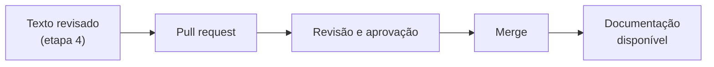

# Etapas 5 e 6 do DDLC · Publicação, comunicação e manutenção

> Documento de estudo. A Bytebank é fictícia. Segue os vídeos da Aula 04 do curso.

## 1. Onde e como publicar

A documentação fica no **GitHub**. Segundo a aula, no GitHub a publicação acontece quando o **pull request** é revisado e aprovado e passa pelo **merge**. Aí o conteúdo fica disponível no repositório (ou num site, se houver gerador de site).

## 2. Plano de comunicação

### Público interno (pessoas da Bytebank)

| Canal | Mensagem |
|---|---|
| Canal oficial de releases (ex.: Slack) | Aviso de que a nova documentação está no ar, com o link e marcando as pessoas interessadas |
| Direto com os stakeholders | Link para quem acompanhou desde o planejamento (lideranças e áreas parceiras) |

**Exemplo de mensagem para o canal de releases:**

> 📘 **Nova documentação da Bytebank no ar**
> Depois do rebranding, a documentação para clientes foi refeita. Já está disponível a página de **Investimentos**, com o passo a passo para começar a investir pelo app.
> Link: (link do repositório)
> Viu algo para ajustar? Responda aqui ou registre na planilha de feedbacks.

### Público externo (clientes da Bytebank)

O público são pessoas físicas, sem conhecimento técnico avançado. Por isso, segundo a aula, o caminho é:

| Canal | Como |
|---|---|
| Dentro do aplicativo | Notificação avisando que há uma nova versão do app e a documentação nova |
| Site da documentação | Notícia ou banner na página inicial |
| Newsletter | E-mail para quem assina |
| Parceria com comunicação/marketing | Um texto mais conversacional (como o post do Nubank sobre a conta PJ) apresentando o serviço de Investimentos |

Release notes ficam para quando o público for técnico (devs).

## 3. Manutenção (o DDLC é cíclico)

Fontes que voltam para o próximo planejamento:

- Feedbacks de SMEs e stakeholders que não couberam nesta entrega (planilha de feedbacks da [etapa 4](03-escrita-e-revisao.md)).
- Métricas de desempenho da documentação (Aula 05).
- Feedbacks do público depois da publicação (suporte, fóruns, seção de feedback).
- Backlog do produto: cada mudança no app vira atualização na documentação.
